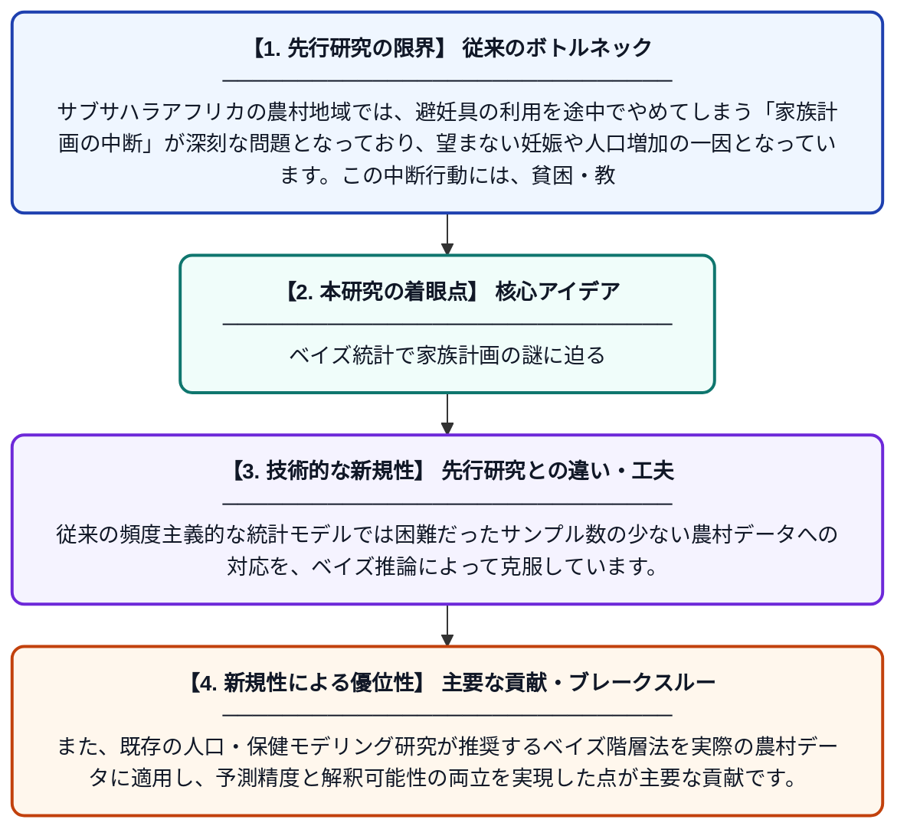

# ナイジェリア南東部農村コミュニティにおける社会経済的・環境的不確実性下での家族計画中断のベイズモデリング

**Original Title**: *Bayesian Modelling of Family Planning Discontinuation under Socioeconomic and Environmental Uncertainty in Rural Communities in South East Nigeria*

> **💡 一言要約**: ベイズ統計で家族計画の謎に迫る

| 項目 | 内容 |
|---|---|
| **著者** | EM Ikegwu, GB Karokatose, MA Idris |
| **掲載誌** | Lafia Journal of Scientific and Industrial Research 2026 |
| **アラートキーワード** | Bayesian hierarchical ... |
| **PDF** | [https://www.lafiascijournals.org.ng/index.php/ljsir/article/download/878/534](https://www.lafiascijournals.org.ng/index.php/ljsir/article/download/878/534) |
| **原文リンク** | [https://www.lafiascijournals.org.ng/index.php/ljsir/article/download/878/534](https://www.lafiascijournals.org.ng/index.php/ljsir/article/download/878/534) |
| **PDF版要約** | [README.pdf](./README.pdf) |

---

## 📊 新規性の図解（先行研究との違いと本研究のブレークスルー）

## 📝 要約

本研究は、ナイジェリア南東部の農村地域における家族計画（避妊）の中断行動を、ベイズ階層モデルを用いて分析したものです。社会経済的要因や環境的不確実性が家族計画の継続・中断に与える影響を統計的に推定・予測しています。ベイズ推論の導入により、データが限られる農村環境においても信頼性の高い推定が可能であることを示しています。

## ❓ どんな問題に取り組んだか

サブサハラアフリカの農村地域では、避妊具の利用を途中でやめてしまう「家族計画の中断」が深刻な問題となっており、望まない妊娠や人口増加の一因となっています。この中断行動には、貧困・教育水準・環境変化などの複合的な要因が絡み合っており、従来の統計手法では不確実性を適切に扱うことが困難でした。

## ✨ 何が新しい？何がすごい？（新規性）

本研究は、生殖保健分野においてベイズ階層モデルを明示的に適用し、社会経済的・環境的不確実性を同時に組み込んだ点が新しいアプローチです。従来の頻度主義的な統計モデルでは困難だったサンプル数の少ない農村データへの対応を、ベイズ推論によって克服しています。また、既存の人口・保健モデリング研究が推奨するベイズ階層法を実際の農村データに適用し、予測精度と解釈可能性の両立を実現した点が主要な貢献です。

## 🎓 大学1年生向けの解説

「家族計画」とは、妊娠の時期や子どもの数を調整するために避妊具などを使うことです。しかし、途中でやめてしまう人が多く、その理由は貧しさや教育、環境など様々な要因が絡み合っています。この研究では「ベイズ統計」という手法を使い、不確かな情報が多い農村でもより正確に「なぜやめてしまうのか」を分析しました。ベイズ統計とは、過去の知識や新しいデータを組み合わせて確率的に物事を推定する方法です。この研究の成果は、より効果的な家族計画支援策の立案に役立てることができます。
