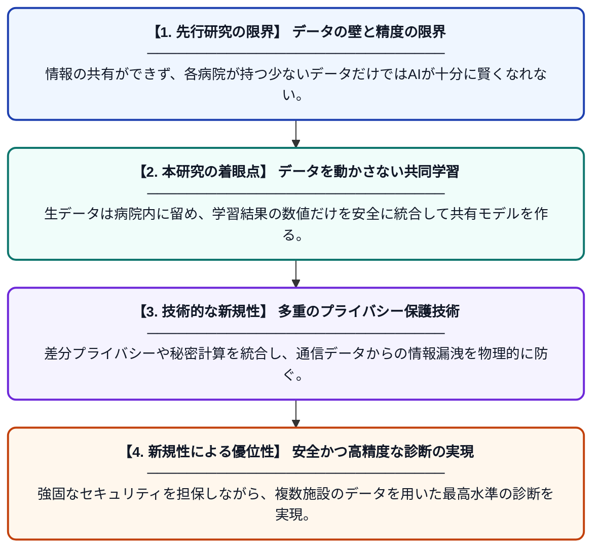

# 多施設医療データを用いたプライバシー保護型がん診断のための連合学習

**Original Title**: *Federated ML for Privacy-Preserving Cancer Diagnosis using Multi-Center Medical Data*

> **💡 一言要約**: データを動かさず、秘匿したままがんを早期発見するAI

| 項目 | 内容 |
|---|---|
| **著者** | V Gokeda, RSS Reddy, T Ahmed, GP Kotla, S Rajesh… |
| **掲載誌** | IEEE World Skills … 2026 |
| **アラートキーワード** | differential privacy |
| **原文リンク** | [https://ieeexplore.ieee.org/abstract/document/11767042/](https://ieeexplore.ieee.org/abstract/document/11767042/) |
| **PDF版要約** | [README.pdf](./README.pdf) |

---

## 📊 新規性の図解（先行研究との違いと本研究のブレークスルー）

## 📝 要約

複数の病院が持つ機密性の高い患者データを外部に出すことなく、共同でがん診断モデルを構築する連合学習フレームワークを提案しています。差分プライバシーや秘密計算などの高度なセキュリティ技術を統合し、データの秘匿性と診断精度の両立を実現しました。

## ❓ どんな問題に取り組んだか

医療データは個人情報保護の観点から施設外への共有が厳しく制限されており、単一の病院のデータだけでは高性能なAIモデルの構築が困難でした。また、学習過程で送受信される情報から元のデータが推測されるリスクも大きな課題となっていました。

## ✨ 何が新しい？何がすごい？（新規性）

本研究の新規性は、連合学習に勾配クリッピング、差分プライバシー、およびセキュア集約を統合し、医療分野に特化した強固な多層防御を構築した点にあります。先行研究では困難だった「プライバシーの完全な保護」と「診断精度の維持」というトレードオフを、最新の暗号学的アプローチで解決しました。多数の病院を模したシミュレーションにより、実用的な環境での有効性を実証した点が大きな貢献です。

## 🎓 大学1年生向けの解説

病院にある患者さんのデータは、プライバシーを守るために外に出すことができません。しかし、AIを賢くするためには多くのデータが必要です。この研究では、データを病院に置いたまま、学習した「知識」だけを安全に集めてAIを育てる「連合学習」という技術を使いました。特別な暗号技術を組み合わせることで、誰のデータか分からないように守りつつ、みんなで協力してがんを見つける賢いAIを作る仕組みを開発したのです。
