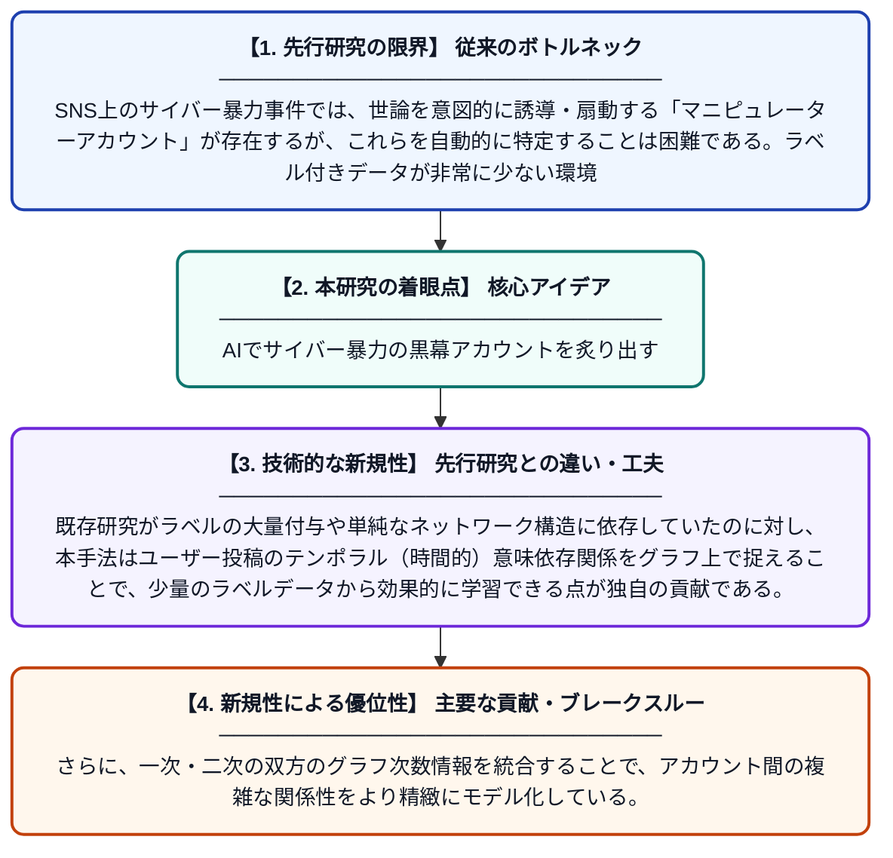

# サイバー暴力イベントにおける操作アカウント検出のための半教師ありグラフ表現学習モデル

**Original Title**: *Semi-Supervised Graph Representation Learning Model for Manipulator Account Detection in Cyberviolence Events*

> **💡 一言要約**: AIでサイバー暴力の黒幕アカウントを炙り出す

| 項目 | 内容 |
|---|---|
| **著者** | X Zhao, H Chen |
| **掲載誌** | Computer Networks 2026 |
| **アラートキーワード** | representation learning |
| **原文リンク** | [https://www.sciencedirect.com/science/article/pii/S1389128626006298](https://www.sciencedirect.com/science/article/pii/S1389128626006298) |
| **PDF版要約** | [README.pdf](./README.pdf) |

---

## 📊 新規性の図解（先行研究との違いと本研究のブレークスルー）

## 📝 要約

本論文は、サイバー暴力事件においてオンライン世論を意図的に操作するアカウント（マニピュレーターアカウント）を自動検出するため、半教師ありの双次数グラフ表現学習フレームワークを提案する。ユーザーの投稿からテンポラルな意味的依存関係を捉え、グラフ構造を活用して少量のラベル付きデータから効率的に学習する。これにより、従来手法と比較してより精度の高いマニピュレーターアカウントの検出を実現する。

## ❓ どんな問題に取り組んだか

SNS上のサイバー暴力事件では、世論を意図的に誘導・扇動する「マニピュレーターアカウント」が存在するが、これらを自動的に特定することは困難である。ラベル付きデータが非常に少ない環境での検出精度の低さや、ユーザーの時系列的な行動パターンの複雑さが主な課題となっている。

## ✨ 何が新しい？何がすごい？（新規性）

本研究は、半教師あり学習とグラフニューラルネットワークを組み合わせた「双次数グラフ表現学習フレームワーク」という新しいアプローチを提案している。既存研究がラベルの大量付与や単純なネットワーク構造に依存していたのに対し、本手法はユーザー投稿のテンポラル（時間的）意味依存関係をグラフ上で捉えることで、少量のラベルデータから効果的に学習できる点が独自の貢献である。さらに、一次・二次の双方のグラフ次数情報を統合することで、アカウント間の複雑な関係性をより精緻にモデル化している。

## 🎓 大学1年生向けの解説

インターネット上では、特定の人を集中的に攻撃するサイバー暴力が問題になっています。こうした暴力を裏で煽ったり組織したりしている「操作アカウント」を自動的に見つけ出すのが本研究の目的です。SNSのユーザー同士のつながりを「グラフ（ネットワーク図）」として表現し、AIがその構造とユーザーの投稿の変化を一緒に学習します。少ししかないラベル付きの正解データでも高精度に怪しいアカウントを検出できる仕組みを作ったのがポイントです。
