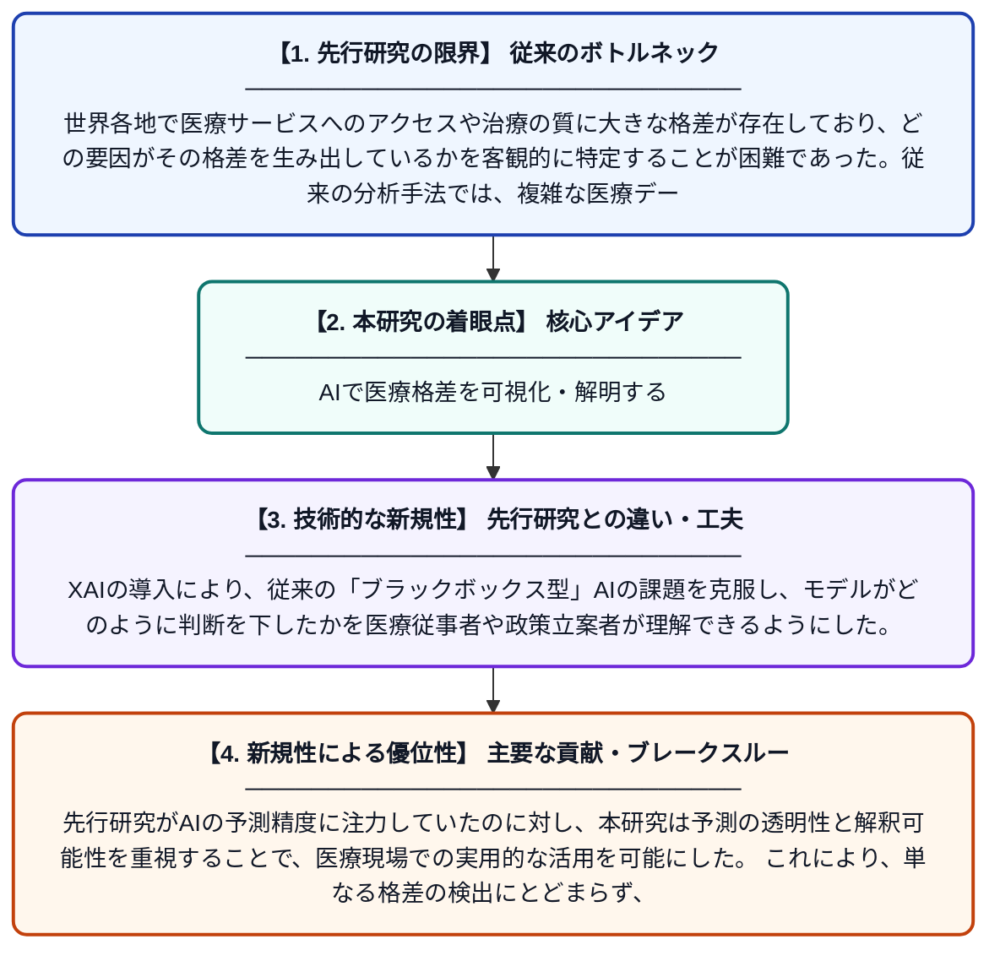

# AIベースの意思決定支援システムを用いた医療格差の計算論的分析

**Original Title**: *Computational Analysis Of Healthcare Inequality Using AI-Based Decision Support Systems*

> **💡 一言要約**: AIで医療格差を可視化・解明する

| 項目 | 内容 |
|---|---|
| **著者** | MS Kumar, S Saxena, CR Vaghela, HN Tune |
| **掲載誌** | International Journal of AI and Machine Learning 2026 |
| **アラートキーワード** | independent component ... |
| **PDF** | [https://www.svedbergopen.com/index.php/ijaiml/article/download/576/437](https://www.svedbergopen.com/index.php/ijaiml/article/download/576/437) |
| **原文リンク** | [https://www.svedbergopen.com/index.php/ijaiml/article/download/576/437](https://www.svedbergopen.com/index.php/ijaiml/article/download/576/437) |
| **PDF版要約** | [README.pdf](./README.pdf) |

---

## 📊 新規性の図解（先行研究との違いと本研究のブレークスルー）

## 📝 要約

本研究では、独立成分分析（ICA）を用いてデータから重要な情報を抽出し、AIモデルの出力を透明かつ解釈可能にする説明可能なAI（XAI）技術を組み合わせることで、医療における不平等・格差の問題を分析する。AIベースの意思決定支援システムを構築し、医療サービスへのアクセスや治療結果における格差を定量的に明らかにすることを目指す。これにより、公平な医療提供に向けた具体的な政策的示唆を提供する。

## ❓ どんな問題に取り組んだか

世界各地で医療サービスへのアクセスや治療の質に大きな格差が存在しており、どの要因がその格差を生み出しているかを客観的に特定することが困難であった。従来の分析手法では、複雑な医療データから有意義なパターンを抽出する能力に限界があり、格差の根本原因を明確に説明することが難しかった。

## ✨ 何が新しい？何がすごい？（新規性）

本研究は、ICA（独立成分分析）による高精度な特徴抽出と、説明可能なAI（XAI）を組み合わせた点が新しい。XAIの導入により、従来の「ブラックボックス型」AIの課題を克服し、モデルがどのように判断を下したかを医療従事者や政策立案者が理解できるようにした。先行研究がAIの予測精度に注力していたのに対し、本研究は予測の透明性と解釈可能性を重視することで、医療現場での実用的な活用を可能にした。これにより、単なる格差の検出にとどまらず、格差の原因説明と是正策の立案まで支援できる点が主要な貢献である。

## 🎓 大学1年生向けの解説

病院にかかりやすい人とかかりにくい人の差（医療格差）は、世界中で深刻な問題です。この研究では、AIを使って大量の医療データを分析し、どこにどんな格差があるかを自動的に見つけ出しています。さらに「説明可能なAI」という技術を使うことで、AIがなぜそのような判断をしたのかを人間がわかる言葉で説明できるようにしました。まるでAIが「この地域では収入が低い人ほど病院に行けていない」と理由まで教えてくれるイメージです。このシステムを使えば、医療格差をなくすための政策を効率よく考えられるようになります。
