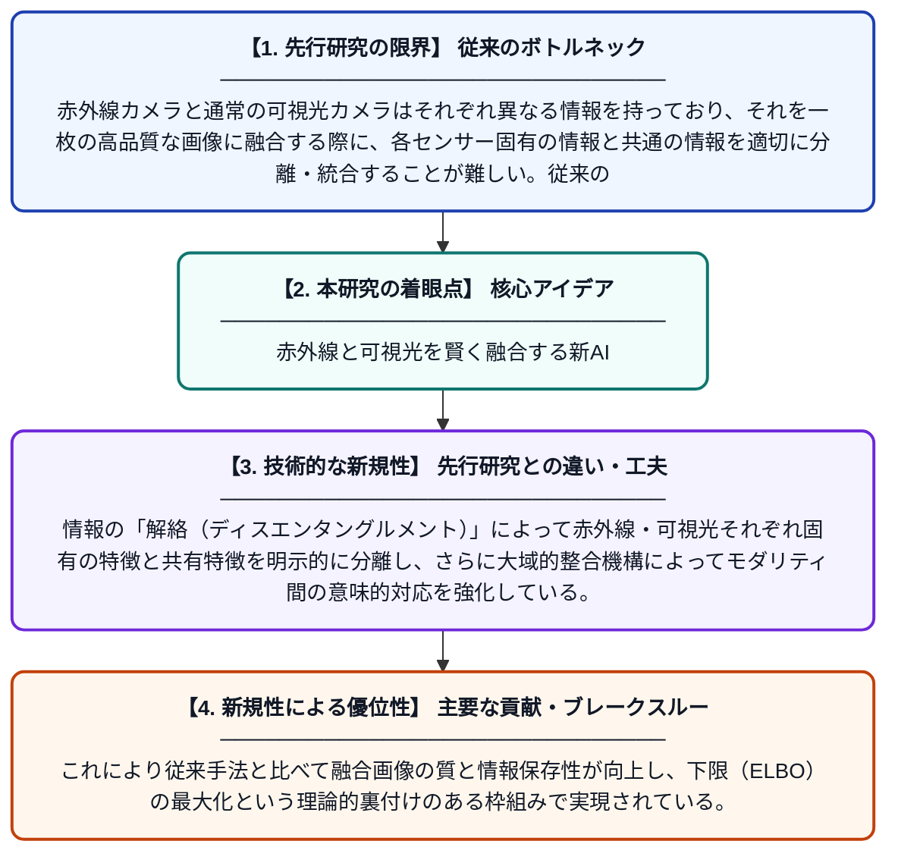

# 情報解絡と大域的整合を用いた赤外線・可視光画像融合のための生成的表現学習

**Original Title**: *Generative representation learning with information disentanglement and global alignment for infrared and visible image fusion*

> **💡 一言要約**: 赤外線と可視光を賢く融合する新AI

| 項目 | 内容 |
|---|---|
| **著者** | H Wu, Y Zhang, B Sun, X Sun, X Guo, Z Zhang, H Qian |
| **掲載誌** | Pattern Recognition 2026 |
| **アラートキーワード** | representation learning |
| **原文リンク** | [https://www.sciencedirect.com/science/article/pii/S0031320326015177](https://www.sciencedirect.com/science/article/pii/S0031320326015177) |
| **PDF版要約** | [README.pdf](./README.pdf) |

---

## 📊 新規性の図解（先行研究との違いと本研究のブレークスルー）

## 📝 要約

本論文は、赤外線画像と可視光画像を融合するための新しいオートエンコーダベースのフレームワークを提案する。統一的な確率的モデリングのもとで生成学習と表現学習のバランスをとり、解絡された表現学習と融合再構成の相乗効果を実現する。情報の解絡と大域的整合を組み合わせることで、より質の高い融合画像を生成することを目指している。

## ❓ どんな問題に取り組んだか

赤外線カメラと通常の可視光カメラはそれぞれ異なる情報を持っており、それを一枚の高品質な画像に融合する際に、各センサー固有の情報と共通の情報を適切に分離・統合することが難しい。従来の手法では生成能力と表現学習が別々に扱われ、両者の相乗効果が十分に活かされていなかった。

## ✨ 何が新しい？何がすごい？（新規性）

本研究は、変分オートエンコーダをベースとした統一的な確率的モデルにより、生成学習と表現学習を同時に最適化する点が新しい。情報の「解絡（ディスエンタングルメント）」によって赤外線・可視光それぞれ固有の特徴と共有特徴を明示的に分離し、さらに大域的整合機構によってモダリティ間の意味的対応を強化している。これにより従来手法と比べて融合画像の質と情報保存性が向上し、下限（ELBO）の最大化という理論的裏付けのある枠組みで実現されている。

## 🎓 大学1年生向けの解説

私たちのスマートフォンカメラは普通の光を撮影しますが、赤外線カメラは暗闇でも熱を感知して撮影できます。この二種類のカメラの画像を一枚にうまく合体させると、どちらの良い情報も持つ鮮明な画像が作れます。しかし単純に合体させると、それぞれのカメラ特有の情報が混ざって品質が下がってしまいます。この論文では、AIを使って「それぞれのカメラだけが持つ情報」と「両方に共通する情報」を賢く分けて整理してから合体させる新しい方法を提案しています。これにより、夜間監視や自動運転など多くの場面でより正確な画像が得られるようになります。
