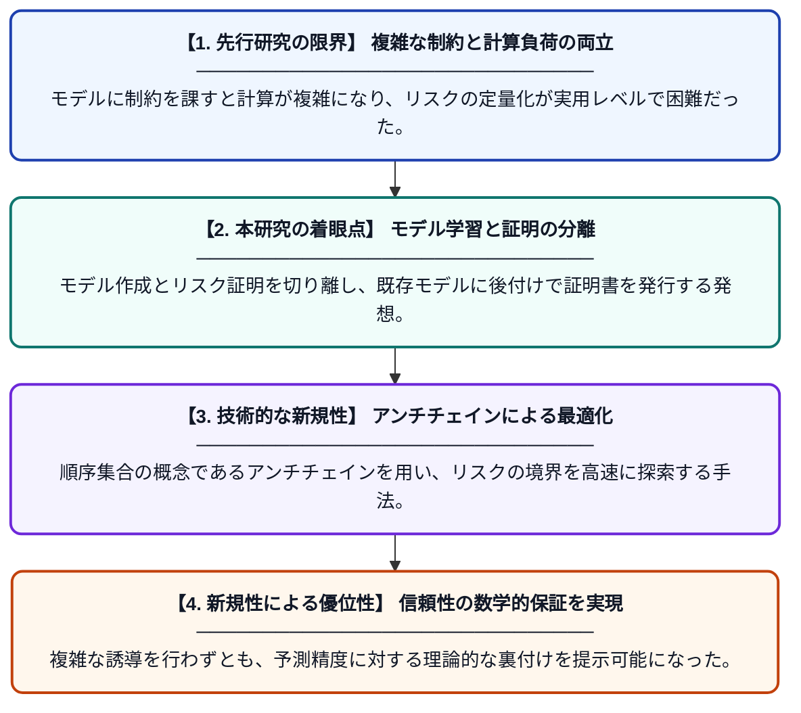

# 教育予測のための構成可能なリスク証明：アンチチェイン最適化と制御シミュレーション

**Original Title**: *Composable Risk Certificates for Educational Prediction: Antichain Optimization and Controlled Simulations*

> **💡 一言要約**: 数学的証明で教育AIの信頼性を保証する新技術

| 項目 | 内容 |
|---|---|
| **著者** | A Szeberényi, R Balku |
| **掲載誌** | Machine Learning and Knowledge Extraction 2026 |
| **アラートキーワード** | optimization |
| **原文リンク** | [https://www.mdpi.com/2504-4990/8/11/370](https://www.mdpi.com/2504-4990/8/11/370) |
| **PDF版要約** | [README.pdf](./README.pdf) |

---

## 📊 新規性の図解（先行研究との違いと本研究のブレークスルー）

## 📝 要約

教育分野における予測モデルの信頼性を担保するため、数学的なリスク証明を構成する新しいフレームワークを提案しています。アンチチェイン最適化を用いることで、モデル学習とは独立して、予測精度に対する厳密な保証を効率的に算出することに成功しました。

## ❓ どんな問題に取り組んだか

教育予測モデルにおいて、特定の制約を維持しつつ予測リスクを定量的に評価することは計算上非常に困難でした。また、既存手法はモデルの構築と最適化が密接に結びついており、柔軟なリスク証明を行う仕組みが不足していました。

## ✨ 何が新しい？何がすごい？（新規性）

本研究は、決定木の構築などのモデル作成プロセスに介入せず、学習済みの結果からリスク証明を「後付け」で構成する手法を確立しました。アンチチェイン最適化を導入することで、複雑なモデル構造を介さずに、数学的に裏付けられたリスクの境界を効率的に特定できます。この「構成可能」なアプローチにより、多様な教育データに対して柔軟に信頼性の高い証明書を発行できる点が革新的です。

## 🎓 大学1年生向けの解説

AIが「この学生は留年する可能性がある」と予測したとき、その予測がどれくらい信じられるかを数字で示すのは難しい問題です。この研究では、AIの予測結果に対して「この予測の正しさは数学的にこれくらい保証されています」という証明書を出す仕組みを作りました。難しい計算を工夫して簡略化することで、どんな教育支援AIにも後からこの証明機能を付け加えられるようになります。これにより、先生や学生が安心してAIの助言を参考にできるようになります。
