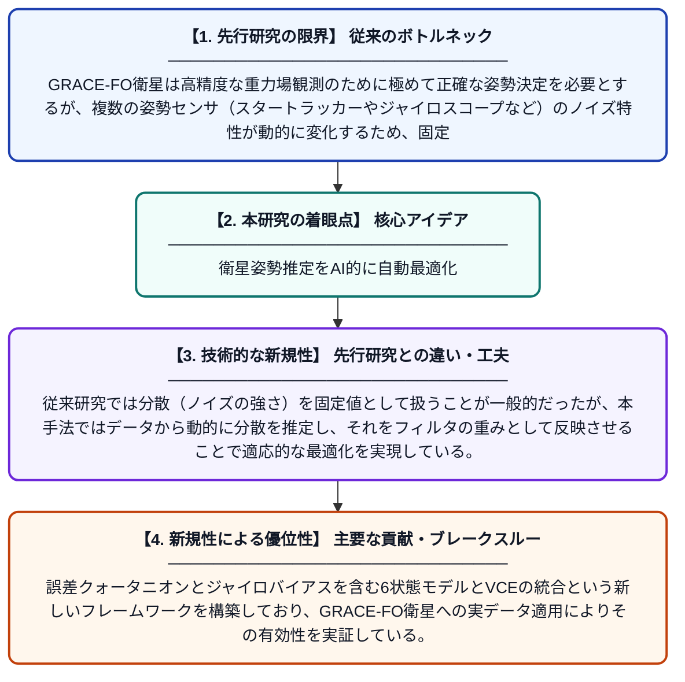

# 分散成分推定に基づくカルマンフィルタ最適化によるGRACE-FO衛星の姿勢融合

**Original Title**: *Variance component estimation-based Kalman filter optimization for GRACE-FO satellite attitude fusion*

> **💡 一言要約**: 衛星姿勢推定をAI的に自動最適化

| 項目 | 内容 |
|---|---|
| **著者** | T YANG, QJ CHEN, YZ SHEN, Y XIAO |
| **掲載誌** | Chinese Journal of Geophysics 2026 |
| **アラートキーワード** | kalman filter |
| **原文リンク** | [http://en.dzkx.org/article/doi/10.6038/cjg2025T0295](http://en.dzkx.org/article/doi/10.6038/cjg2025T0295) |
| **PDF版要約** | [README.pdf](./README.pdf) |

---

## 📊 新規性の図解（先行研究との違いと本研究のブレークスルー）

## 📝 要約

本論文は、GRACE-FO衛星の姿勢決定精度を向上させるため、誤差クォータニオンとジャイロバイアスを用いた6状態カルマンフィルタに分散成分推定を組み合わせた姿勢データ融合手法を提案している。分散成分推定によって各センサのノイズ特性を動的に評価し、その結果をカルマンフィルタの重み付けに反映することで、より精度の高い姿勢推定を実現する。複数のセンサデータを最適に統合することで、従来手法よりも信頼性の高い姿勢融合を可能にしている。

## ❓ どんな問題に取り組んだか

GRACE-FO衛星は高精度な重力場観測のために極めて正確な姿勢決定を必要とするが、複数の姿勢センサ（スタートラッカーやジャイロスコープなど）のノイズ特性が動的に変化するため、固定した重み付けでは最適な姿勢融合が困難であった。従来のカルマンフィルタでは各センサの確率的特性（分散）を事前に固定値として設定するため、実際のノイズ状況に柔軟に対応できないという課題があった。

## ✨ 何が新しい？何がすごい？（新規性）

本研究の新規性は、分散成分推定（VCE）をカルマンフィルタに組み込み、各センサの観測ノイズの分散をリアルタイムで自動推定・更新する点にある。従来研究では分散（ノイズの強さ）を固定値として扱うことが一般的だったが、本手法ではデータから動的に分散を推定し、それをフィルタの重みとして反映させることで適応的な最適化を実現している。誤差クォータニオンとジャイロバイアスを含む6状態モデルとVCEの統合という新しいフレームワークを構築しており、GRACE-FO衛星への実データ適用によりその有効性を実証している。

## 🎓 大学1年生向けの解説

人工衛星は宇宙でどの方向を向いているかを正確に知る必要があります（これを「姿勢決定」と呼びます）。衛星にはその向きを測るセンサが複数ついていますが、それぞれのセンサには誤差（ノイズ）があり、単純に平均するだけでは精度が出ません。この論文では、「カルマンフィルタ」という数学的な手法を使って複数センサのデータをうまく組み合わせる方法を改良しました。特に、各センサのノイズの大きさをデータから自動的に学習して最適な重み付けをする仕組みを加えることで、より正確に衛星の向きを推定できるようになりました。これは、GPSや自動運転など多くの分野でも使われている技術の応用です。
