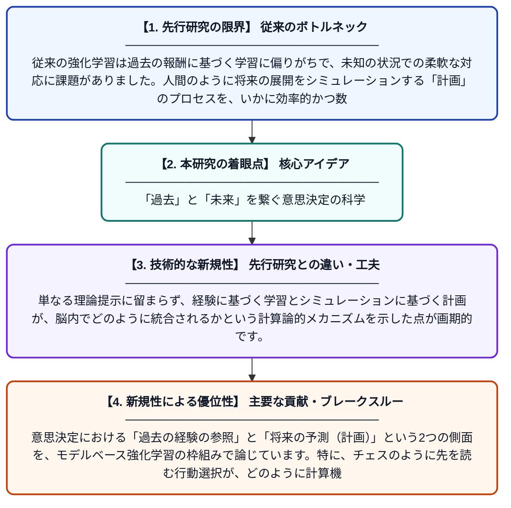

# 計画とモデルベース強化学習

**Original Title**: *Planning and Model-based Reinforcement Learning*

> **💡 一言要約**: 「過去」と「未来」を繋ぐ意思決定の科学

| 項目 | 内容 |
|---|---|
| **著者** | T Gureckis |
| **掲載誌** | 2026 |
| **アラートキーワード** | reinforcement |
| **PDF** | [https://teaching.gureckislab.org/ccm/readings_pdf/rl-planning.pdf](https://teaching.gureckislab.org/ccm/readings_pdf/rl-planning.pdf) |
| **原文リンク** | [https://teaching.gureckislab.org/ccm/readings_pdf/rl-planning.pdf](https://teaching.gureckislab.org/ccm/readings_pdf/rl-planning.pdf) |
| **PDF版要約** | [README.pdf](./README.pdf) |

---

## 📊 新規性の図解（先行研究との違いと本研究のブレークスルー）

## 📝 要約

意思決定における「過去の経験の参照」と「将来の予測（計画）」という2つの側面を、モデルベース強化学習の枠組みで論じています。特に、チェスのように先を読む行動選択が、どのように計算機モデルと人間の認知プロセスで実現されるかを解説しています。

## ❓ どんな問題に取り組んだか

従来の強化学習は過去の報酬に基づく学習に偏りがちで、未知の状況での柔軟な対応に課題がありました。人間のように将来の展開をシミュレーションする「計画」のプロセスを、いかに効率的かつ数学的にモデル化するかが大きな課題です。

## ✨ 何が新しい？何がすごい？（新規性）

心理学的な知見と最新の機械学習アルゴリズムを融合させ、人間が計算資源を節約しながら高度な「先読み」を行う仕組みを解明しています。単なる理論提示に留まらず、経験に基づく学習とシミュレーションに基づく計画が、脳内でどのように統合されるかという計算論的メカニズムを示した点が画期的です。

## 🎓 大学1年生向けの解説

私たちは何かを決める時、「前はこれで上手くいった」と思い出すこともあれば、「こうしたら次はどうなるか」と予測することもあります。この「予測して計画を立てる力」をコンピュータに教える技術がモデルベース強化学習です。この研究は、人間が頭の中で行っているシミュレーションの仕組みを解明し、より賢く柔軟なAIを作るための道筋を示しています。
