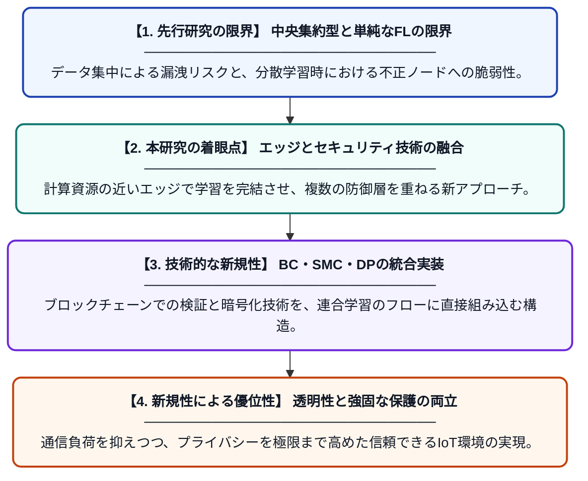

# IoTにおけるエッジベースの連合学習：アーキテクチャ、セキュリティ、および課題

**Original Title**: *Edge-Based Federated Learning in IoT: Architectures, Security, and Challenges*

> **💡 一言要約**: IoTのプライバシーを最新技術の融合で守り抜く

| 項目 | 内容 |
|---|---|
| **著者** | S Nandi, P Bhattacharjee |
| **掲載誌** | AI and ML in IoT Security |
| **アラートキーワード** | differential privacy |
| **原文リンク** | [https://api.taylorfrancis.com/content/chapters/edit/download?identifierName=doi&identifierValue=10.1201/9781003734857-10&type=chapterpdf](https://api.taylorfrancis.com/content/chapters/edit/download?identifierName=doi&identifierValue=10.1201/9781003734857-10&type=chapterpdf) |
| **PDF版要約** | [README.pdf](./README.pdf) |

---

## 📊 新規性の図解（先行研究との違いと本研究のブレークスルー）

## 📝 要約

IoT環境において、データプライバシーを保護しながら効率的に学習を行う「エッジベース連合学習」の構成とセキュリティ課題を網羅的に解説した論文です。ブロックチェーンや秘密計算、差分プライバシーを組み合わせることで、透明性が高く堅牢なエッジコンピューティング基盤を実現する手法を提案しています。

## ❓ どんな問題に取り組んだか

IoTデバイスの急増に伴い、膨大なデータをクラウドに集約する従来の手法では、通信コストの増大や深刻なプライバシー漏洩リスクが避けられません。また、分散したエッジ端末で学習を行う際のセキュリティ確保や、不正な更新を防ぐための透明性の欠如も大きな課題となっています。

## ✨ 何が新しい？何がすごい？（新規性）

本研究の核心は、連合学習（FL）を単独で用いるのではなく、ブロックチェーン、秘密計算（SMC）、差分プライバシー（DP）という複数の先端技術を統合した点にあります。これにより、データの機密性を保ちつつ、モデルの更新過程をブロックチェーンで記録することで、改ざん耐性と透明性を同時に確保するフレームワークを提示しました。先行研究で個別に対処されていた効率性と信頼性の問題を、統合的なアーキテクチャによって解決しています。

## 🎓 大学1年生向けの解説

身の回りのセンサーやスマホなどのIoT機器からデータを集める際、そのまま送ると中身を盗み見られる心配があります。この研究では、データを外に出さずに手元の機器だけでAIを賢くし、その結果だけを共有する「連合学習」という仕組みを、さらに最新の暗号技術で守る方法を考えています。ブロックチェーンなどを使って「誰がどのように学習させたか」を正しく記録することで、嘘の情報を流されるのを防ぎ、安心してAIを使える社会を目指しています。
