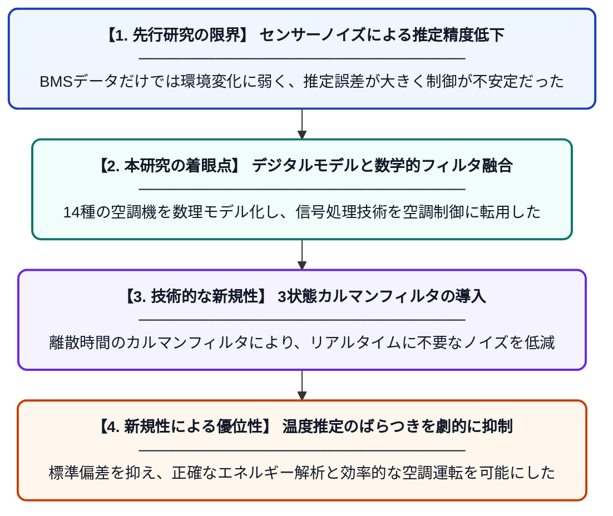

# BMSベースの空調機デジタルモデル：MATLABシミュレーションとカルマンフィルタによるエネルギー解析

**Original Title**: *BMS-Based Air Handling Unit Digital Model: Energy Analysis via MATLAB Simulation and Kalman Filter*

> **💡 一言要約**: カルマンフィルタで空調の温度推定を精密化

| 項目 | 内容 |
|---|---|
| **著者** | ZS Kılınç, M Sezgin |
| **掲載誌** | 10th International Artificial Intelligence and Data … 2026 |
| **アラートキーワード** | kalman filter |
| **原文リンク** | [https://ieeexplore.ieee.org/abstract/document/11728073/](https://ieeexplore.ieee.org/abstract/document/11728073/) |
| **PDF版要約** | [README.pdf](./README.pdf) |

---

## 📊 新規性の図解（先行研究との違いと本研究のブレークスルー）

## 📝 要約

ビル管理システム（BMS）のデータを活用し、14種類の空調機（AHU）を対象とした高精度なデジタルモデルを構築しました。3状態の離散時間カルマンフィルタを導入することで、センサーデータのノイズを効果的に除去し、温度推定の精度を大幅に向上させています。

## ❓ どんな問題に取り組んだか

大規模建築物の空調システム（AHU）は動作が複雑であり、センサーから得られるデータには多くのノイズが含まれます。従来の管理システムでは、このノイズが原因で正確なエネルギー解析や精密な温度制御が困難であるという課題がありました。

## ✨ 何が新しい？何がすごい？（新規性）

14種類もの多様なAHUタイプを網羅的にデジタルモデル化した上で、離散時間カルマンフィルタを適用した点が独創的です。このフィルタリングにより温度推定の標準偏差を低減し、実測値に近い安定したデータ抽出を実現しました。さらに、将来的に非線形モデルへ対応するための拡張カルマンフィルタ（EKF）への道筋も示しています。

## 🎓 大学1年生向けの解説

大きなビルの空調機は、センサーを使って温度を測りながら動いていますが、実はそのデータには細かい「ノイズ（誤差）」が混ざっています。この研究では、数学のテクニックを使ってそのノイズをきれいに取り除く「デジタル上の空調機モデル」を作りました。これにより、空調が今どんな状態なのかを正確に把握でき、電気代の節約や快適な温度維持に役立てることができます。
