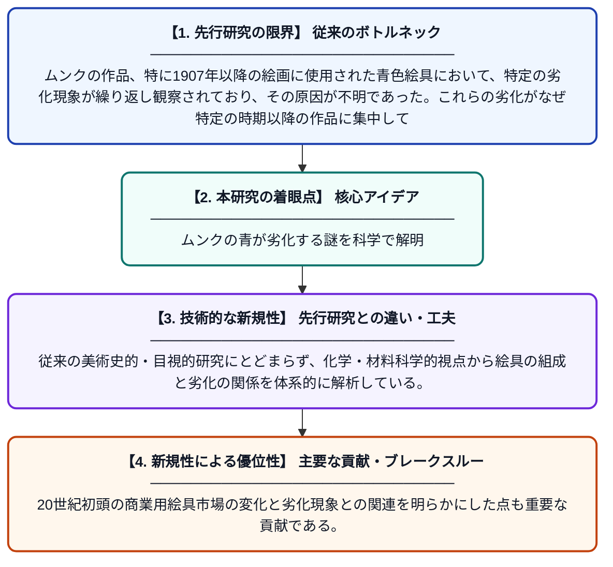

# エドヴァルド・ムンクのコレクションにおける…：20世紀初頭の市販油絵具の多角的分析研究

**Original Title**: *… in Edvard Munch's collection: a multi-analytical study of early 20th century commercial oil paints: authors: Beatrice G. Boracchi, Eun-Jin Strand Ferrer, ICA Sandu,[et al…*

> **💡 一言要約**: ムンクの青が劣化する謎を科学で解明

| 項目 | 内容 |
|---|---|
| **著者** | ICA Sandu, B Boracchi, JS Ferrer |
| **アラートキーワード** | ICA |
| **原文リンク** | [https://munch.tind.io/record/46832](https://munch.tind.io/record/46832) |
| **PDF版要約** | [README.pdf](./README.pdf) |

---

## 📊 新規性の図解（先行研究との違いと本研究のブレークスルー）

## 📝 要約

本研究は、エドヴァルド・ムンクが1907年以降の作品に使用した青色絵具に頻繁に見られる劣化現象を解明するため、市販のウルトラマリンブルー絵具10種を対象に多角的な分析調査を実施した。複数の分析手法を組み合わせることで、絵具の成分・構造・劣化メカニズムを詳細に明らかにした。これにより、文化財保存の観点から重要な科学的知見が提供されている。

## ❓ どんな問題に取り組んだか

ムンクの作品、特に1907年以降の絵画に使用された青色絵具において、特定の劣化現象が繰り返し観察されており、その原因が不明であった。これらの劣化がなぜ特定の時期以降の作品に集中しているのか、絵具の成分や製造方法との関係を科学的に解明する必要があった。

## ✨ 何が新しい？何がすごい？（新規性）

本研究は、ムンクが実際に使用した市販のウルトラマリンブルー絵具を対象に、複数の分析手法（マルチアナリティカルアプローチ）を組み合わせて包括的に調査した点が新しい。従来の美術史的・目視的研究にとどまらず、化学・材料科学的視点から絵具の組成と劣化の関係を体系的に解析している。20世紀初頭の商業用絵具市場の変化と劣化現象との関連を明らかにした点も重要な貢献である。

## 🎓 大学1年生向けの解説

ノルウェーの有名な画家エドヴァルド・ムンク（『叫び』で知られる）の絵画で、青い色の部分が時間とともに傷んでしまう現象が問題になっています。この研究では、ムンクが使っていた市販の青色絵具を科学的な道具で詳しく調べました。絵具の成分や構造を分析することで、なぜ1907年以降の絵に劣化が多いのかを探っています。まるで絵画の「健康診断」を行うような研究で、大切な芸術作品を未来に残すための保存科学の一例です。
