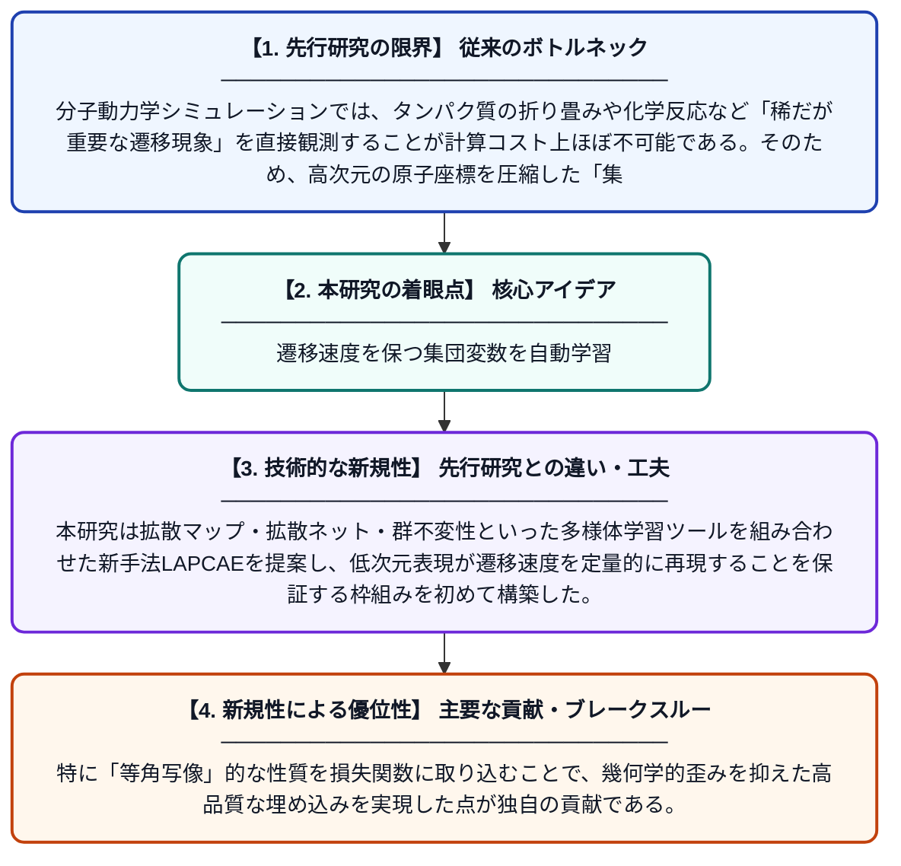

# 遷移速度を再現する集団変数の学習

**Original Title**: *Learning Collective Variables That Reproduce Transition Rates*

> **💡 一言要約**: 遷移速度を保つ集団変数を自動学習

| 項目 | 内容 |
|---|---|
| **著者** | S Sule, A Mehta, MK Cameron |
| **掲載誌** | Multiscale Modeling & Simulation 2026 |
| **アラートキーワード** | manifold learning |
| **原文リンク** | [https://epubs.siam.org/doi/abs/10.1137/25M177093X](https://epubs.siam.org/doi/abs/10.1137/25M177093X) |
| **PDF版要約** | [README.pdf](./README.pdf) |

---

## 📊 新規性の図解（先行研究との違いと本研究のブレークスルー）

## 📝 要約

本論文では、分子シミュレーションにおける稀な遷移現象を効率よく記述するための「集団変数」を自動的に学習する手法を提案する。拡散マップや群不変性などの多様体学習ツールを統合し、新たな手法「Laplacian Conformal Autoencoder（LAPCAE）」を開発した。この手法は、状態間の遷移速度を正確に再現できる低次元表現を獲得することを目標としている。

## ❓ どんな問題に取り組んだか

分子動力学シミュレーションでは、タンパク質の折り畳みや化学反応など「稀だが重要な遷移現象」を直接観測することが計算コスト上ほぼ不可能である。そのため、高次元の原子座標を圧縮した「集団変数」を用いて現象を記述する必要があるが、遷移速度を正しく再現できる集団変数を人手なしに見つけることは長年の難題であった。

## ✨ 何が新しい？何がすごい？（新規性）

先行研究では拡散マップや深層オートエンコーダーが個別に使われてきたが、それらを統合しつつ遷移速度という物理的な制約を組み込んだ手法は存在しなかった。本研究は拡散マップ・拡散ネット・群不変性といった多様体学習ツールを組み合わせた新手法LAPCAEを提案し、低次元表現が遷移速度を定量的に再現することを保証する枠組みを初めて構築した。特に「等角写像」的な性質を損失関数に取り込むことで、幾何学的歪みを抑えた高品質な埋め込みを実現した点が独自の貢献である。

## 🎓 大学1年生向けの解説

原子や分子の動きをコンピュータでシミュレーションするとき、膨大な変数があって全部を追いかけるのはとても大変です。そこで「重要な動きだけを表す少数の変数（集団変数）」に圧縮できれば、計算がずっと楽になります。しかし、その変数が「どれくらい速く状態が変化するか」という情報まで正しく保てるかが難しい問題でした。この論文では、機械学習の一種である「多様体学習」を活用して、遷移速度をちゃんと再現できる集団変数を自動的に見つける新しい方法を提案しています。これにより、薬の開発や材料科学など、稀な現象の解析が大幅に効率化されることが期待されます。
