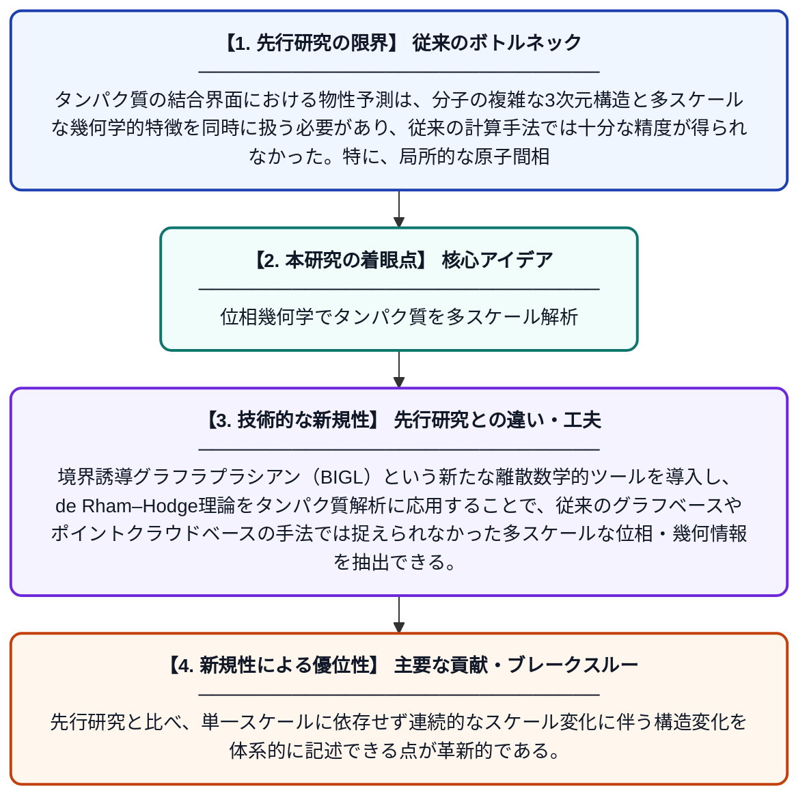

# タンパク質特性の持続的多様体学習

**Original Title**: *Persistent Manifold Learning of Protein Properties*

> **💡 一言要約**: 位相幾何学でタンパク質を多スケール解析

| 項目 | 内容 |
|---|---|
| **著者** | X Xu, Z Su, GW Wei, C Wang |
| **掲載誌** | arXiv preprint arXiv:2607.25115 2026 |
| **アラートキーワード** | manifold learning |
| **PDF** | [https://arxiv.org/pdf/2607.25115](https://arxiv.org/pdf/2607.25115) |
| **原文リンク** | [https://arxiv.org/pdf/2607.25115](https://arxiv.org/pdf/2607.25115) |
| **PDF版要約** | [README.pdf](./README.pdf) |

---

## 📊 新規性の図解（先行研究との違いと本研究のブレークスルー）

## 📝 要約

本論文では、タンパク質の結合界面をマルチスケールな多様体の族として記述する新しい計算フレームワーク「持続的多様体学習（PML）」を提案する。de Rham–Hodge理論の離散的実現である境界誘導グラフラプラシアン（BIGL）を用いることで、タンパク質の幾何学的・位相的情報を多スケールにわたって抽出する。このフレームワークを機械学習と組み合わせることで、タンパク質の物性予測精度を大幅に向上させることを示している。

## ❓ どんな問題に取り組んだか

タンパク質の結合界面における物性予測は、分子の複雑な3次元構造と多スケールな幾何学的特徴を同時に扱う必要があり、従来の計算手法では十分な精度が得られなかった。特に、局所的な原子間相互作用と大域的な構造情報を統合的に記述することが困難であった。

## ✨ 何が新しい？何がすごい？（新規性）

本研究の最大の新規性は、持続的ホモロジーの考え方を多様体学習に拡張した「持続的多様体学習」という全く新しいフレームワークを構築した点にある。境界誘導グラフラプラシアン（BIGL）という新たな離散数学的ツールを導入し、de Rham–Hodge理論をタンパク質解析に応用することで、従来のグラフベースやポイントクラウドベースの手法では捉えられなかった多スケールな位相・幾何情報を抽出できる。先行研究と比べ、単一スケールに依存せず連続的なスケール変化に伴う構造変化を体系的に記述できる点が革新的である。

## 🎓 大学1年生向けの解説

タンパク質は体の中で様々な働きをする分子で、その性質は複雑な立体構造によって決まります。この研究では、数学の「位相幾何学（形の学問）」を使って、タンパク質の形を様々なスケール（大きさ）で同時に分析する新しい方法を開発しました。例えるなら、地図を虫眼鏡で見る倍率を少しずつ変えながら、どの倍率でも重要な地形情報を逃さず記録するようなイメージです。この手法をAI（機械学習）と組み合わせることで、タンパク質がどのように他の分子とくっつくかをより正確に予測できるようになります。これは新薬の開発などに役立てることが期待されています。
