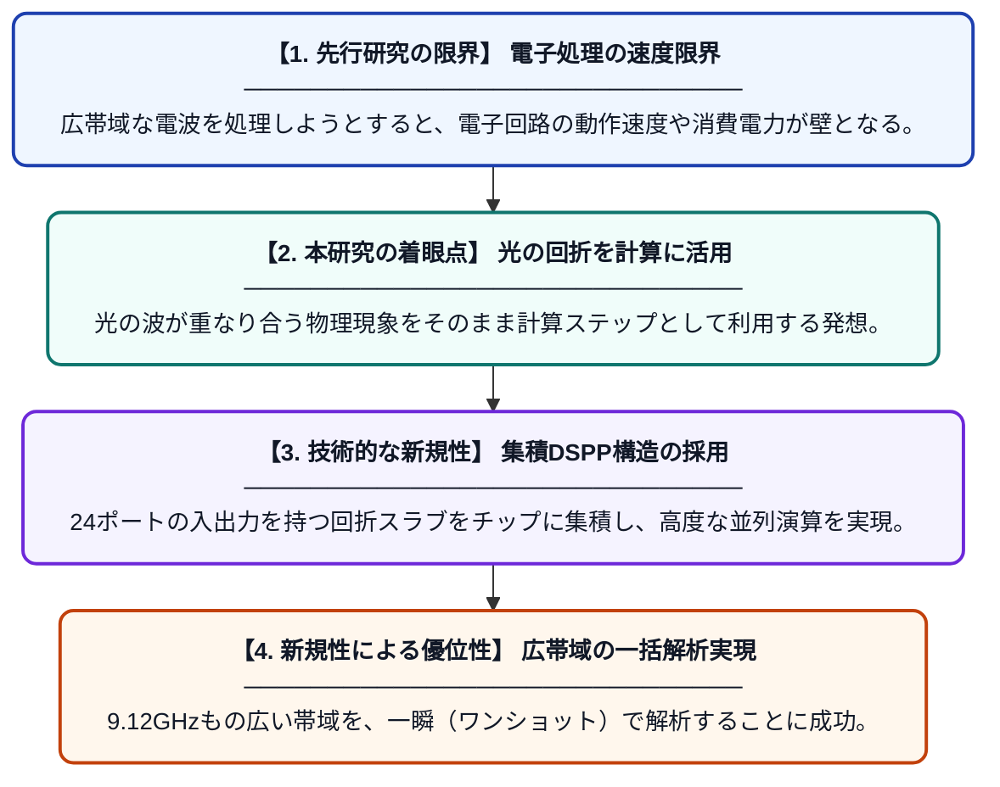

# リアルタイムRFスペクトル計測と整合フィルタリングに向けた集積回折スラブ光プロセッサ

**Original Title**: *Integrated Diffractive Slab Photonic Processor for Real-Time RF Spectrum Sensing and Matched Filtering*

> **💡 一言要約**: 広帯域電波を一瞬で解析する超高速光チップ

| 項目 | 内容 |
|---|---|
| **著者** | Z Shen, W Zhou, W Ma, W Li |
| **掲載誌** | European Conference and Exhibition on Optical … 2026 |
| **アラートキーワード** | one shot |
| **原文リンク** | [https://opg.optica.org/abstract.cfm?uri=ECEOC-2026-Mo4_P_33](https://opg.optica.org/abstract.cfm?uri=ECEOC-2026-Mo4_P_33) |
| **PDF版要約** | [README.pdf](./README.pdf) |

---

## 📊 新規性の図解（先行研究との違いと本研究のブレークスルー）

## 📝 要約

回折スラブ構造を用いた集積光プロセッサ（DSPP）により、9.12GHzの超広帯域RF信号を一括でスペクトル解析および整合フィルタリングする技術を開発しました。光の物理的な回折現象をチップ上で利用することで、従来の電子処理の限界を超える高速な電波信号処理を低遅延で実現しています。

## ❓ どんな問題に取り組んだか

従来の電子的なRF信号処理では、サンプリング速度の制約（シャノン・ナイキストの定理）により、広帯域な電波をリアルタイムで解析しようとすると膨大な計算負荷と消費電力が発生します。また、既存の光プロセッサは装置が大型化しやすく、実用的な集積デバイスとしての実装が課題でした。

## ✨ 何が新しい？何がすごい？（新規性）

24点の入出力を備えた回折スラブ光プロセッサ（DSPP）をチップ上に集積し、スペクトル解析とレーダー向け整合フィルタリングの2つの機能を実証しました。9.12 GHzという広帯域を380 MHzの分解能で、一度の操作（ワンショット）により並列処理できる点が最大の特徴です。物理的な光の干渉と回折を計算に利用することで、電気回路では困難なリアルタイム性を集積サイズで達成しました。

## 🎓 大学1年生向けの解説

スマホやレーダーに使われる電波（RF信号）を、電気の代わりに「光」を使って一瞬で分析する魔法のようなチップの研究です。これまでは複雑な計算機が必要だった作業を、光が広がる性質（回折）をうまく利用して、光がチップを通り抜ける間に終わらせてしまいます。これにより、非常に広い範囲の電波情報を、待ち時間なしで正確に読み取ることが可能になります。
