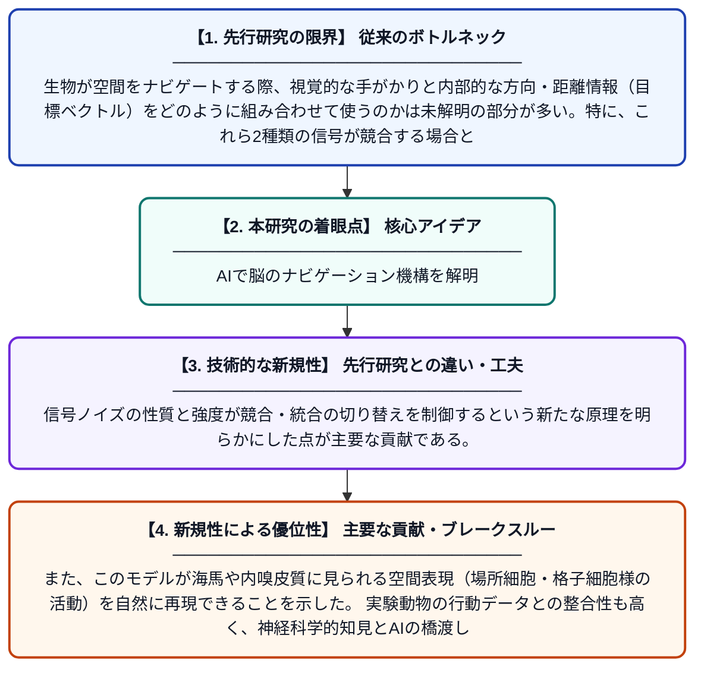

# 空間ナビゲーションにおける視覚信号と目標ベクトル信号の競合・統合を説明する深層強化学習モデル

**Original Title**: *A deep reinforcement learning account of competition and integration of visual and goal vector signals for spatial navigation*

> **💡 一言要約**: AIで脳のナビゲーション機構を解明

| 項目 | 内容 |
|---|---|
| **著者** | S Vijayabaskaran, S Cheng |
| **掲載誌** | Scientific Reports 2026 |
| **アラートキーワード** | reinforcement |
| **原文リンク** | [https://www.nature.com/articles/s41598-026-63080-3](https://www.nature.com/articles/s41598-026-63080-3) |
| **PDF版要約** | [README.pdf](./README.pdf) |

---

## 📊 新規性の図解（先行研究との違いと本研究のブレークスルー）

## 📝 要約

本研究では、視覚信号と目標ベクトル信号の相互作用を深層強化学習によってモデル化し、空間ナビゲーション時の行動と空間表現を分析した。信号ノイズの性質と程度が、これら2つの信号の競合または統合のどちらが生じるかを決定することを示した。このモデルは、動物実験で観察されるナビゲーション行動の多様なパターンを再現することに成功した。

## ❓ どんな問題に取り組んだか

生物が空間をナビゲートする際、視覚的な手がかりと内部的な方向・距離情報（目標ベクトル）をどのように組み合わせて使うのかは未解明の部分が多い。特に、これら2種類の信号が競合する場合と協調して統合される場合の切り替えメカニズムの理解が課題であった。ノイズや不確実性がある環境下でどちらの信号に依存するかを決める要因の特定が求められていた。

## ✨ 何が新しい？何がすごい？（新規性）

先行研究では視覚信号か目標ベクトル信号のどちらか一方に焦点を当てたモデルが多かったが、本研究は両信号を統一的に扱う深層強化学習フレームワークを初めて提案した。信号ノイズの性質と強度が競合・統合の切り替えを制御するという新たな原理を明らかにした点が主要な貢献である。また、このモデルが海馬や内嗅皮質に見られる空間表現（場所細胞・格子細胞様の活動）を自然に再現できることを示した。実験動物の行動データとの整合性も高く、神経科学的知見とAIの橋渡しとなる成果である。

## 🎓 大学1年生向けの解説

私たちや動物が知らない場所を移動するとき、脳は「目で見た景色」と「自分がどの方向にどれだけ進んだか」という2種類の情報を使っています。この研究では、AIの学習手法である強化学習を使って、その2種類の情報がどのように組み合わさるかをコンピューター上でシミュレーションしました。周囲の情報が不確かなとき、脳はどちらの情報を優先すべきかを自動的に判断していることがわかりました。このモデルは実際の動物実験の結果ともよく一致しており、脳のナビゲーション機能の謎に迫る重要な一歩となっています。
