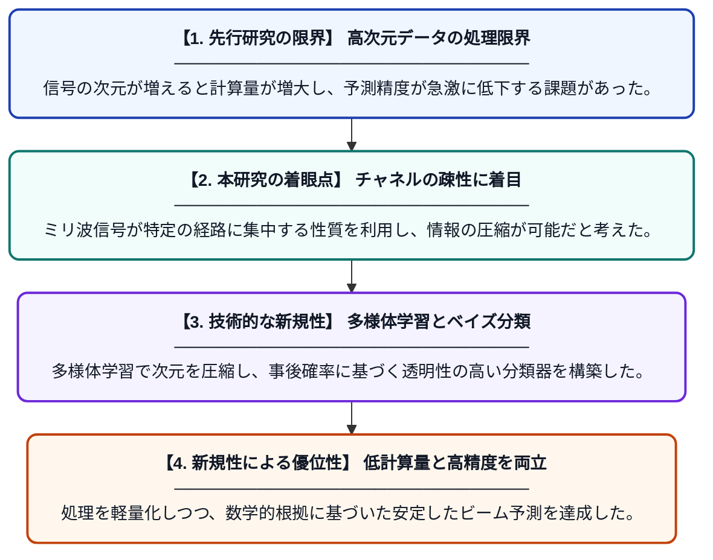

# ベイズ分類器に基づくビーム予測：解釈可能かつ低計算量のアルゴリズム

**Original Title**: *Bayesian Classifier-Based Beam Prediction: An Interpretable and Low-Complexity Algorithm*

> **💡 一言要約**: 多様体学習で次元を圧縮し高精度なビーム予測を実現

| 項目 | 内容 |
|---|---|
| **著者** | P Gao, L Yang |
| **掲載誌** | IEEE 104th Vehicular Technology Conference … 2026 |
| **アラートキーワード** | manifold learning |
| **原文リンク** | [https://ieeexplore.ieee.org/abstract/document/11758389/](https://ieeexplore.ieee.org/abstract/document/11758389/) |
| **PDF版要約** | [README.pdf](./README.pdf) |

---

## 📊 新規性の図解（先行研究との違いと本研究のブレークスルー）

## 📝 要約

ミリ波通信におけるビーム予測の精度向上と計算量削減を目的とし、多様体学習とベイズ分類器を組み合わせた新しいアルゴリズムを提案しています。チャネルの疎性を利用して信号ベクトルの次元を削減することで、高次元データ特有の学習効率の低下を克服し、高い予測精度と解釈可能性を両立させました。

## ❓ どんな問題に取り組んだか

従来のビーム予測手法、特にカーネル密度推定を用いる方式では、データの次元数が増えると計算効率や精度が著しく低下する「次元の呪い」が大きな課題でした。また、多くの高度な予測モデルはブラックボックス化しており、通信制御において重要な「なぜそのビームを選んだか」という解釈性が欠如していました。

## ✨ 何が新しい？何がすごい？（新規性）

ミリ波チャネルが持つ「特定の方向にのみ信号が伝搬する」という疎性を活用し、多様体学習によってプロービング信号の次元を効果的に圧縮した点が大きな特徴です。次元削減されたデータにベイズ分類器を適用することで、従来の深層学習モデルよりも圧倒的に計算負荷を抑えつつ、事後確率に基づいた明確な判断根拠を持つ予測を可能にしました。この手法により、ハードウェア資源が限られた環境でも、リアルタイムかつ高精度なビーム追従が可能になります。

## 🎓 大学1年生向けの解説

スマホなどで使う次世代の高速通信（ミリ波）は、電波を特定の方向に狙い撃ちする「ビーム」という技術を使います。しかし、動いている相手に対してどの向きが最適かを瞬時に計算するのは非常に難しく、これまでは計算に時間がかかりすぎるか、仕組みが複雑すぎてブラックボックス化していました。この研究では、複雑な情報を「ギュッ」とコンパクトにまとめる数学的な工夫を使い、シンプルで分かりやすいルールでビームの向きを当てることに成功しました。これにより、スマホの電池を節約しながら、いつでも安定して速いネット接続ができるようになります。
