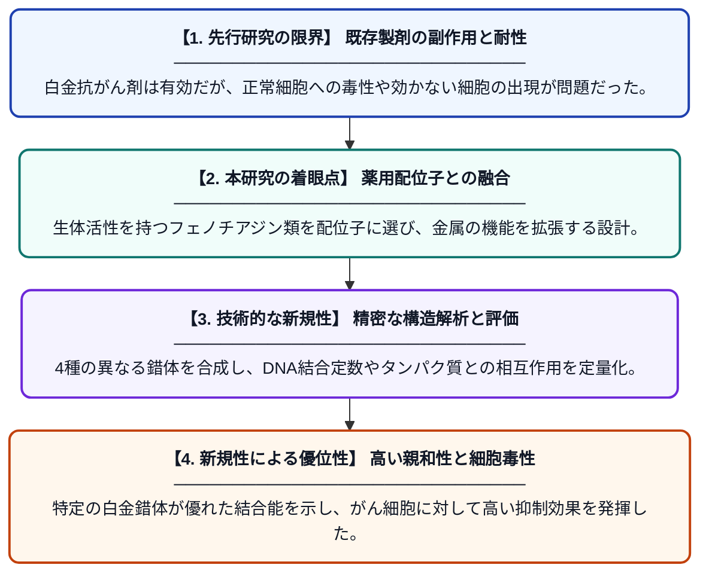

# フェノチアジン配位子を用いたパラジウム(II)および白金(II)錯体：構造決定、細胞毒性およびDNA/BSA結合親和性

**Original Title**: *Palladium (II) and platinum (II) complexes with phenothiazine ligands: Characterization, cytotoxicity and DNA/BSA binding affinity*

> **💡 一言要約**: 薬用骨格と金属の融合でがんに挑む新錯体

| 項目 | 内容 |
|---|---|
| **著者** | BV Pantović, TP Andrejević, J Branković, T Ilic-Tomic… |
| **掲載誌** | Inorganica Chimica Acta 2026 |
| **アラートキーワード** | ICA |
| **原文リンク** | [https://www.sciencedirect.com/science/article/pii/S0020169326004421](https://www.sciencedirect.com/science/article/pii/S0020169326004421) |
| **PDF版要約** | [README.pdf](./README.pdf) |

---

## 📊 新規性の図解（先行研究との違いと本研究のブレークスルー）

## 📝 要約

抗精神病薬としての性質を持つフェノチアジン誘導体を配位子とした、新しいパラジウム(II)および白金(II)錯体を4種類合成しました。これらの錯体はがん細胞に対して顕著な細胞毒性を示し、生体内のDNAや血清アルブミン(BSA)と強く相互作用することを明らかにしました。

## ❓ どんな問題に取り組んだか

シスプラチンに代表される既存の金属抗がん剤は、副作用や薬剤耐性が大きな課題となっています。そのため、より優れた治療効果を持ち、生体内での挙動がコントロール可能な新しい金属錯体の開発が切望されています。

## ✨ 何が新しい？何がすごい？（新規性）

独自の生理活性を持つフェノチアジン骨格をパラジウムおよび白金に配位させ、構造の違いが生物学的活性に与える影響を精密に評価した点が革新的です。特に、メチル基の有無や中心金属の種類が、生体高分子であるDNAやタンパク質への結合親和性にどう作用するかを系統的に解明しました。これにより、従来の金属錯体とは異なるメカニズムでの抗腫瘍効果の可能性を示しました。

## 🎓 大学1年生向けの解説

がんの治療に使われる「プラチナ製剤」を、より使いやすく強力にする研究です。昔から精神科の薬などで使われてきた「フェノチアジン」という物質を、白金やパラジウムという金属と合体させて新しい化合物を4つ作りました。これらががん細胞をやっつける力があることや、体の中で遺伝子（DNA）やタンパク質とどうやって結びつくかを詳しく調べました。将来、副作用の少ない新しい抗がん剤を作るための大切な一歩となる研究です。
