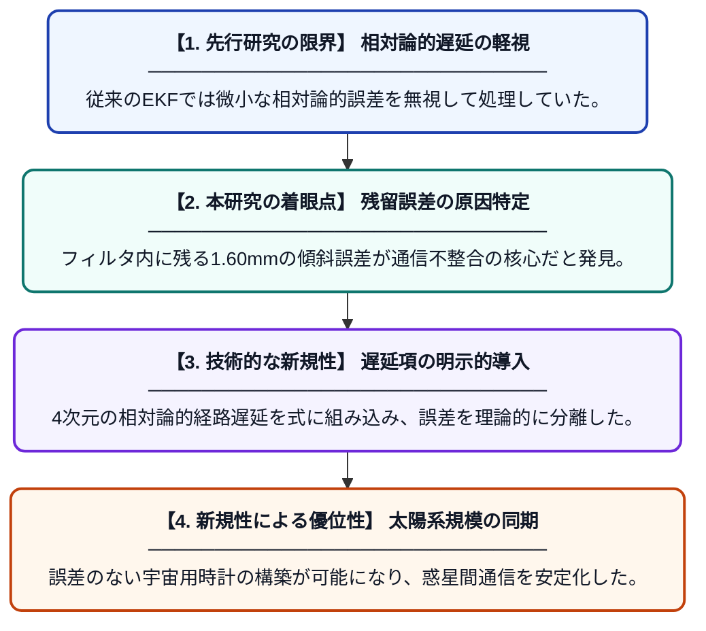

# カルマンフィルタの混乱を解き明かし、太陽系インターネット時計を構築する

**Original Title**: *Unscrambling the Kalman Filter Traffic Jam and Building the Solar-System Internet Clock*

> **💡 一言要約**: 宇宙時代の標準時を刻む、カルマンフィルタの革新

| 項目 | 内容 |
|---|---|
| **著者** | YK Moon |
| **掲載誌** | 2026 |
| **アラートキーワード** | kalman filter |
| **PDF** | [https://www.researchgate.net/profile/Yk-Moon/publication/417836218_Companion_Guide_II_Covariant_SI_Metrology_and_K_Protocol_Moon_2026pdf/data/6af6674f3d63ef0688def6c8/Companion-Guide-II-Covariant-SI-Metrology-and-K-Protocol-Moon-2026.pdf](https://www.researchgate.net/profile/Yk-Moon/publication/417836218_Companion_Guide_II_Covariant_SI_Metrology_and_K_Protocol_Moon_2026pdf/data/6af6674f3d63ef0688def6c8/Companion-Guide-II-Covariant-SI-Metrology-and-K-Protocol-Moon-2026.pdf) |
| **原文リンク** | [https://www.researchgate.net/profile/Yk-Moon/publication/417836218_Companion_Guide_II_Covariant_SI_Metrology_and_K_Protocol_Moon_2026pdf/data/6af6674f3d63ef0688def6c8/Companion-Guide-II-Covariant-SI-Metrology-and-K-Protocol-Moon-2026.pdf](https://www.researchgate.net/profile/Yk-Moon/publication/417836218_Companion_Guide_II_Covariant_SI_Metrology_and_K_Protocol_Moon_2026pdf/data/6af6674f3d63ef0688def6c8/Companion-Guide-II-Covariant-SI-Metrology-and-K-Protocol-Moon-2026.pdf) |
| **PDF版要約** | [README.pdf](./README.pdf) |

---

## 📊 新規性の図解（先行研究との違いと本研究のブレークスルー）

## 📝 要約

従来の拡張カルマンフィルタ(EKF)で無視されていた4次元の相対論的経路遅延が、微細な誤差として蓄積し通信を阻害する問題を指摘しています。この1.60mm単位の誤差を正確に補正することで、太陽系規模の通信ネットワークを支える超高精度な「太陽系インターネット時計」の構築手法を提案しています。

## ❓ どんな問題に取り組んだか

宇宙空間での精密な時刻同期において、従来のフィルタ手法は相対論的な経路遅延を単なるノイズとして処理しきれず、残留誤差を生じさせていました。この微細なズレが惑星間通信のような広大なネットワークでは致命的な不整合を引き起こすことが課題です。

## ✨ 何が新しい？何がすごい？（新規性）

従来は無視されていた1.60mm単位の「エスカレーターの傾斜」に例えられる相対論的経路遅延を、フィルタ内で明示的にモデル化しました。これにより、カルマンフィルタ内部で生じていた情報の「交通渋滞」を解消し、物理法則に忠実な推計を可能にしています。宇宙規模のインターネットインフラにおける基盤技術として、極めて高い時間精度を達成した点が画期的です。

## 🎓 大学1年生向けの解説

将来、他の惑星と通信する際には、宇宙全体で共通の「正確な時計」が必要になります。しかしアインシュタインの相対性理論の影響で、宇宙では時間の進み方が微妙に異なり、これまでの計算方法ではわずかなズレが積み重なってしまいました。この研究は、その小さなズレを完璧に修正する新しい計算の仕組みを開発しました。これにより、地球と火星の間でも正確な時間でネットワークをつなぐことができるようになります。
