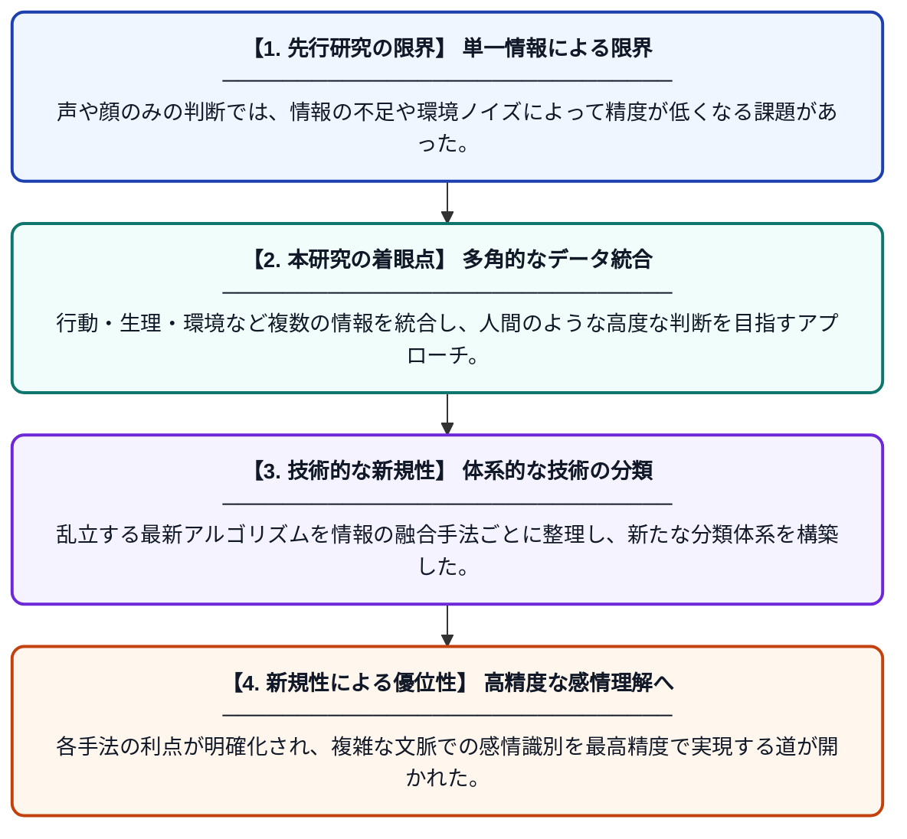

# 最新のマルチモーダル感情認識：包括的な調査と分類体系

**Original Title**: *State-of-the-art Multimodal Emotion Recognition: A comprehensive survey and taxonomy*

> **💡 一言要約**: 複数情報を統合し、AIが人の心を深く読み解く。

| 項目 | 内容 |
|---|---|
| **著者** | T Küçükyılmaz, T Dökeroğlu, A Sharipbay, MH Lee… |
| **掲載誌** | 2026 |
| **アラートキーワード** | affective computing |
| **原文リンク** | [https://rankscience.kz/en/articles/18296](https://rankscience.kz/en/articles/18296) |
| **PDF版要約** | [README.pdf](./README.pdf) |

---

## 📊 新規性の図解（先行研究との違いと本研究のブレークスルー）

## 📝 要約

AIとアフェクティブ・コンピューティングの重要分野である「マルチモーダル感情認識（MER）」について、最新技術を網羅的に調査し体系化した論文です。音声、表情、生理信号など複数の情報を統合することで、従来の単一手法よりも高精度に人間の感情を解釈する仕組みを解説しています。

## ❓ どんな問題に取り組んだか

従来の感情認識は「顔だけ」「声だけ」といった単一の情報源（ユニモーダル）に頼っており、情報の欠落やノイズに弱いという課題がありました。また、急速に進化するこの分野において、最新の手法を整理し比較するための体系的なフレームワークが不足していました。

## ✨ 何が新しい？何がすごい？（新規性）

2026年時点の最先端技術を網羅し、行動信号と生理信号を統合する最新のMER手法を「分類学（タクソノミー）」として再構築した点が画期的です。単なる手法紹介に留まらず、データの融合タイミングや異なるモダリティ間の相互作用を評価する新たな基準を提示し、今後の研究の指針を明確に示しています。

## 🎓 大学1年生向けの解説

人間が相手の気持ちを察するとき、声のトーンだけでなく、顔の表情や体の動き、時にはドキドキしている様子（心拍）など、色々な情報を組み合わせて判断しますよね。この論文は、それと同じことをAIにさせる「マルチモーダル感情認識」という技術の最新まとめです。AIが「目」や「耳」など複数の感覚を同時に使って、より正確に私たちの心を理解するための最先端の知恵が詰まっています。
