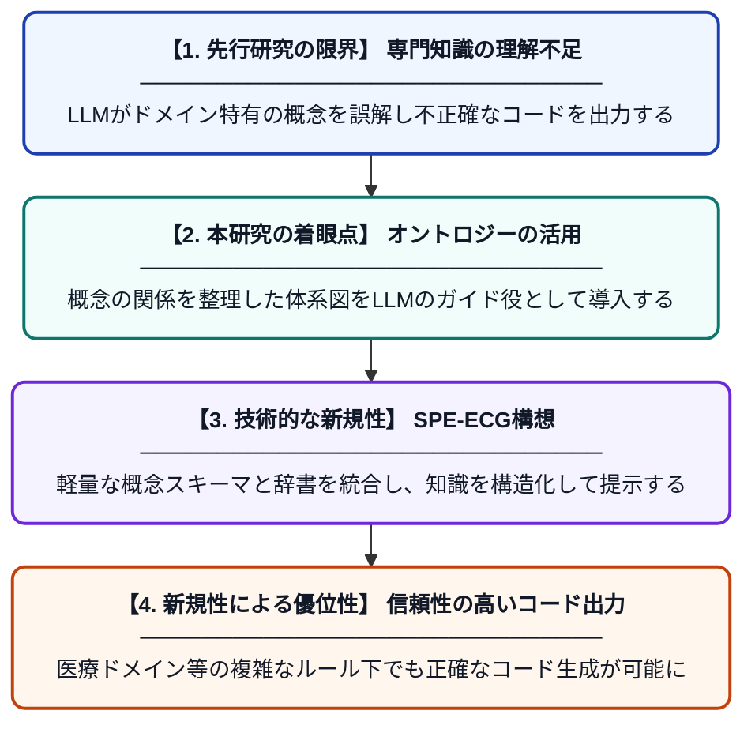

# SPE-ECG：LLMによるコード生成を強化するためのオントロジー誘導型知識表現フレームワーク

**Original Title**: *SPE-ECG: An Ontology-Guided Knowledge Representation Framework for Enhancing LLM-Based Code Generation*

> **💡 一言要約**: オントロジーでLLMの専門コード生成を劇的に正確に

| 項目 | 内容 |
|---|---|
| **著者** | T Mahmood, MT Afzal, AS Al-Shamayleh, G Mustafa… |
| **掲載誌** | Computation 2026 |
| **アラートキーワード** | Ontology |
| **原文リンク** | [https://www.mdpi.com/2079-3197/14/11/272](https://www.mdpi.com/2079-3197/14/11/272) |
| **PDF版要約** | [README.pdf](./README.pdf) |

---

## 📊 新規性の図解（先行研究との違いと本研究のブレークスルー）

## 📝 要約

大規模言語モデル（LLM）による専門分野のコード生成精度を向上させるため、ドメイン固有のオントロジーを活用したフレームワーク「SPE-ECG」を提案する研究です。リウマチ疾患（RA/DMARD）の事例を用い、軽量な概念スキーマと辞書を組み合わせることで、LLMが専門的な知識構造を正しく理解した上でコードを出力できるよう支援します。

## ❓ どんな問題に取り組んだか

汎用的なLLMは、医療や工学などの高度な専門知識が必要な分野において、概念間の論理的な関係を十分に理解できず、不正確なコードや「ハルシネーション（もっともらしい嘘）」を生成する傾向があります。特に専門用語の定義や属性の紐付けが重要な領域では、精度の低さが実用化の壁となっていました。

## ✨ 何が新しい？何がすごい？（新規性）

本研究の新規性は、ドメイン固有の軽量オントロジー（概念の体系図）をLLMの知識表現に直接統合する「SPE-ECG」フレームワークを構築した点にあります。従来の単純なキーワード検索による拡張（RAG）とは異なり、エンティティ（要素）間の階層構造や属性を明示したオントロジーをプロンプトに反映させる手法を開発しました。これにより、専門領域における用語の一貫性を保ちながら、論理的に正しいコードを生成する仕組みを確立し、医療情報処理における信頼性を大幅に向上させています。

## 🎓 大学1年生向けの解説

AIにプログラミングを頼むとき、難しい専門用語（例えば病名や薬の名前）が出てくると、AIは適当な嘘をついてしまうことがあります。この研究では、AIに専用の「知識の地図（オントロジー）」を渡すことで、その間違いを防ぐ方法を考えました。地図には「この言葉はこういう意味で、これと関係がある」と詳しく書いてあるので、AIは迷わずに正しいコードが書けるようになります。これにより、お医者さんが使うような専門的なツールもAIで安全に作れるようになります。
