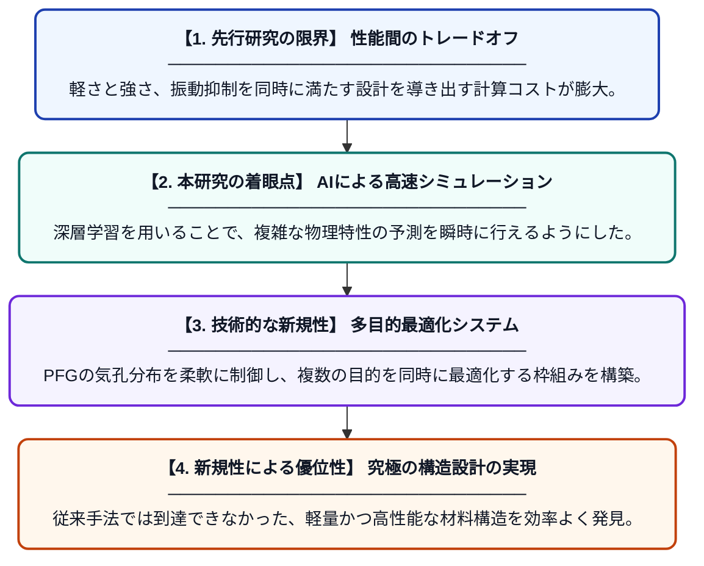

# 機械的・動的性能向上のための多孔質傾斜機能材料薄板の多目的構造最適化

**Original Title**: *Multi-objective structural optimization of porous functionally graded plates for enhanced mechanical and dynamic performance*

> **💡 一言要約**: AIで極める、軽くて強い次世代多孔質材料の最適設計

| 項目 | 内容 |
|---|---|
| **著者** | F Tang, Q Cao, Q Liu, Y Ma, R Lu, D Zhang, S Wang… |
| **掲載誌** | Materials & Design 2026 |
| **アラートキーワード** | optimization |
| **原文リンク** | [https://www.sciencedirect.com/science/article/pii/S0264127526020010](https://www.sciencedirect.com/science/article/pii/S0264127526020010) |
| **PDF版要約** | [README.pdf](./README.pdf) |

---

## 📊 新規性の図解（先行研究との違いと本研究のブレークスルー）

## 📝 要約

多孔質傾斜機能材料（PFG）を用いた薄板において、重量、剛性、振動特性の間のトレードオフを解消する多目的最適化フレームワークを提案しました。深層学習と進化的アルゴリズムを組み合わせることで、複雑な設計空間から最適な気孔分布パターンを効率的に導き出しています。

## ❓ どんな問題に取り組んだか

多孔質傾斜機能材料（PFG）は軽量で高性能ですが、「軽さ」「剛性」「振動抑制」という性能は互いに相反する関係にあります。これら全ての性能を同時に最大化する設計を見つけるには膨大な計算コストがかかり、実用的な最適化が極めて困難でした。

## ✨ 何が新しい？何がすごい？（新規性）

本研究は、CNNなどの深層学習モデルを用いて構造解析を高速化し、多目的遺伝アルゴリズム（NSGA-II等）と統合した独自の最適化フレームワークを構築した点が画期的です。従来の均一な設計ではなく、複雑な気孔率のグラデーションをパラメータとして自在に制御し、物理的な限界に近い性能を引き出すことに成功しました。これにより、計算負荷を劇的に抑えながら、複数の性能指標を同時に満たす「パレート最適解」を高精度に提示できる点が先行研究との大きな違いです。

## 🎓 大学1年生向けの解説

「傾斜機能材料」とは、場所によって材料の性質を少しずつ変化させたハイテクな材料のことです。この論文では、板の中にたくさんの小さな「穴」をあける際、どこにどれだけの穴を配置すれば「最も軽くて、最も丈夫で、さらに変な振動が起きない」というわがままな条件を全て満たせるかを研究しています。AIにシミュレーションを学習させることで、人間では到底思いつかないような「究極の穴の配置パターン」を瞬時に見つけ出せるようになりました。
