# インテリジェント・エンタープライズにおけるポイズニング攻撃と推論攻撃に対抗するプライバシー保護型パーソナライズ連合学習

**Original Title**: *Privacy-Preserving Personalized Federated Learning Against Poisoning and Inference Attacks in Intelligent Enterprises*

> **💡 一言要約**: 企業のAIを守り抜く、最強の分散型学習システム

| 項目 | 内容 |
|---|---|
| **著者** | R Fotohi, FS Aliee, B Farahani |
| **掲載誌** | IEEE Transactions on Cognitive Communications … 2026 |
| **アラートキーワード** | Federated Learning |
| **原文リンク** | [https://ieeexplore.ieee.org/abstract/document/11745543/](https://ieeexplore.ieee.org/abstract/document/11745543/) |
| **PDF版要約** | [README.pdf](./README.pdf) |

---

## 📊 新規性の図解（先行研究との違いと本研究のブレークスルー）

```mermaid
%%{init: {'flowchart': {'wrappingWidth': 520, 'nodeSpacing': 18, 'rankSpacing': 28, 'padding': 14, 'curve': 'basis'}, 'themeVariables': {'fontSize': '14px'}}}%%
flowchart TD
    S1["<b>【1. 先行研究の限界】 従来のボトルネック</b><br/>──────────────────────────────<br/>企業がAIを導入する際、データを1箇所に集約すると漏洩リスクがあり、一方で連合学習（分散学習）では「嘘のデータを教え込む攻撃」や「通信内容から秘密を暴く攻撃」への脆弱性が課題でした"]
    S2["<b>【2. 本研究の着眼点】 核心アイデア</b><br/>──────────────────────────────<br/>企業のAIを守り抜く、最強の分散型学習システム"]
    S3["<b>【3. 技術的な新規性】 先行研究との違い・工夫</b><br/>──────────────────────────────<br/>従来の連合学習では難しかった、悪意のある更新を自動で検知・排除する堅牢な集約アルゴリズムを導入し、さらに差分プライバシー技術を組み合わせることで多重の防御壁を構築しました。"]
    S4["<b>【4. 新規性による優位性】 主要な貢献・ブレークスルー</b><br/>──────────────────────────────<br/>これにより、高い予測精度を維持したまま、推論攻撃とポイズニング攻撃の両方を同時に無効化することに成功しています。"]
    S1 --> S2
    S2 --> S3
    S3 --> S4
    style S1 fill:#EFF6FF,stroke:#1E40AF,stroke-width:2px,color:#111827,rx:8,ry:8
    style S2 fill:#F0FDFA,stroke:#0F766E,stroke-width:2px,color:#111827,rx:8,ry:8
    style S3 fill:#F5F3FF,stroke:#6D28D9,stroke-width:2px,color:#111827,rx:8,ry:8
    style S4 fill:#FFF7ED,stroke:#C2410C,stroke-width:2px,color:#111827,rx:8,ry:8
```

## 📝 要約

企業におけるAI活用において、データのプライバシー保護とサイバー攻撃への耐性を両立させる新しい「パーソナライズ連合学習」手法を提案しています。各拠点のデータの違いに対応しつつ、悪意あるデータ注入（ポイズニング）や機密情報の抜き取り（推論攻撃）を効果的に防ぎ、通信効率の向上も実現しました。

## ❓ どんな問題に取り組んだか

企業がAIを導入する際、データを1箇所に集約すると漏洩リスクがあり、一方で連合学習（分散学習）では「嘘のデータを教え込む攻撃」や「通信内容から秘密を暴く攻撃」への脆弱性が課題でした。また、拠点ごとにデータの性質が異なるため、一律のモデルでは精度が上がらないという問題もありました。

## ✨ 何が新しい？何がすごい？（新規性）

本研究の最大の貢献は、個々の環境に最適化する「パーソナライズ」と「高度なセキュリティ」を初めて高水準で統合した点にあります。従来の連合学習では難しかった、悪意のある更新を自動で検知・排除する堅牢な集約アルゴリズムを導入し、さらに差分プライバシー技術を組み合わせることで多重の防御壁を構築しました。これにより、高い予測精度を維持したまま、推論攻撃とポイズニング攻撃の両方を同時に無効化することに成功しています。

## 🎓 大学1年生向けの解説

AIを賢くするには大量のデータが必要ですが、会社の秘密データを外に出すのは危険です。そこで、データは各会社に置いたまま、AIの「知恵」だけを共有して全員で成長させる「連合学習」という仕組みが注目されています。しかし、この仕組みには「わざと間違った情報を教える犯人」や「通信内容から秘密を盗み見るスパイ」が入り込む隙がありました。この論文は、そうした攻撃をシャットアウトし、それぞれの会社にぴったり合った安全なAIを作るための新しいルールを開発したものです。
