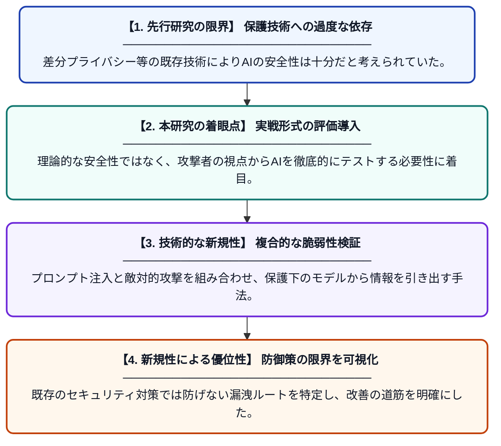

# セキュリティリスク：プロンプト注入、データ漏洩、および敵対的攻撃

**Original Title**: *Security Risks: Prompt Injection, Data Leakage, and Adversarial Attacks*

> **💡 一言要約**: AIの盾、差分プライバシーを突破する最新のリスクを解明

| 項目 | 内容 |
|---|---|
| **著者** | S Şaşal, Ö Can |
| **掲載誌** | AI-Enabled Digital Forensics and Cybersecurity |
| **アラートキーワード** | differential privacy |
| **原文リンク** | [https://api.taylorfrancis.com/content/chapters/edit/download?identifierName=doi&identifierValue=10.1201/9781003754824-16&type=chapterpdf](https://api.taylorfrancis.com/content/chapters/edit/download?identifierName=doi&identifierValue=10.1201/9781003754824-16&type=chapterpdf) |
| **PDF版要約** | [README.pdf](./README.pdf) |

---

## 📊 新規性の図解（先行研究との違いと本研究のブレークスルー）

## 📝 要約

本論文は、AIモデルにおけるプロンプト注入、データ漏洩、敵対的攻撃といった主要なセキュリティ脆弱性を包括的に分析しています。特に、差分プライバシー（DP）などの保護技術が導入されている環境下でも、レッドチーミング評価によって依然として機密データが漏洩するリスクがあることを実証しました。

## ❓ どんな問題に取り組んだか

AIの学習過程でプライバシーを保護するために「差分プライバシー」が利用されていますが、その有効性には限界があることが懸念されていました。特にプロンプト注入や最新の攻撃手法に対して、従来の防御策がどの程度機能し、どのような条件下でデータが漏洩するのかという実態が十分に解明されていませんでした。

## ✨ 何が新しい？何がすごい？（新規性）

本研究の新規性は、差分プライバシーが適用された最新のAIシステムに対し、レッドチーミングによる多角的な攻撃評価を行った点にあります。先行研究が理論的な防御に留まっていたのに対し、本論文は実用的な攻撃シナリオ（プロンプト注入など）を用いて、既存の防御壁が特定の条件下で容易に無効化されることを具体的に示しました。これにより、サイバーセキュリティの観点から次世代AI防御モデルの必要性を理論と実践の両面で裏付けています。

## 🎓 大学1年生向けの解説

AI（人工知能）は、人間が教えた秘密のデータをうっかり喋ってしまうことがあります。それを防ぐために「データをぼかして覚える（差分プライバシー）」という工夫がされていますが、この論文はその工夫が完璧ではないことを発見しました。例えば、AIを言葉巧みに誘導する攻撃を使うと、隠していたはずの情報が盗み出せてしまうのです。この研究は、AIをより安全に使うために、今の守り方をもっと強化しなければならないことを教えてくれています。
