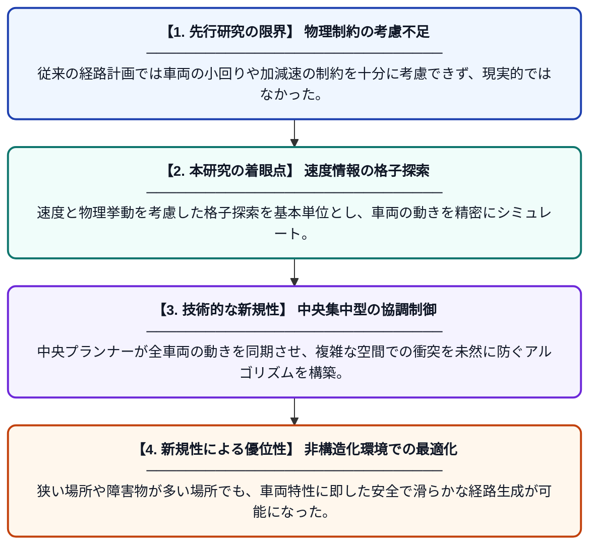

# MV*: 非構造化環境におけるキネダイナミクスを考慮したマルチエージェント経路計画アルゴリズム

**Original Title**: *MV*: A kinodynamic multi-agent path planning algorithm in unstructured environments*

> **💡 一言要約**: 狭い場所でも車同士がスムーズに避ける経路計画

| 項目 | 内容 |
|---|---|
| **著者** | AZ Andaryan, MGH Bell, M Ramezani, DG Geers |
| **掲載誌** | Transportation Research Part C … 2027 |
| **アラートキーワード** | multi agent |
| **原文リンク** | [https://www.sciencedirect.com/science/article/pii/S0968090X26006273](https://www.sciencedirect.com/science/article/pii/S0968090X26006273) |
| **PDF版要約** | [README.pdf](./README.pdf) |

---

## 📊 新規性の図解（先行研究との違いと本研究のブレークスルー）

## 📝 要約

非構造化環境において、車両特有の運動制約（キネダイナミクス）を持つ複数台の車両が、衝突を避けつつ協調して移動するための経路計画アルゴリズム「MV*」を提案しています。速度を考慮したシングルエージェントの格子探索をベースに、中央集中型の制御によって安全かつ効率的な経路生成を実現しています。

## ❓ どんな問題に取り組んだか

従来の経路計画では、車のような「急に真横に動けない」「加速・減速に時間がかかる」といった物理的制約を考慮しつつ、複数の車両が狭い空間で互いに衝突を避けるための計算を高速に行うことが困難でした。特に障害物が多い非構造化環境では、車両間の協調と計算負荷のバランスが大きな課題となっていました。

## ✨ 何が新しい？何がすごい？（新規性）

本研究の核心は、速度情報を組み込んだ格子探索（Lattice Search）をマルチエージェントの枠組みに統合した点にあります。車両のキネダイナミクスをモデル化しつつ、中央集中型のプランナーが各エージェントの軌道を調整することで、静的障害物だけでなく動的な他車両との衝突も回避可能です。これにより、現実の車両挙動に即した高精度な経路生成を、複雑な環境下で実現したことが主要な貢献です。

## 🎓 大学1年生向けの解説

駐車場や狭い路地のような場所で、何台もの車がぶつからずに目的地まで最短で進むための「賢い司令塔」を作る研究です。車は急には曲がれないし、急停止もできないという現実のルールを守りながら、コンピュータが全員分の動きをまとめて計算します。お互いに道を譲り合うようなスムーズな動きを自動で作れるのが、この技術のすごいところです。
