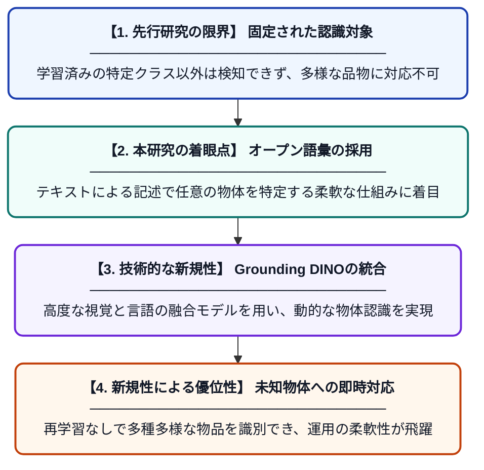

# Shareish連帯プラットフォームにおける動的な複数物体認識のためのディープラーニング

**Original Title**: *Deep Learning for Dynamic Multiple Object Recognition on the Shareish Solidarity Platform*

> **💡 一言要約**: 言葉で指示して未知の物体も検知する次世代AI

| 項目 | 内容 |
|---|---|
| **著者** | L Di Girolamo |
| **掲載誌** | 2026 |
| **アラートキーワード** | Open-Vocabulary Object ... |
| **原文リンク** | [https://matheo.uliege.be/handle/2268.2/26960](https://matheo.uliege.be/handle/2268.2/26960) |
| **PDF版要約** | [README.pdf](./README.pdf) |

---

## 📊 新規性の図解（先行研究との違いと本研究のブレークスルー）

## 📝 要約

連帯・共有プラットフォームにおいて、動的に変化する多種多様な物体を認識するためのディープラーニング手法を提案しています。従来型の「閉じたセット」の検知モデルと、Grounding DINOなどの「オープン語彙」モデルを比較し、未知の物体にも柔軟に対応できるシステムの構築を目指しました。

## ❓ どんな問題に取り組んだか

従来の物体検知モデルは、事前に学習させた特定のカテゴリしか認識できない「クローズドセット」という制約がありました。物品の貸し借りや寄付を行う動的なプラットフォームでは、流通する品物が多岐にわたるため、固定されたカテゴリだけでは対応しきれないという課題がありました。

## ✨ 何が新しい？何がすごい？（新規性）

本研究は、最新のオープン語彙物体検知モデル（Grounding DINO等）を共有プラットフォームに適用し、その有効性を実証した点に新規性があります。従来の再学習が必要な手法とは異なり、自然言語のプロンプトを入力するだけで未学習の物体を検知できるため、動的な環境下でのメンテナンスコストを劇的に削減しました。これにより、プラットフォームの拡張性と汎用性を大幅に向上させています。

## 🎓 大学1年生向けの解説

これまでのAIは、あらかじめ「これはリンゴ」「これはペン」と教えられたものしか見分けられませんでした。この研究では、最新の技術を使って「言葉で説明するだけで、教わっていない物でも見つけ出すAI」を開発・比較しています。これにより、リサイクルや助け合いのアプリなどで、どんな新しい道具が出てきても、AIが自動でそれが何かを正しく認識できるようになります。
