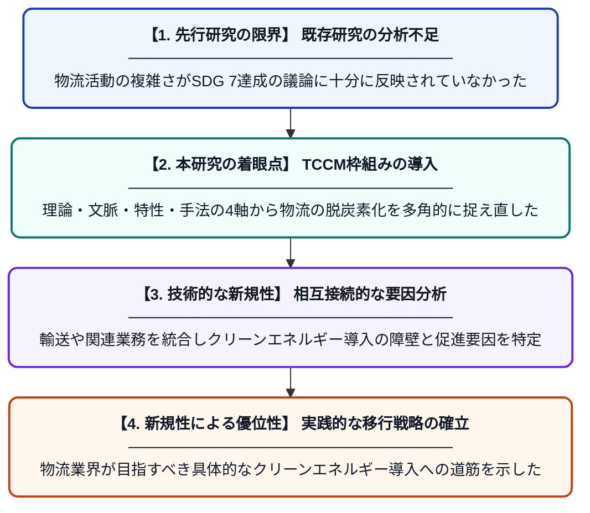

# 物流の脱炭素化：TCCM枠組みを通じたSDG 7達成におけるクリーンエネルギーの役割の解明

**Original Title**: *Decarbonizing Logistics: Unveiling the Role of Clean Energy in Achieving Sustainable Development Goal 7 Through a Theory–Context–Characteristics–Methodology …*

> **💡 一言要約**: 物流の脱炭素化とSDG 7達成の鍵を解明

| 項目 | 内容 |
|---|---|
| **著者** | S Mukherjee, RR Panigrahi, AB Jibril, MB Hossain |
| **掲載誌** | Sustainable Development 2026 |
| **アラートキーワード** | logistics |
| **原文リンク** | [https://onlinelibrary.wiley.com/doi/abs/10.1002/sd.71820](https://onlinelibrary.wiley.com/doi/abs/10.1002/sd.71820) |
| **PDF版要約** | [README.pdf](./README.pdf) |

---

## 📊 新規性の図解（先行研究との違いと本研究のブレークスルー）

## 📝 要約

本研究は、物流とサプライチェーンにおけるSDG 7（エネルギーをみんなに、そしてクリーンに）の達成に向けた主要な推進要因と障壁を調査したものです。TCCM（理論・文脈・特性・手法）フレームワークを用いて、輸送を含む相互に関連する物流活動におけるクリーンエネルギー導入の役割を明らかにしました。

## ❓ どんな問題に取り組んだか

従来の物流研究は、再生可能エネルギーやグリーン物流といった抽象的な概念に焦点を当てることが多く、SDG 7の具体的な達成に向けた障壁や促進要因が十分に特定されていませんでした。また、輸送などの複雑に絡み合う物流活動を統合的に捉えた多角的な分析が不足していました。

## ✨ 何が新しい？何がすごい？（新規性）

本研究は、TCCMフレームワークを適用することで、物流におけるSDG 7達成への道筋を多角的に分析した点が画期的です。単なるエネルギー論を超え、物流特有の相互接続された活動（輸送等）に焦点を当て、具体的な推進要因と阻害要因を整理しました。これにより、物流業界に特化したクリーンエネルギー移行の戦略的な指針を初めて体系化しています。

## 🎓 大学1年生向けの解説

ネット通販などで荷物を運ぶ「物流」は、多くの二酸化炭素を排出するため、地球温暖化の大きな原因の一つとなっています。この研究は、物流で使うエネルギーをどうやってクリーンなものに変えていくか、そのためのヒントや邪魔な壁を詳しく調べています。トラックだけでなく、倉庫や全体の仕組みをどう変えれば持続可能な社会に近づけるのかを分析しました。これを知ることで、未来のクリーンな輸送の姿が見えてきます。
