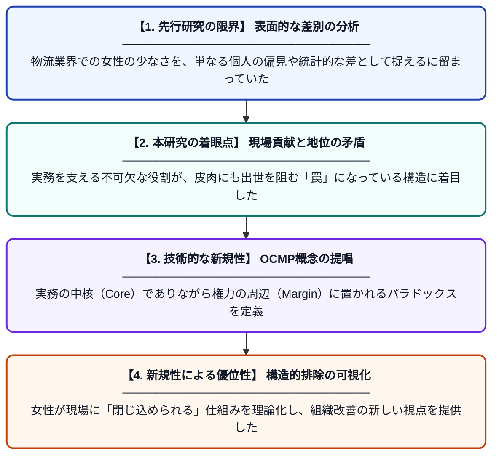

# トルコの物流業界におけるジェンダー・ナラティブと女性リーダーシップ

**Original Title**: *Gender narratives and female leadership in the Turkish logistics sector*

> **💡 一言要約**: 現場の主役なのに評価されない女性の矛盾を解明

| 項目 | 内容 |
|---|---|
| **著者** | A Arslan, E Isik, S Yener |
| **掲載誌** | RAE: Revista de Administracao de Empresas 2026 |
| **アラートキーワード** | logistics |
| **原文リンク** | [https://www.emerald.com/rae/article-abstract/66/3/17/1408873](https://www.emerald.com/rae/article-abstract/66/3/17/1408873) |
| **PDF版要約** | [README.pdf](./README.pdf) |

---

## 📊 新規性の図解（先行研究との違いと本研究のブレークスルー）

## 📝 要約

トルコの物流業界において、女性が実務の維持に不可欠な役割を果たしているにもかかわらず、なぜ戦略的に周辺へ追いやられているのかを調査した研究です。「オペレーショナル・コア・マージン・パラドックス（OCMP）」という独自の概念を用い、女性の貢献が評価に繋がらない構造を解明しています。

## ❓ どんな問題に取り組んだか

物流業界は伝統的に男性中心の文化が強く、女性は現場を支える重要な実務を担いながらも、意思決定の場などの組織の中核からは排除される傾向があります。この「実務上の不可欠さ」と「地位の周辺化」という矛盾が、どのような語り（ナラティブ）によって正当化されているのかが課題でした。

## ✨ 何が新しい？何がすごい？（新規性）

本研究の最大の貢献は、実務で不可欠な存在（コア）であることが、逆に組織の権力構造から遠ざけられる（マージン）原因となる「オペレーショナル・コア・マージン・パラドックス（OCMP）」という概念を提唱した点にあります。単なる個人の差別の問題ではなく、組織が女性の労働力を都合よく利用しながら、出世を阻むための構造的な仕組みを理論化しました。トルコの文脈を通じ、社会的な語りがいかに不平等を維持しているかを実証的に示した点が画期的です。

## 🎓 大学1年生向けの解説

物流の仕事は、社会の荷物を動かすとても大切な役割ですが、そこでは「女性が一生懸命働いているのに、なぜかリーダーになれない」という不思議な現象が起きています。この論文は、女性が現場で頑張って成果を出すほど、むしろ「現場に必要だから」という理由で、上の役職へ行くチャンスを奪われていることを明らかにしました。これを「現場の主役が、権力からは脇役にされる矛盾」と呼んでいます。この仕組みを理解することで、どうすれば公平な会社を作れるかを考えるヒントになります。
