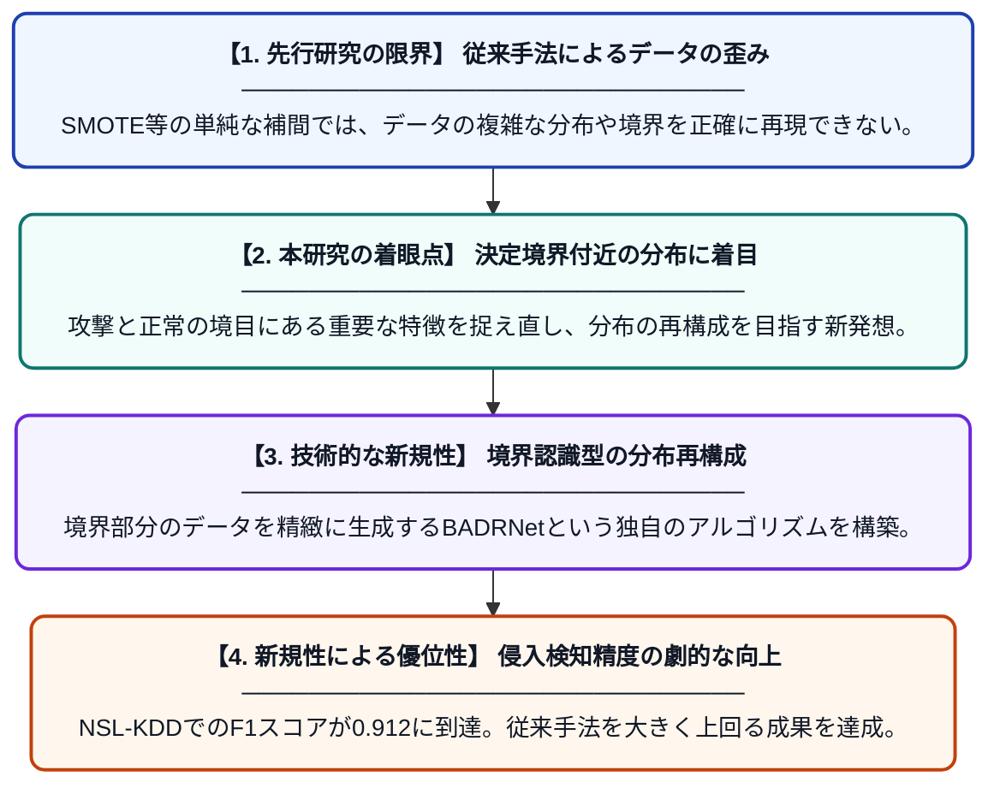

# BADRNet: 不均衡なネットワーク侵入検知のための境界を考慮した攻撃分布再構成

**Original Title**: *BADRNet: Boundary-Aware Attack Distribution Reconstruction for Imbalanced Network Intrusion Detection*

> **💡 一言要約**: 境界を捉えてサイバー攻撃を正確に見抜くAI技術

| 項目 | 内容 |
|---|---|
| **著者** | Z Xu, J Li, B Huang, R Li, Z Gu |
| **掲載誌** | International Conference on Advanced Data Mining … 2026 |
| **アラートキーワード** | SMOTE |
| **原文リンク** | [https://link.springer.com/chapter/10.1007/978-981-92-7744-5_21](https://link.springer.com/chapter/10.1007/978-981-92-7744-5_21) |
| **PDF版要約** | [README.pdf](./README.pdf) |

---

## 📊 新規性の図解（先行研究との違いと本研究のブレークスルー）

## 📝 要約

ネットワーク侵入検知における深刻なデータ不均衡問題を解決するため、攻撃データの境界線を考慮して分布を再構成する手法「BADRNet」を提案しました。従来手法が苦手としていた複雑なデータ分布を正確に捉えることで、検知精度を大幅に向上させています。

## ❓ どんな問題に取り組んだか

ネットワーク侵入検知では、正常通信に比べて攻撃データが極端に少ない「データ不均衡」が精度低下の大きな原因です。従来のデータ増強手法（SMOTEなど）は、単純な複製や線形補間に頼るため、複雑なデータの分布やクラス間の境界を正確に再現できないという課題がありました。

## ✨ 何が新しい？何がすごい？（新規性）

本研究は、データの「境界」を意識した分布再構成（Boundary-Aware Distribution Reconstruction）というアプローチを導入した点が画期的です。単にデータを増やすのではなく、攻撃と正常の決定境界付近の分布を精緻にモデリングすることで、より識別力の高い学習データを生成することに成功しました。これにより、NSL-KDDデータセットにおいてF1スコアを0.858から0.912へと大きく引き上げ、既存手法を圧倒する性能を証明しました。

## 🎓 大学1年生向けの解説

インターネットの悪い通信を見つけるAIは、お手本となる「攻撃データ」が少なすぎて学習が難しいという弱点があります。今までは似たようなデータを無理やり増やして補っていましたが、それだと「どこからが攻撃か」という境界線がぼやけてしまっていました。この研究では、その境界線を賢く見極めて、本物そっくりのデータを賢く作り出す方法を開発しました。これにより、AIがより正確に攻撃を見分けられるようになり、セキュリティが一段と強化されます。
