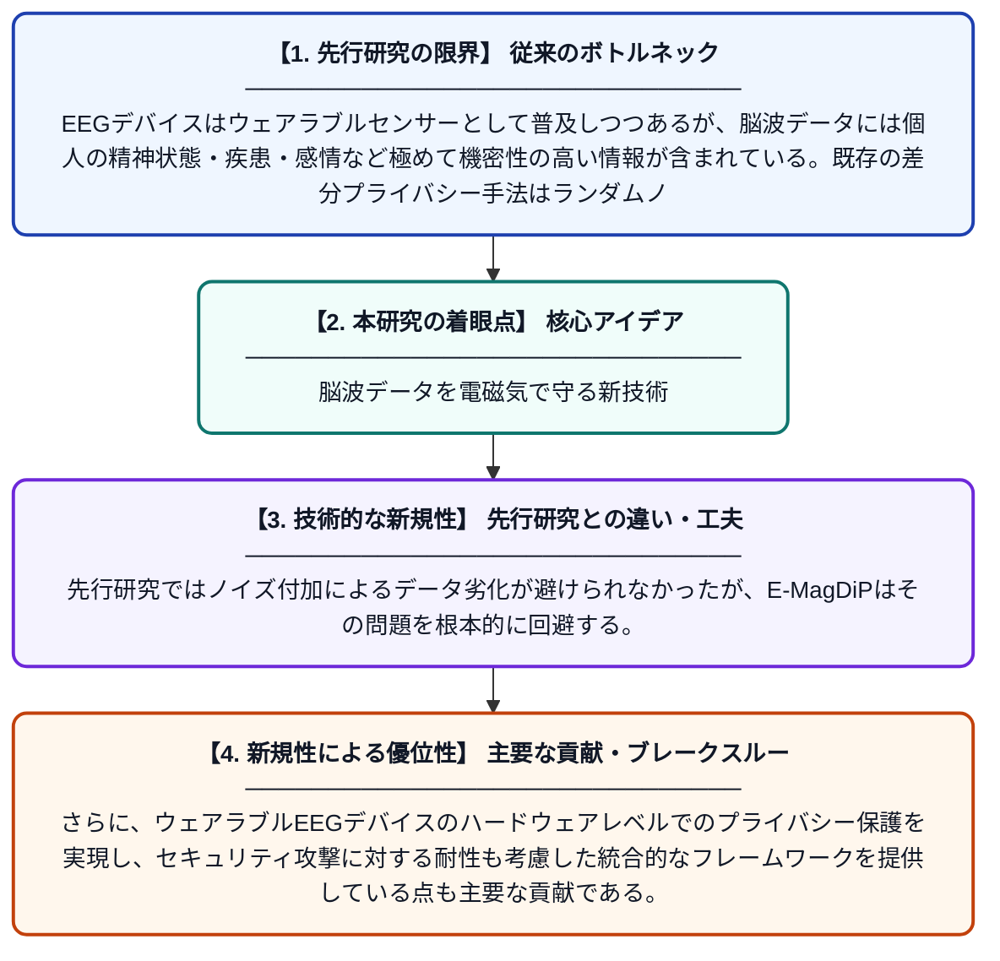

# E-MagDiP: EEGを用いたコミュニティセンシングのための電磁気ベース差分プライバシー

**Original Title**: *E-MagDiP: Electro-Magnetic based Differential Privacy for EEG based Community Sensing*

> **💡 一言要約**: 脳波データを電磁気で守る新技術

| 項目 | 内容 |
|---|---|
| **著者** | AIK Kalupahana, V Ranjan, LS Peh |
| **掲載誌** | arXiv preprint arXiv:2607.25968 2026 |
| **アラートキーワード** | differential privacy |
| **PDF** | [https://arxiv.org/pdf/2607.25968](https://arxiv.org/pdf/2607.25968) |
| **Git リポジトリ** | [https://github.com/kokke/tiny-AES-c](https://github.com/kokke/tiny-AES-c) |
| **原文リンク** | [https://arxiv.org/abs/2607.25968](https://arxiv.org/abs/2607.25968) |
| **PDF版要約** | [README.pdf](./README.pdf) |

---

## 📊 新規性の図解（先行研究との違いと本研究のブレークスルー）

## 📝 要約

本論文は、EEG（脳波）センサーを用いたウェアラブルコミュニティセンシングにおけるプライバシー保護の新手法「E-MagDiP」を提案する。従来の差分プライバシー手法で使用されるランダムノイズ生成に頼らず、電磁気的特性を活用してプライバシーを保護するアプローチを採用している。これにより、EEGデータから個人の機密情報が漏洩するリスクを低減しつつ、データの有用性を維持することを目指している。

## ❓ どんな問題に取り組んだか

EEGデバイスはウェアラブルセンサーとして普及しつつあるが、脳波データには個人の精神状態・疾患・感情など極めて機密性の高い情報が含まれている。既存の差分プライバシー手法はランダムノイズを付加するため、データの品質低下や計算コストの増大という問題があった。特にコミュニティセンシングのように多数のユーザーが関与する環境では、プライバシー攻撃への脆弱性も懸念されていた。

## ✨ 何が新しい？何がすごい？（新規性）

本研究の最大の新規性は、ランダムノイズを使わずに電磁気的特性を利用して差分プライバシーを実現する点にある。先行研究ではノイズ付加によるデータ劣化が避けられなかったが、E-MagDiPはその問題を根本的に回避する。さらに、ウェアラブルEEGデバイスのハードウェアレベルでのプライバシー保護を実現し、セキュリティ攻撃に対する耐性も考慮した統合的なフレームワークを提供している点も主要な貢献である。

## 🎓 大学1年生向けの解説

EEG（脳波計）は頭に装着して脳の電気的活動を測るセンサーで、最近はスマートウォッチのようにウェアラブルデバイスとして使われています。しかし脳波には病気や感情など個人の秘密が詰まっているため、データが漏れると大変危険です。この研究では、電磁気の性質を賢く使うことで、脳波データを外部から読み取れないように保護する新しい方法を開発しました。従来の方法はデータにわざとノイズ（乱数）を混ぜてごまかす手法でしたが、それだとデータの質が落ちてしまう欠点がありました。E-MagDiPはその欠点を解決し、プライバシーを守りながら正確なデータを使えるようにする技術です。
