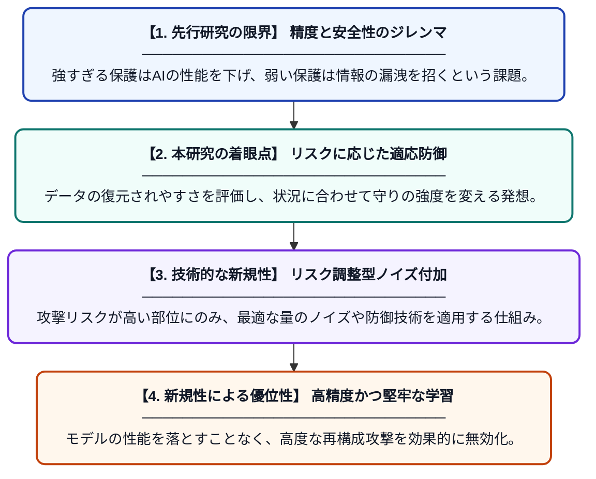

# 再構成攻撃に対するリスク調整型防御を用いた適応的プライバシー配慮型スプリット学習

**Original Title**: *Adaptive Privacy-Aware Split Learning with Risk-Calibrated Defense Against Reconstruction Attacks*

> **💡 一言要約**: リスクを予測して守る賢い分割学習

| 項目 | 内容 |
|---|---|
| **著者** | M Lakshmanan, R Sriramkumar, T Godhandaraman |
| **掲載誌** | IEEE World Skills … 2026 |
| **アラートキーワード** | differential privacy |
| **原文リンク** | [https://ieeexplore.ieee.org/abstract/document/11767195/](https://ieeexplore.ieee.org/abstract/document/11767195/) |
| **PDF版要約** | [README.pdf](./README.pdf) |

---

## 📊 新規性の図解（先行研究との違いと本研究のブレークスルー）

## 📝 要約

分散学習手法の一つであるスプリット学習において、中間データから元の情報を復元する「再構成攻撃」を防ぐ新しいフレームワークを提案しています。リスクに基づいてプライバシー保護の強度を動的に調整することで、データの安全性と学習モデルの精度の両立を実現しました。

## ❓ どんな問題に取り組んだか

スプリット学習では、クライアントからサーバーへ送る中間データから元の画像などが復元されるリスクがあります。従来の差分プライバシーなどの手法は、一律にノイズを加えるため、モデルの精度が大幅に低下したり通信負荷が増大したりする課題がありました。

## ✨ 何が新しい？何がすごい？（新規性）

本研究の核心は、攻撃による復元リスクをリアルタイムで評価し、それに応じて防御の強さを変える「リスク調整型防御」を導入した点にあります。先行研究が静的なノイズ付加に頼っていたのに対し、本手法はデータの脆弱性に合わせて適応的にノイズ量や暗号化を制御します。これにより、高い予測精度を維持しながら、再構成攻撃を効果的に阻止する「プライバシーと精度の最適化」を実現しました。

## 🎓 大学1年生向けの解説

AIを学習させる際、1台のPCではなく複数のPCで分担して作業する「スプリット学習」という方法がありますが、途中のデータから個人の秘密が盗まれる危険があります。この研究では、データの「盗まれやすさ」を自動で判定し、危ない時だけ強力なガードをかける仕組みを作りました。例えるなら、常に重い鎧を着るのではなく、危険な場所を通る時だけ盾を構えるような、効率的で賢い守り方です。これにより、安全を守りつつ、AIの性能も落とさずに学習ができるようになります。
