# 種を超えた神経変性：イヌの変性性脊髄症とヒトの筋萎縮性側索硬化症の相違点の分析

**Original Title**: *Neurodegeneration across species: analysis of the differences between canine degenerative myelopathy and human amyotrophic lateral sclerosis.*

> **💡 一言要約**: 犬と人の神経難病を比較し、共通の謎を解き明かす

| 項目 | 内容 |
|---|---|
| **著者** | JAO Pereira, JAO Pereira |
| **掲載誌** | 2026 |
| **アラートキーワード** | ALS |
| **原文リンク** | [https://www.cabidigitallibrary.org/doi/full/10.5555/20260523211](https://www.cabidigitallibrary.org/doi/full/10.5555/20260523211) |
| **PDF版要約** | [README.pdf](./README.pdf) |

---

## 📊 新規性の図解（先行研究との違いと本研究のブレークスルー）

```mermaid
%%{init: {'flowchart': {'wrappingWidth': 520, 'nodeSpacing': 18, 'rankSpacing': 28, 'padding': 14, 'curve': 'basis'}, 'themeVariables': {'fontSize': '14px'}}}%%
flowchart TD
    S1["<b>【1. 先行研究の限界】 マウスモデルの限界</b><br/>──────────────────────────────<br/>ALS研究でマウスの結果が人間にうまく通用しないという課題があった。"]
    S2["<b>【2. 本研究の着眼点】 大型哺乳類への着目</b><br/>──────────────────────────────<br/>人により近い自然発症の症状を持つ犬のDMを詳細な比較対象に選定した。"]
    S3["<b>【3. 技術的な新規性】 種横断的ゲノム解析</b><br/>──────────────────────────────<br/>SOD1変異による病態の共通点と種固有の相違点を分子レベルで分析した。"]
    S4["<b>【4. 新規性による優位性】 高精度な病態予測</b><br/>──────────────────────────────<br/>種固有の差異を考慮することで、人への臨床応用が可能な知見を得た。"]
    S1 --> S2
    S2 --> S3
    S3 --> S4
    style S1 fill:#EFF6FF,stroke:#1E40AF,stroke-width:2px,color:#111827,rx:8,ry:8
    style S2 fill:#F0FDFA,stroke:#0F766E,stroke-width:2px,color:#111827,rx:8,ry:8
    style S3 fill:#F5F3FF,stroke:#6D28D9,stroke-width:2px,color:#111827,rx:8,ry:8
    style S4 fill:#FFF7ED,stroke:#C2410C,stroke-width:2px,color:#111827,rx:8,ry:8
```

## 📝 要約

ヒトの筋萎縮性側索硬化症（ALS）とイヌの変性性脊髄症（DM）を比較し、共通するSOD1遺伝子変異がもたらす神経変性メカニズムを解明する研究です。両疾患の進行性運動障害における類似点と、種特有の病理学的相違を体系的に明らかにしました。

## ❓ どんな問題に取り組んだか

ALSとDMは共にSOD1遺伝子変異が関与する難病ですが、種の違いが病態にどう影響するかは不明確でした。治療法開発には、マウスモデルだけでなく、より人間に近い特徴を持つ大型動物モデルとの比較を通じた深い理解が必要とされていました。

## ✨ 何が新しい？何がすごい？（新規性）

従来のALS研究の主流であったマウスモデルではなく、自然発症するイヌのDMを比較対象に据えた点が画期的です。単なる症状の比較にとどまらず、SOD1変異が引き起こす分子レベルの反応における「種による違い」を具体的に定義しました。この貢献により、動物実験の成果をヒトの臨床へ応用する際の精度が飛躍的に向上しました。

## 🎓 大学1年生向けの解説

全身の筋肉が動かなくなる人間の難病「ALS」と、犬に起こる似た病気「DM」を比べる研究です。実は人間も犬も、同じ遺伝子の異常でこの病気になることがわかっています。この研究では、犬と人間でどこが似ていてどこが違うのかを詳しく調べることで、どちらにも効く新しい薬を見つけようとしています。種の違いを超えて共通する仕組みを知ることが、難病克服の鍵になります。
