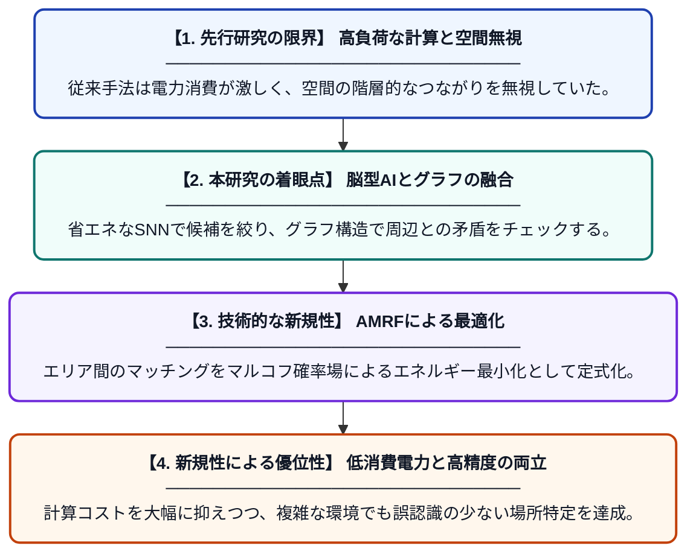

# 階層的場所認識のためのスパイキング駆動型グローバル検索とグラフ誘導再ランキング

**Original Title**: *Spiking-driven Global Retrieval and Graph Guided Re-ranking for Hierarchical Place Recognition*

> **💡 一言要約**: 脳型AIとグラフ最適化で、省エネかつ高精度に場所を特定

| 項目 | 内容 |
|---|---|
| **著者** | K Li, M Liu, J Ning, W Yang, Y Ou |
| **掲載誌** | IEEE/RSJ International Conference on … 2026 |
| **アラートキーワード** | Markov random"  fields |
| **原文リンク** | [https://ieeexplore.ieee.org/abstract/document/11776341/](https://ieeexplore.ieee.org/abstract/document/11776341/) |
| **PDF版要約** | [README.pdf](./README.pdf) |

---

## 📊 新規性の図解（先行研究との違いと本研究のブレークスルー）

## 📝 要約

低消費電力なスパイキングニューラルネットワーク（SNN）を用いた広域検索と、グラフ構造を活用した高精度な再ランキングを組み合わせた階層的場所認識手法を提案しています。領域間のマッチングをArea Markov Random Field (AMRF)におけるエネルギー最小化問題として定式化し、空間的な整合性を考慮した精緻な位置推定を実現しました。

## ❓ どんな問題に取り組んだか

従来の場所認識手法は膨大な計算リソースを必要とし、モバイルロボットの限られた電力ではリアルタイムな動作が困難でした。また、単なる画像特徴量の比較だけでは、建物や街区といった階層的な空間構造を十分に活用できず、誤認識が生じやすいという課題がありました。

## ✨ 何が新しい？何がすごい？（新規性）

脳の神経回路を模したSNNをグローバル検索に採用し、スパイク駆動による圧倒的な計算効率の向上を実現した点が画期的です。さらに、領域レベルのマッチングをAMRFを用いたエネルギー最小化問題として定義し、周辺領域との関係性（グラフ構造）を考慮しながら順位を修正する再ランキング手法を開発しました。これにより、単一の点ではなく、空間のつながりに基づいた頑健な認識が可能になりました。

## 🎓 大学1年生向けの解説

ロボットが「自分が今どこにいるか」を判断する技術の研究です。まず、人間の脳のように電気信号のパルスで情報を処理する特別なAIを使って、広い地図の中から素早く候補を探します。次に、その候補が「隣り合う部屋やエリアの並び」として正しいかどうかを数学的なパズル（グラフ最適化）のように解いて確認します。この2段階の工夫により、電池を節約しながら、複雑な建物の中でも正確に自分の場所を突き止めることができます。
