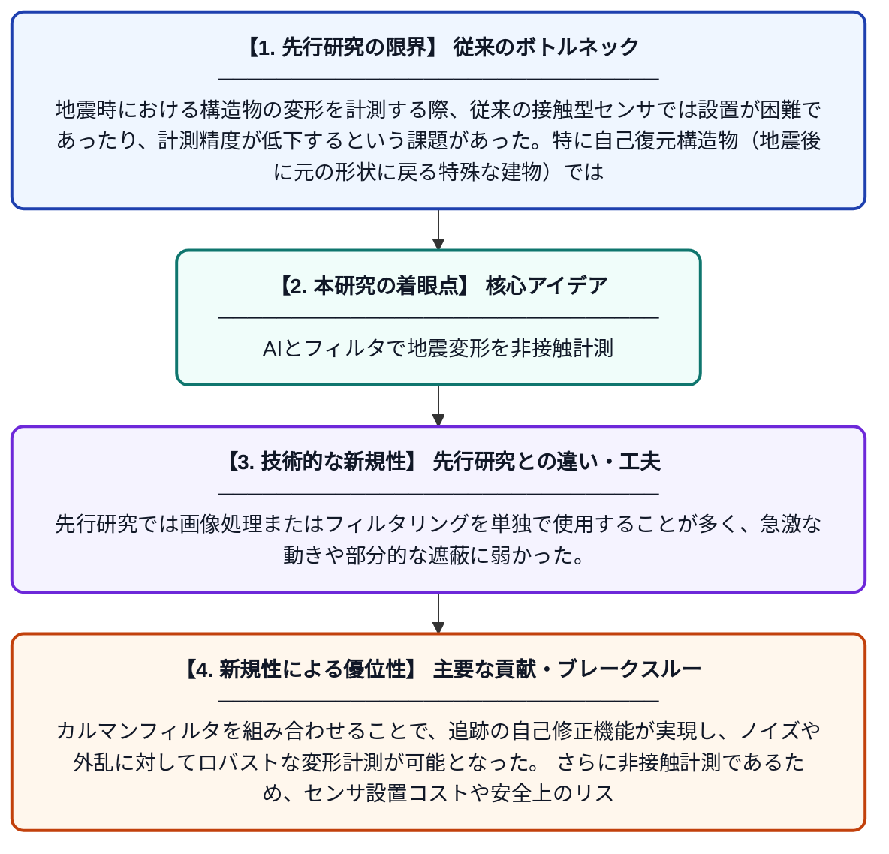

# 自己復元構造物の地震変形計測のためのカルマンフィルタ支援型ビジョントランスフォーマー

**Original Title**: *Kalman filter-aided vision transformer for seismic deformation measurement of self-centering structures*

> **💡 一言要約**: AIとフィルタで地震変形を非接触計測

| 項目 | 内容 |
|---|---|
| **著者** | F Hu, Y Duan, H Zhang, Y Fang, JJR Cheng |
| **掲載誌** | Mechanical Systems and Signal Processing 2026 |
| **アラートキーワード** | kalman filter |
| **原文リンク** | [https://www.sciencedirect.com/science/article/pii/S0888327026008332](https://www.sciencedirect.com/science/article/pii/S0888327026008332) |
| **PDF版要約** | [README.pdf](./README.pdf) |

---

## 📊 新規性の図解（先行研究との違いと本研究のブレークスルー）

## 📝 要約

本論文は、地震時における自己復元構造物の変形をカルマンフィルタとビジョントランスフォーマーを組み合わせたフレームワークによって非接触で高精度に計測する手法を提案している。トランスフォーマーベースのテンプレートと探索領域のマッチングにカルマンフィルタを統合することで、自己修正機能を持つ追跡システムを実現している。この手法により、従来のセンサ設置が困難な構造物に対しても信頼性の高い変形計測が可能となる。

## ❓ どんな問題に取り組んだか

地震時における構造物の変形を計測する際、従来の接触型センサでは設置が困難であったり、計測精度が低下するという課題があった。特に自己復元構造物（地震後に元の形状に戻る特殊な建物）では、大変形や複雑な動きが生じるため、正確な変形追跡が難しかった。また、ビジョンベースの手法単独では、オクルージョンや急激な動きによる追跡失敗が起こりやすかった。

## ✨ 何が新しい？何がすごい？（新規性）

本研究の新規性は、ビジョントランスフォーマーによる高精度な画像マッチングとカルマンフィルタによる状態推定を融合させた点にある。先行研究では画像処理またはフィルタリングを単独で使用することが多く、急激な動きや部分的な遮蔽に弱かった。カルマンフィルタを組み合わせることで、追跡の自己修正機能が実現し、ノイズや外乱に対してロバストな変形計測が可能となった。さらに非接触計測であるため、センサ設置コストや安全上のリスクを大幅に低減できる点も重要な貢献である。

## 🎓 大学1年生向けの解説

建物が地震でどれだけ動いたかを、カメラ映像だけで正確に測る技術です。AIの一種である「ビジョントランスフォーマー」が映像の中の建物を追いかけ、「カルマンフィルタ」という数学的な予測ツールが追跡ミスを自動で修正してくれます。センサーを建物に取り付けなくても計測できるため、危険な場所でも安全に使えます。特に、地震の後に自動的に元の形に戻る特殊な構造物を対象としており、その複雑な動きも高精度に捉えることができます。
