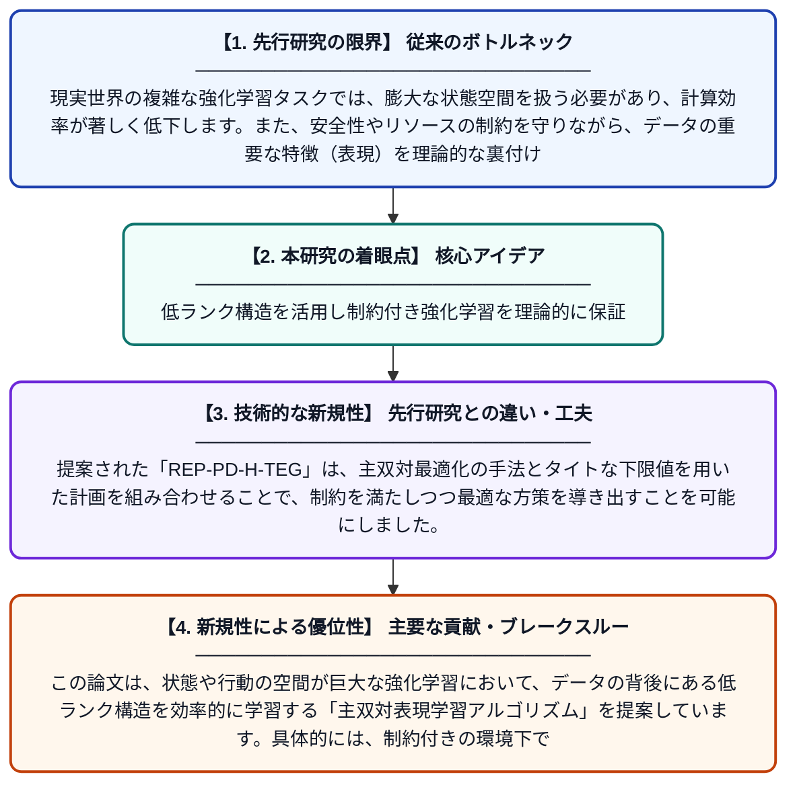

# 低ランク制約付きマルコフ決定過程における主双対表現学習

**Original Title**: *Primal-Dual Representation Learning for Low-Rank Constrained MDPs*

> **💡 一言要約**: 低ランク構造を活用し制約付き強化学習を理論的に保証

| 項目 | 内容 |
|---|---|
| **著者** | C Zhou, C Zhang, W Bai, H Zhao, H Qian |
| **掲載誌** | arXiv preprint arXiv:2610.30756 2026 |
| **アラートキーワード** | representation learning |
| **PDF** | [https://arxiv.org/pdf/2610.30756](https://arxiv.org/pdf/2610.30756) |
| **原文リンク** | [https://arxiv.org/pdf/2610.30756](https://arxiv.org/pdf/2610.30756) |
| **PDF版要約** | [README.pdf](./README.pdf) |

---

## 📊 新規性の図解（先行研究との違いと本研究のブレークスルー）

## 📝 要約

この論文は、状態や行動の空間が巨大な強化学習において、データの背後にある低ランク構造を効率的に学習する「主双対表現学習アルゴリズム」を提案しています。具体的には、制約付きの環境下でも理論的な性能保証を持つ手法を開発し、複雑なタスクにおける学習効率の向上を実現しました。

## ❓ どんな問題に取り組んだか

現実世界の複雑な強化学習タスクでは、膨大な状態空間を扱う必要があり、計算効率が著しく低下します。また、安全性やリソースの制約を守りながら、データの重要な特徴（表現）を理論的な裏付けを持って学習することは、これまで困難な課題とされてきました。

## ✨ 何が新しい？何がすごい？（新規性）

本研究は、低ランク制約付きマルコフ決定過程において、理論的に保証された初の表現学習アルゴリズムを提案した点が画期的です。提案された「REP-PD-H-TEG」は、主双対最適化の手法とタイトな下限値を用いた計画を組み合わせることで、制約を満たしつつ最適な方策を導き出すことを可能にしました。

## 🎓 大学1年生向けの解説

AIがチェスやロボットの操作を学ぶとき、すべての情報をそのまま覚えるのは大変です。この研究では、複雑な情報の中から「本当に大事なエッセンス（低ランク構造）」だけを抜き出し、賢く学習する方法を作りました。さらに、決められたルールをしっかり守りながら学習ができることを、数学の力を使って世界で初めて証明したのがこの論文のすごいところです。
