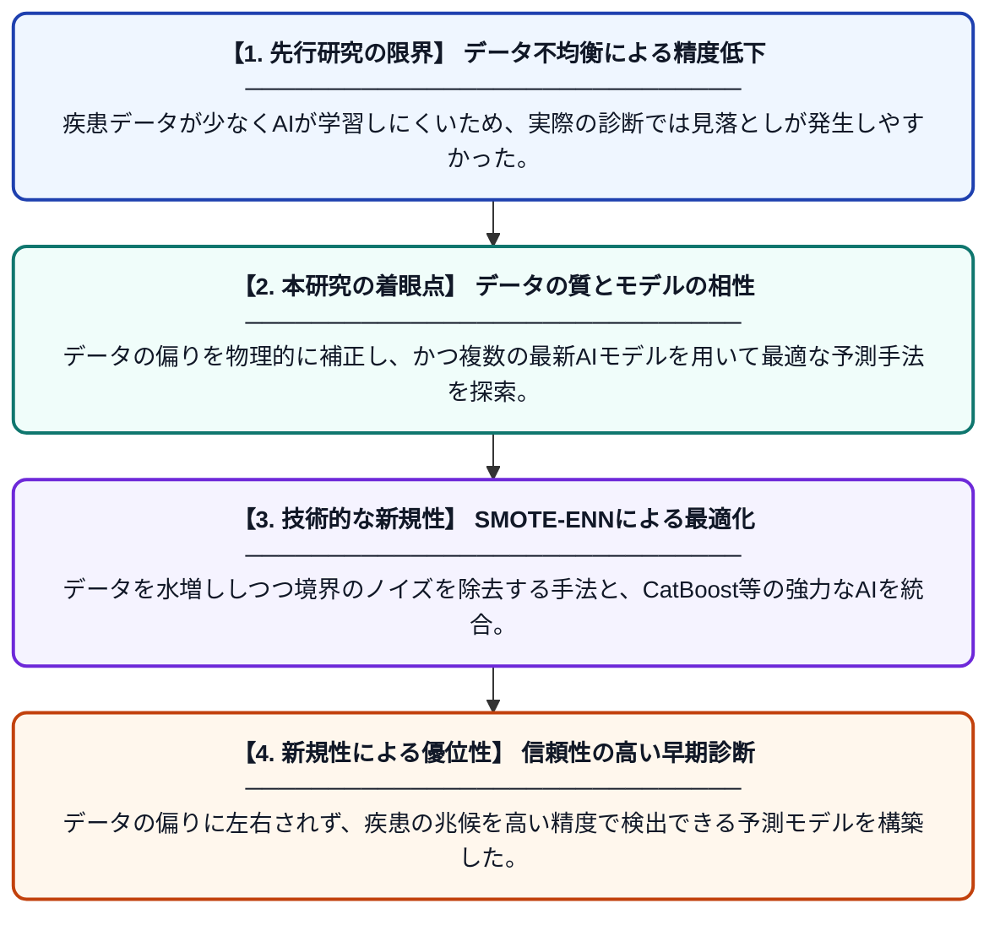

# MLP、AdaBoost、CatBoostとSMOTE-ENNを組み合わせた肝疾患予測の比較研究

**Original Title**: *Comparison of MLP, AdaBoost, and CatBoost with SMOTE–ENN for Liver Disease Prediction*

> **💡 一言要約**: 不均衡データを克服し、肝疾患をAIで高精度に予測

| 項目 | 内容 |
|---|---|
| **著者** | MS Kurniawan, M Akrom |
| **掲載誌** | SISTEMASI 2026 |
| **アラートキーワード** | SMOTE |
| **PDF** | [https://sistemasi.ftik.unisi.ac.id/index.php/stmsi/article/download/7034/1461](https://sistemasi.ftik.unisi.ac.id/index.php/stmsi/article/download/7034/1461) |
| **原文リンク** | [https://sistemasi.ftik.unisi.ac.id/index.php/stmsi/article/download/7034/1461](https://sistemasi.ftik.unisi.ac.id/index.php/stmsi/article/download/7034/1461) |
| **PDF版要約** | [README.pdf](./README.pdf) |

---

## 📊 新規性の図解（先行研究との違いと本研究のブレークスルー）

## 📝 要約

肝疾患の早期診断を目的として、データ不均衡を解消するSMOTE-ENN手法と、MLP、AdaBoost、CatBoostという3つの機械学習モデルを組み合わせた予測精度を比較した研究です。医療データの偏りを補正することで、診断の信頼性を向上させる最適なアルゴリズムの特定を試みています。

## ❓ どんな問題に取り組んだか

肝疾患は世界的に高い死亡率を伴う深刻な健康課題であり、早期診断が極めて重要です。しかし、診断に用いるデータセットは疾患の有無に大きな偏り（データ不均衡）があることが多く、従来の機械学習モデルでは少数派である疾患ありの判定精度が低くなるという課題がありました。

## ✨ 何が新しい？何がすごい？（新規性）

本研究の新規性は、データの不均衡を解消するためにSMOTE（オーバーサンプリング）とENN（アンダーサンプリング）を組み合わせたSMOTE-ENN手法を導入し、データの偏りとノイズを同時に処理した点にあります。その上で、ニューラルネットワーク（MLP）と2種類のブースティング手法（AdaBoost、CatBoost）を比較検証し、肝疾患予測における各モデルの特性と最適な組み合わせを具体的に示しました。特にCatBoostのような最新のアルゴリズムが、不均衡補正後の医療データに対して高い汎用性を持つことを証明した点が大きな貢献です。

## 🎓 大学1年生向けの解説

この研究は、AIを使って「健康診断の結果から肝臓の病気を見つける」精度を高めるためのものです。実は、AIに学習させるデータは「病気ではない人」が圧倒的に多く、AIが「とりあえず全員健康と答えれば正解率が高くなる」と勘違いしてしまう問題がありました。そこで、データを人工的に増やしたり、紛らわしいデータを取り除いたりする工夫をして、AIが「病気の人」を正確に見つけられるようにしました。色々なAIの種類を試した結果、どの方法が一番賢く診断できるかを明らかにしています。
