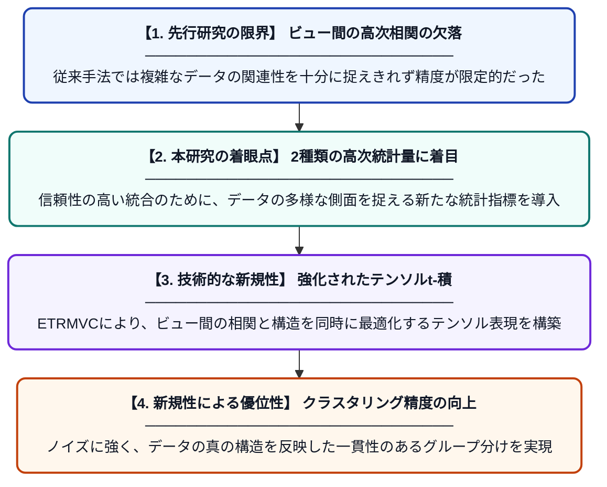

# マルチビュークラスタリングのための強化されたテンソルt-積表現

**Original Title**: *Enhanced Tensorial t-Product Representation for Multi-View Clustering*

> **💡 一言要約**: テンソルt-積で複数の視点を高度に統合

| 項目 | 内容 |
|---|---|
| **著者** | H Wang, J Pan, Y Gao, H Zhang, J Chen, H Cai |
| **掲載誌** | IEEE Transactions on Emerging … 2026 |
| **アラートキーワード** | representation learning |
| **原文リンク** | [https://ieeexplore.ieee.org/abstract/document/11795153/](https://ieeexplore.ieee.org/abstract/document/11795153/) |
| **PDF版要約** | [README.pdf](./README.pdf) |

---

## 📊 新規性の図解（先行研究との違いと本研究のブレークスルー）

## 📝 要約

複数のデータソースを統合するマルチビュークラスタリングにおいて、テンソルt-積を用いた新しい表現学習手法「ETRMVC」を提案しています。この手法は、信頼性の高い統合のために2種類の高次統計情報を抽出し、ビュー間の複雑な相関関係を効果的に捉えることができます。

## ❓ どんな問題に取り組んだか

従来のマルチビュークラスタリングでは、異なる視点（ビュー）間の複雑な高次相関を十分に捉えきれず、ノイズや冗長な情報に対して脆弱であるという課題がありました。特に、データの多様な構造を維持しながら、信頼性の高い一貫した表現を抽出することが困難でした。

## ✨ 何が新しい？何がすごい？（新規性）

本研究は、テンソルt-積表現を強化したETRMVCを提案し、2種類の高次統計情報を同時に抽出することで、より精緻なデータ統合を実現しました。従来のテンソル分解手法に比べ、ビュー固有の特性と共通の構造をより柔軟に分離・統合できる点が画期的です。これにより、複雑なデータセットにおいても高いクラスタリング精度と頑健性を達成しています。

## 🎓 大学1年生向けの解説

スマートフォンのカメラ画像、音声、テキストなど、同じ対象を違う方法で記録したデータを「マルチビューデータ」と呼びます。この論文は、それらのバラバラな情報をテンソル（多次元の表のようなもの）を使って、数学的に上手く一つのまとまりにする新しい方法を開発しました。これまでは情報の繋がりを見落とすことがありましたが、この方法なら複雑な関係もしっかり捉えて、正確にデータをグループ分けできます。
