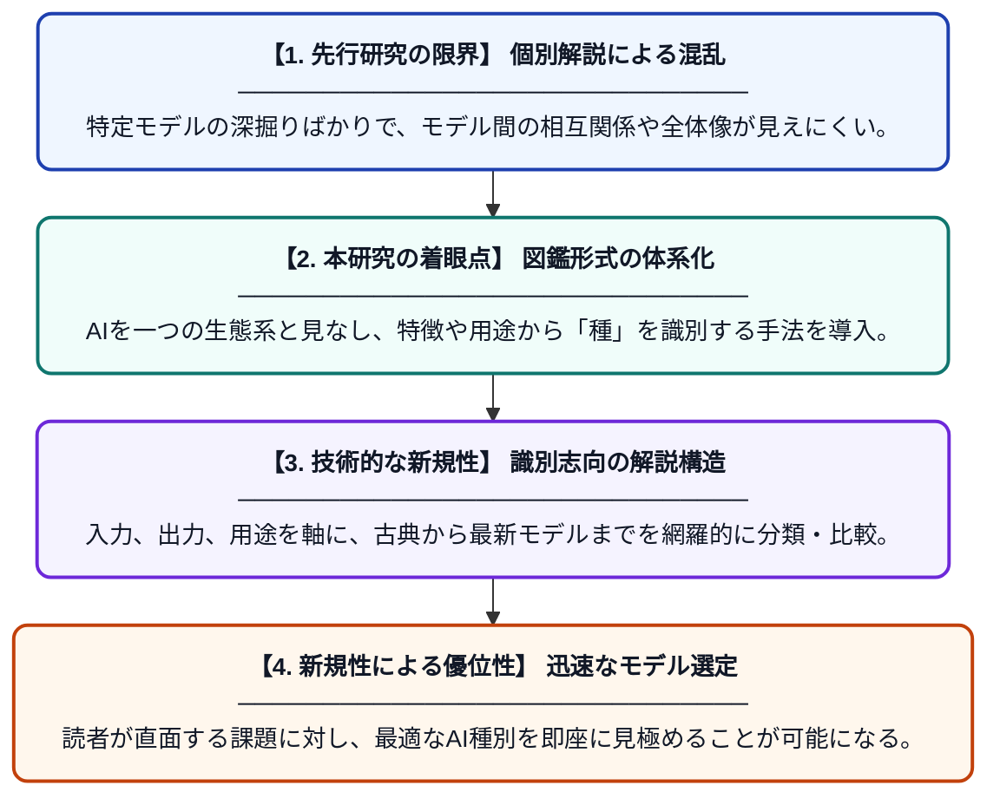

# AIモデル・フィールドガイド：線形回帰からマルチモーダル基盤モデルまで、主要なAI種別の独立巡回ガイド

**Original Title**: *A Field Guide to AI Model Types: An Independent Tour of the Major Kinds of AI Model, from Linear Regression to Multimodal Foundation Models*

> **💡 一言要約**: 複雑なAIの生態系をパッと見分けられる「AI図鑑」

| 項目 | 内容 |
|---|---|
| **著者** | SK Rajendran |
| **アラートキーワード** | Markov random"  fields |
| **原文リンク** | [https://books.google.com/books?hl=ja&lr=lang_ja|lang_en&id=BicyEgAAQBAJ&oi=fnd&pg=PP1&dq="Markov+random"++fields&ots=gH3KAyRD9a&sig=4oU8ZCnIRZFGqT63pmsAGafKu0g](https://books.google.com/books?hl=ja&lr=lang_ja|lang_en&id=BicyEgAAQBAJ&oi=fnd&pg=PP1&dq="Markov+random"++fields&ots=gH3KAyRD9a&sig=4oU8ZCnIRZFGqT63pmsAGafKu0g) |
| **PDF版要約** | [README.pdf](./README.pdf) |

---

## 📊 新規性の図解（先行研究との違いと本研究のブレークスルー）

## 📝 要約

古典的な線形回帰から最新のマルチモーダル基盤モデルまで、多種多様なAIモデルを「動物図鑑」のように体系化したガイドブックです。各モデルの特徴、生息地（用途）、入力データ（エサ）を整理し、似たモデル同士を素早く見分けるための実践的な視点を提供します。

## ❓ どんな問題に取り組んだか

AI技術の急速な発展により、膨大な数のモデルが乱立し、初心者や実務家がそれぞれの役割や違いを把握することが困難になっています。特定の技術を深く掘り下げる資料は多いものの、全体像を俯瞰し、適切なモデルを識別するための包括的な地図が不足していました。

## ✨ 何が新しい？何がすごい？（新規性）

本研究（書籍）は、AIモデルを一つの「生態系」として捉え、野外図鑑（フィールドガイド）の形式で体系化した点が画期的です。数学的な詳細に埋没するのではなく、各モデルの「識別ポイント」に焦点を当て、古典的手法と最新の生成AIを地続きで解説しています。これにより、読者は膨大なAIの「種」の中から、特定の課題に対してどのモデルが最適かを迅速に判断できる能力を得られます。

## 🎓 大学1年生向けの解説

AIの世界には、計算が得意なものや絵を描くのが得意なものなど、たくさんの種類があります。この本は、それらを動物図鑑のように整理して、それぞれの特徴や使い道をわかりやすく教えてくれるガイドです。難しい数式を覚える前に、「このAIは何が得意なのか」という全体像を掴むことができます。似ているけれど違うAIの見分け方もわかるので、AIの勉強を始める時の最初の地図として最適です。
