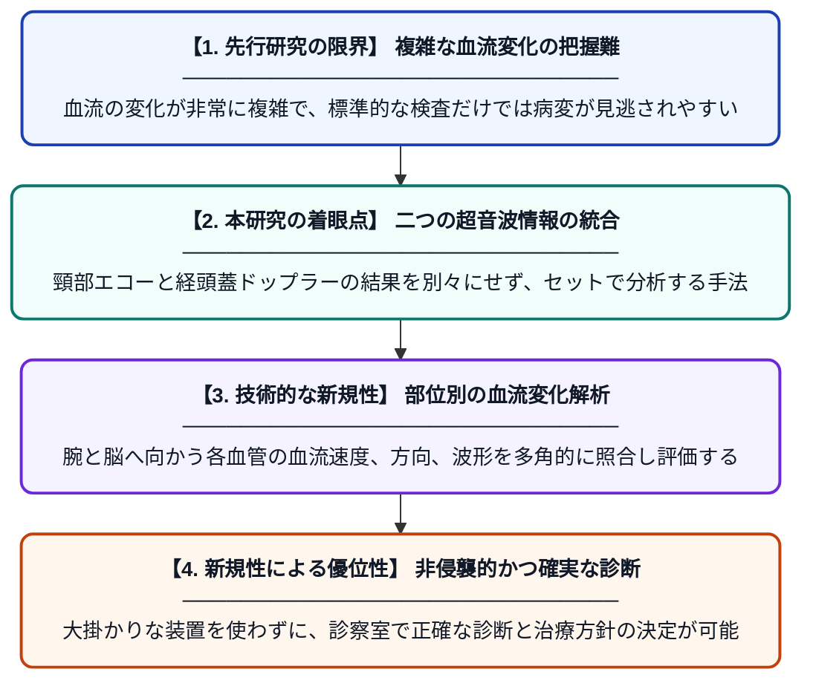

# 腕頭動脈狭窄症の超音波診断：頸部と経頭蓋ドップラーの統合的アプローチ

**Original Title**: *Ultrasonographic Clues to Innominate Artery Stenosis: Integration of Extracranial Duplex and Transcranial Doppler Findings in Two Cases*

> **💡 一言要約**: 超音波の統合評価で腕頭動脈の狭窄を見抜く

| 項目 | 内容 |
|---|---|
| **著者** | GD Oikonomou, I Cholis, I Liampas, D Veltsista… |
| **掲載誌** | Journal of Clinical … 2026 |
| **アラートキーワード** | ICA |
| **原文リンク** | [https://onlinelibrary.wiley.com/doi/abs/10.1002/jcu.70476](https://onlinelibrary.wiley.com/doi/abs/10.1002/jcu.70476) |
| **PDF版要約** | [README.pdf](./README.pdf) |

---

## 📊 新規性の図解（先行研究との違いと本研究のブレークスルー）

## 📝 要約

稀ながら重大な脳血管不全を招く腕頭動脈狭窄症の診断において、超音波検査の重要性を示した症例報告です。頸部超音波と経頭蓋ドップラーの所見を組み合わせることで、複雑な血行動態の変化を正確に捉える診断プロセスを解説しています。

## ❓ どんな問題に取り組んだか

腕頭動脈狭窄症は血行動態が複雑であり、従来のスクリーニング検査では病態を見逃したり過小評価したりするリスクがありました。特に、どの血流指標をどのように組み合わせれば、外来レベルの超音波検査で確実な診断に繋がるかが明確ではありませんでした。

## ✨ 何が新しい？何がすごい？（新規性）

本研究の新規性は、頸部の血管エコー（頸部デュプレックス法）と頭蓋内のドップラー検査（TCD）という、異なる部位の超音波情報を統合して解釈する具体的な臨床フローを提示した点にあります。単一の部位での血流測定に留まらず、脳へ向かう血流の方向や側副血行路のパターンの変化を多角的に分析する手法を確立しました。これにより、高価なCT血管造影や侵襲的なカテーテル検査を行う前に、高い精度で腕頭動脈の病変を特定できることを証明しました。

## 🎓 大学1年生向けの解説

心臓から右腕と脳へと血液を送る「腕頭動脈」が狭くなると、脳への血流が不足してしまいます。この論文では、体の外から超音波を当てる「エコー検査」を工夫して、この病気を見つける方法を解説しています。首の血管だけでなく、頭の中の血管の血流も同時に調べることで、血液が逆流したり速度が変わったりする「隠れたサイン」を読み解きます。特別な手術なしで、音波だけで血管の詰まり具合を予測できるという素晴らしい研究です。
