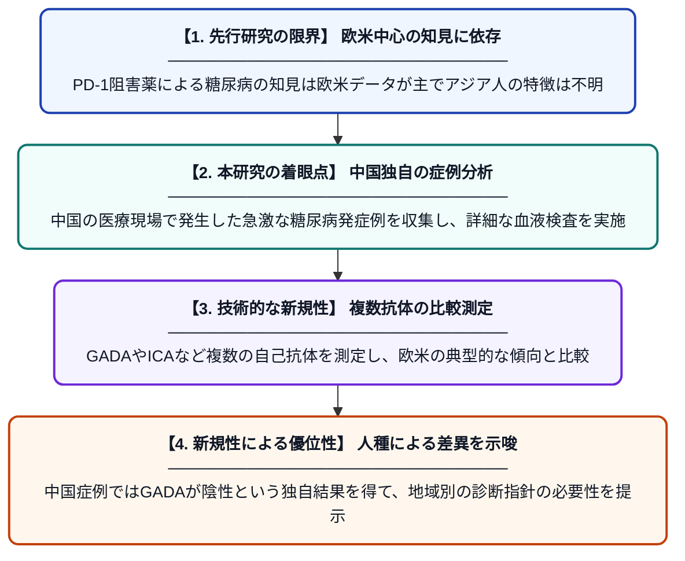

# 急激に発症する1型糖尿病と糖尿病ケトアシドーシス：中国におけるPD-1阻害薬に関連した内分泌毒性の症例集

**Original Title**: *Rapid-onset type 1 diabetes mellitus and diabetic ketoacidosis: A case series of programmed cell death 1 inhibitor-associated endocrine toxicity in ChinaFour case …*

> **💡 一言要約**: 抗がん剤による急激な糖尿病、中国での特有な抗体傾向を報告

| 項目 | 内容 |
|---|---|
| **著者** | H Mao, X Jiang, X Huang, J Fang, Y Mao, L Hong |
| **掲載誌** | Medicine 2026 |
| **アラートキーワード** | ICA |
| **原文リンク** | [https://www.ovid.com/jnls/md-journal/abstract/10.1097/md.0000000000051420~rapid-onset-type-1-diabetes-mellitus-and-diabetic](https://www.ovid.com/jnls/md-journal/abstract/10.1097/md.0000000000051420~rapid-onset-type-1-diabetes-mellitus-and-diabetic) |
| **PDF版要約** | [README.pdf](./README.pdf) |

---

## 📊 新規性の図解（先行研究との違いと本研究のブレークスルー）

## 📝 要約

免疫チェックポイント阻害薬（PD-1阻害薬）によるがん治療中に、急激な1型糖尿病と糖尿病ケトアシドーシスを発症した中国の4症例を分析しました。欧米で一般的とされるGADA抗体が見られず、アジア人特有の免疫反応パターンが存在する可能性を報告しています。

## ❓ どんな問題に取り組んだか

がん治療に革命をもたらしたPD-1阻害薬ですが、副作用として自分の膵臓を攻撃し、短期間で重篤な1型糖尿病を引き起こす「内分泌毒性」が問題となっています。特にアジア人患者における自己抗体の出現傾向や臨床的特徴については、欧米のデータと異なる可能性があり、詳細な調査が求められていました。

## ✨ 何が新しい？何がすごい？（新規性）

本研究の新規性は、中国の患者群において欧米の先行研究とは異なる自己抗体プロフィールを特定した点にあります。欧米ではGADA（グルタミン酸脱炭酸酵素抗体）の陽性率が高いのに対し、本症例群ではGADAは全例陰性であり、代わりにICA（膵島細胞抗体）のみが一部で陽性となりました。これは、薬剤誘発性糖尿病のメカニズムに人種的・遺伝的な背景が関与している可能性を具体的に示す重要な知見です。

## 🎓 大学1年生向けの解説

がんを治すための最新の薬が、まれに副作用として「突然の糖尿病」を引き起こすことがあります。この研究では、中国でその副作用が起きた4人の患者さんを詳しく調べました。すると、欧米の人たちに多く見られる特定の異常（抗体）が中国の患者さんには見られないという、興味深い違いが見つかりました。この発見は、人種に合わせた副作用のチェック方法を作るための第一歩になります。
