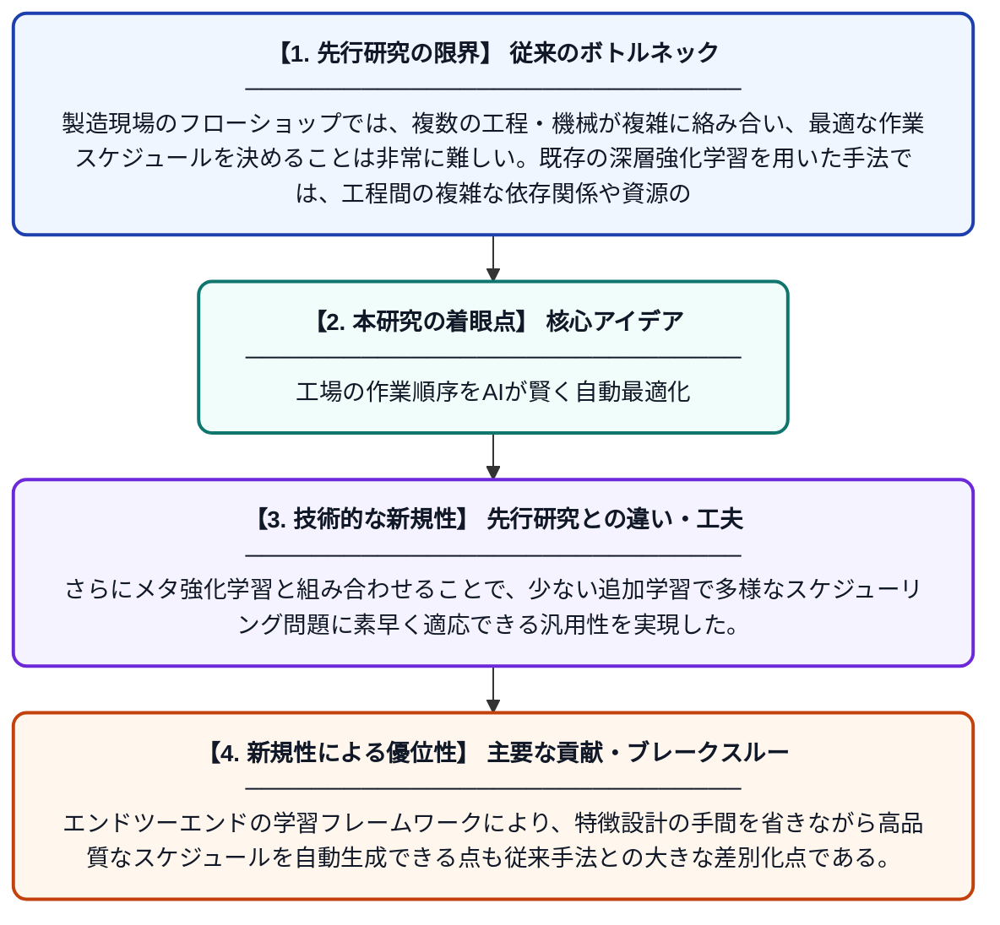

# 競合認識グラフメタ強化学習によるフローショップの効率的・汎用的スケジューリング

**Original Title**: *Efficient and generalized scheduling for flow shops via contention-aware graph meta-reinforcement learning*

> **💡 一言要約**: 工場の作業順序をAIが賢く自動最適化

| 項目 | 内容 |
|---|---|
| **著者** | S Wang, Q Liu, L Gao, X Li |
| **掲載誌** | Applied Soft Computing 2026 |
| **アラートキーワード** | reinforcement |
| **原文リンク** | [https://www.sciencedirect.com/science/article/pii/S1568494626015334](https://www.sciencedirect.com/science/article/pii/S1568494626015334) |
| **PDF版要約** | [README.pdf](./README.pdf) |

---

## 📊 新規性の図解（先行研究との違いと本研究のブレークスルー）

## 📝 要約

本論文は、フローショップにおける複雑な工程間の依存関係や競合を十分に捉えられていなかった従来の深層強化学習ベースのスケジューリング手法の課題に取り組む。競合を考慮したグラフ表現とメタ強化学習を組み合わせたエンドツーエンドの手法を提案し、多様なスケジューリング問題に対して効率的かつ汎用的に対応できる仕組みを構築した。これにより、新たな問題設定への素早い適応と高品質なスケジュール生成を両立することを目指している。

## ❓ どんな問題に取り組んだか

製造現場のフローショップでは、複数の工程・機械が複雑に絡み合い、最適な作業スケジュールを決めることは非常に難しい。既存の深層強化学習を用いた手法では、工程間の複雑な依存関係や資源の競合を十分に表現できておらず、スケジューリング品質や汎用性に限界があった。特に未知の問題設定に対して迅速かつ高精度に対応することが困難であった。

## ✨ 何が新しい？何がすごい？（新規性）

本研究では、工程間の「競合」を明示的にグラフ構造としてモデル化する競合認識グラフ表現を新たに導入し、従来手法では見逃されていた相互依存関係を精緻に捉えることを可能にした。さらにメタ強化学習と組み合わせることで、少ない追加学習で多様なスケジューリング問題に素早く適応できる汎用性を実現した。エンドツーエンドの学習フレームワークにより、特徴設計の手間を省きながら高品質なスケジュールを自動生成できる点も従来手法との大きな差別化点である。

## 🎓 大学1年生向けの解説

工場では、たくさんの製品を複数の機械で順番に加工する作業（フローショップ）があり、どの順番で作業すれば一番効率が良いかを決めるのがスケジューリングです。この問題はとても複雑で、コンピュータが自動的に良い答えを出すのが難しいとされています。この研究では、作業同士の「ぶつかり合い（競合）」をグラフという図で表現し、AIが状況をよりよく理解できるようにしました。さらに「メタ学習」という技術を使って、一度学習したAIが新しい工場の問題にも素早く対応できるようにしています。これにより、工場の生産効率を高める賢いスケジューリングシステムの実現に近づきました。
