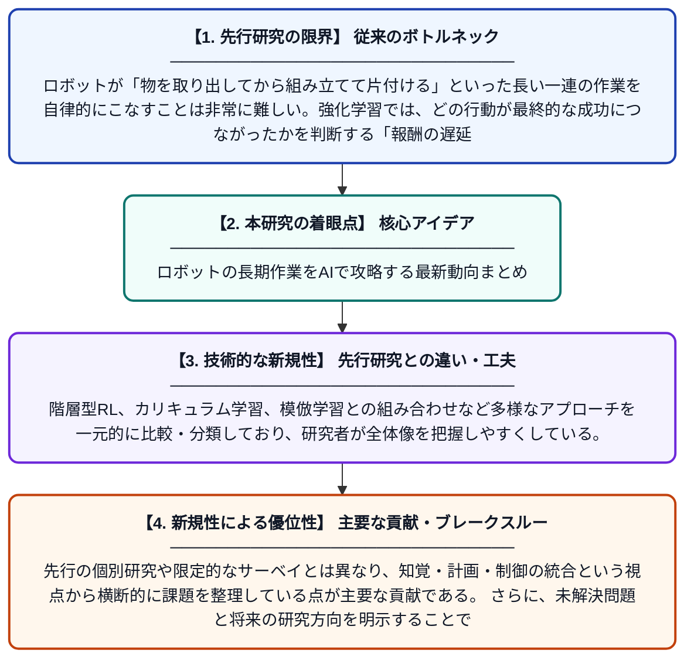

# 長期的ロボット操作のための強化学習手法に関するスコーピングレビュー

**Original Title**: *A scoping review of reinforcement learning methods for long horizon robotic manipulation*

> **💡 一言要約**: ロボットの長期作業をAIで攻略する最新動向まとめ

| 項目 | 内容 |
|---|---|
| **著者** | M Acs, X Zhong |
| **掲載誌** | Discover Robotics 2026 |
| **アラートキーワード** | reinforcement |
| **原文リンク** | [https://link.springer.com/article/10.1007/s44430-026-00037-1](https://link.springer.com/article/10.1007/s44430-026-00037-1) |
| **PDF版要約** | [README.pdf](./README.pdf) |

---

## 📊 新規性の図解（先行研究との違いと本研究のブレークスルー）

## 📝 要約

本論文は、長期的なロボット操作タスクに対する強化学習（RL）手法を体系的にレビューしたスコーピングレビューである。多段階意思決定、報酬の遅延、知覚・計画・制御の統合といった根本的な課題を整理し、既存手法の傾向と限界を明らかにしている。これにより、今後の研究方向性や未解決問題についての包括的な見取り図を提供している。

## ❓ どんな問題に取り組んだか

ロボットが「物を取り出してから組み立てて片付ける」といった長い一連の作業を自律的にこなすことは非常に難しい。強化学習では、どの行動が最終的な成功につながったかを判断する「報酬の遅延」や、多くの段階にわたる計画立案が大きな障壁となっている。また、視覚認識・計画・物理制御を長時間にわたって統合する点も未解決の課題として残っている。

## ✨ 何が新しい？何がすごい？（新規性）

本研究は、長期的ロボット操作に特化した強化学習手法を幅広く横断的に整理した初期的なスコーピングレビューである点が新しい。階層型RL、カリキュラム学習、模倣学習との組み合わせなど多様なアプローチを一元的に比較・分類しており、研究者が全体像を把握しやすくしている。先行の個別研究や限定的なサーベイとは異なり、知覚・計画・制御の統合という視点から横断的に課題を整理している点が主要な貢献である。さらに、未解決問題と将来の研究方向を明示することで、分野全体の進展を加速する基盤を提供している。

## 🎓 大学1年生向けの解説

ロボットが「冷蔵庫を開けて食材を取り出し、料理して皿に盛り付ける」ような長い作業を自分でできるようになるには、どう学習させればよいかを研究した論文です。こうした長い作業では、どの行動が正解だったかをロボット自身が判断するのがとても難しいという問題があります。この論文では、世界中の研究者がこの問題に対してどんな方法を試してきたかをまとめて整理しました。いわば「ロボット学習の攻略法まとめ本」のような役割を果たしており、今後どんな研究が必要かも示しています。
