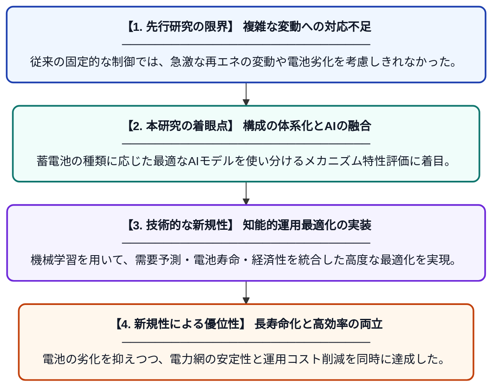

# AI駆動型蓄電池システム（BESS）のメカニズム特性評価と知的運用最適化

**Original Title**: *Artificial intelligence-driven BESSs mechanisms characterization and intelligent operational optimization*

> **💡 一言要約**: AIで蓄電池を操り、再エネ時代の電力を安定させる

| 項目 | 内容 |
|---|---|
| **著者** | L Li, W Meng |
| **掲載誌** | Journal of Energy Storage 2027 |
| **アラートキーワード** | optimization |
| **原文リンク** | [https://www.sciencedirect.com/science/article/pii/S2352152X26053090](https://www.sciencedirect.com/science/article/pii/S2352152X26053090) |
| **PDF版要約** | [README.pdf](./README.pdf) |

---

## 📊 新規性の図解（先行研究との違いと本研究のブレークスルー）

## 📝 要約

再生可能エネルギーの導入拡大に伴う電力網の不安定さを解消するため、AIを活用した蓄電池システム（BESS）の運用最適化手法を提案しています。BESSの基本構造から多様な構成を体系的に整理し、機械学習を用いた高度な制御メカニズムを明らかにしています。

## ❓ どんな問題に取り組んだか

天候に左右される再生可能エネルギーが急増し、電力需給のバランス維持が非常に困難になっています。従来の蓄電池制御では、複雑に変化する需要や電池の劣化特性にリアルタイムで適応することが難しいという課題がありました。

## ✨ 何が新しい？何がすごい？（新規性）

本研究は、BESSの多様なアーキテクチャを体系的に分類し、それぞれの特性に最適化されたAIアルゴリズムを紐付けた点が画期的です。単なる充放電制御に留まらず、電池の寿命予測と経済性を同時に考慮した多目的最適化フレームワークを構築しました。これにより、先行研究よりも長期的かつ効率的な電力供給の基盤を提示しています。

## 🎓 大学1年生向けの解説

太陽光や風力で電気を作ると、天気に左右されて電気が足りなくなったり余ったりしてしまいます。そこで巨大な「蓄電池」が必要になりますが、いつどれだけ電気を貯めて、いつ使うかを決めるのはとても難しい問題です。この研究では、AI（人工知能）を使って、蓄電池を最も効率よく、かつ長持ちするようにコントロールする仕組みを考え出しました。これによって、地球に優しいエネルギーをいつでも安心して使えるようになります。
