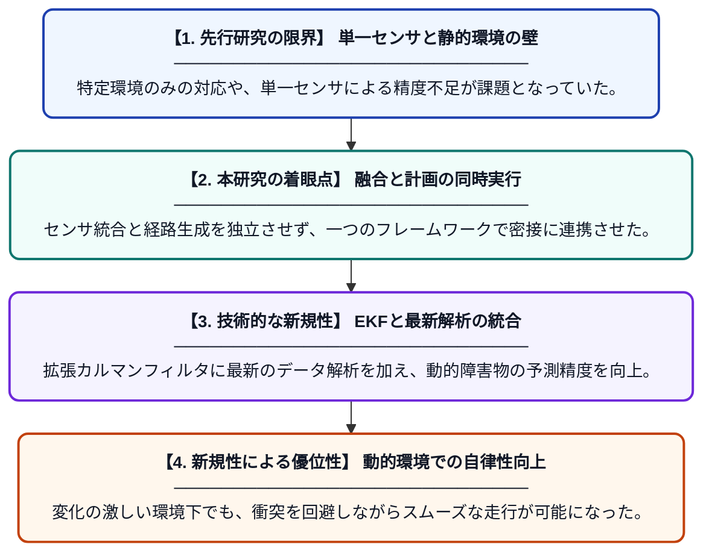

# 動的環境における自動運転車両ナビゲーションのための経路計画を統合したマルチセンサ融合フレームワーク

**Original Title**: *An Integrated Multi-Sensor Fusion Framework with Path Planning for Autonomous Vehicle Navigation in Dynamic Environments*

> **💡 一言要約**: 複数センサと経路計画の融合で、動く障害物を賢く回避！

| 項目 | 内容 |
|---|---|
| **著者** | S Atchaya, S Jeyanthi, S Lakshmi Narayanan |
| **掲載誌** | International Conference on … 2026 |
| **アラートキーワード** | kalman filter |
| **原文リンク** | [https://ieeexplore.ieee.org/abstract/document/11765403/](https://ieeexplore.ieee.org/abstract/document/11765403/) |
| **PDF版要約** | [README.pdf](./README.pdf) |

---

## 📊 新規性の図解（先行研究との違いと本研究のブレークスルー）

## 📝 要約

動的な環境下で自動運転車が安全かつ効率的に走行できるよう、複数のセンサ情報を統合し、同時に経路計画を行う新しいフレームワークを提案しています。拡張カルマンフィルタ（EKF）などの手法をベースに、リアルタイムでの状態推定と障害物回避を高い精度で両立させています。

## ❓ どんな問題に取り組んだか

自動運転車が複雑で常に変化する環境において、単一のセンサのみでは周囲の状況を正確に把握できず、安全性の確保が困難であるという課題があります。また、センサ情報の統合と安全な経路の生成をリアルタイムで同時に実行することは、計算負荷が高く最適化が難しいとされてきました。

## ✨ 何が新しい？何がすごい？（新規性）

従来のセンサ融合技術に、最新のデータ収集・分析システムを組み合わせたリアルタイム経路計画アルゴリズムを統合した点が画期的です。先行研究で主流だったガウス雑音を前提とする拡張カルマンフィルタ（EKF）の利点を活かしつつ、最新の解析手法によって動的環境特有の不確実性を排除しています。これにより、複雑な交通状況下でも周囲の物体の動きを高い精度で予測し、最適な走行ルートを動的に導き出すことに成功しました。

## 🎓 大学1年生向けの解説

自動運転車が「周りに何があるか」を正しく知るためには、カメラやレーダーなど複数の「目」の情報をうまく組み合わせる必要があります。この研究は、それらのバラバラな情報を賢くまとめ、さらに「次にどう動くべきか」という進路相談をセットで行う新しい仕組みを作りました。たとえ周りの車や歩行者が急に動いても、パニックにならずに安全な道を選び続けることができます。車に「正確な知覚」と「冷静な判断力」を同時に持たせるような技術です。
