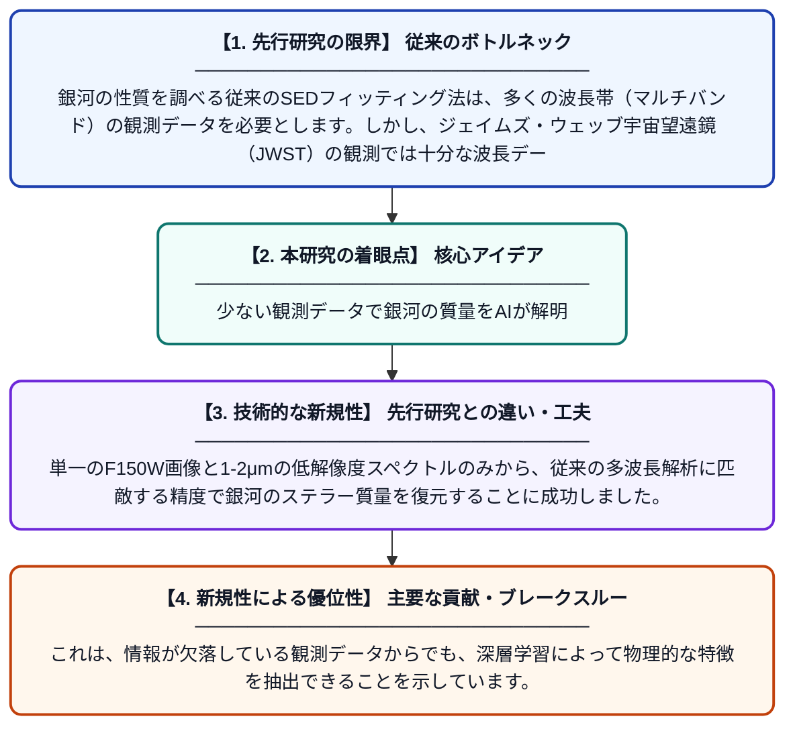

# JWSTの銀河画像と低解像度スペクトルのための自己教師あり表現学習

**Original Title**: *Self-Supervised Representation Learning for JWST Galaxy Images and Low Resolution Spectra*

> **💡 一言要約**: 少ない観測データで銀河の質量をAIが解明

| 項目 | 内容 |
|---|---|
| **著者** | Y Cheng, M Fouesneau, IG Momcheva, T Buck, S Sun |
| **掲載誌** | arXiv preprint arXiv … 2026 |
| **アラートキーワード** | representation learning |
| **PDF** | [https://arxiv.org/pdf/2610.31078](https://arxiv.org/pdf/2610.31078) |
| **原文リンク** | [https://arxiv.org/pdf/2610.31078](https://arxiv.org/pdf/2610.31078) |
| **PDF版要約** | [README.pdf](./README.pdf) |

---

## 📊 新規性の図解（先行研究との違いと本研究のブレークスルー）

## 📝 要約

JWSTの限られた観測データから銀河の質量を推定するため、画像とスペクトルを組み合わせた自己教師あり学習モデルを開発しました。従来の解析手法では多くの波長帯のデータが必要でしたが、本手法は単一波長の画像と特定のスペクトル情報のみで高精度な推定を可能にします。

## ❓ どんな問題に取り組んだか

銀河の性質を調べる従来のSEDフィッティング法は、多くの波長帯（マルチバンド）の観測データを必要とします。しかし、ジェイムズ・ウェッブ宇宙望遠鏡（JWST）の観測では十分な波長データが揃わない「疎なデータ」が多く、従来の解析手法を適用しにくいという課題がありました。

## ✨ 何が新しい？何がすごい？（新規性）

画像とスペクトルという異なる形式のデータを同時に扱う「マルチモーダル自己教師あり学習」を天文学に応用した点が画期的です。単一のF150W画像と1-2μmの低解像度スペクトルのみから、従来の多波長解析に匹敵する精度で銀河のステラー質量を復元することに成功しました。これは、情報が欠落している観測データからでも、深層学習によって物理的な特徴を抽出できることを示しています。

## 🎓 大学1年生向けの解説

遠い宇宙にある銀河の重さを調べるには、通常はたくさんの色（波長）で撮影した写真が必要になります。しかし、この研究では最新のAIを使うことで、たった1色の写真と少しの光の情報だけで、銀河の重さを正確に推測できるようにしました。これは、人間が断片的なヒントから全体を予想するような賢さを、宇宙の解析に持ち込んだものです。この技術があれば、データが少ない遠くの銀河の謎も、より効率的に解き明かすことができます。
