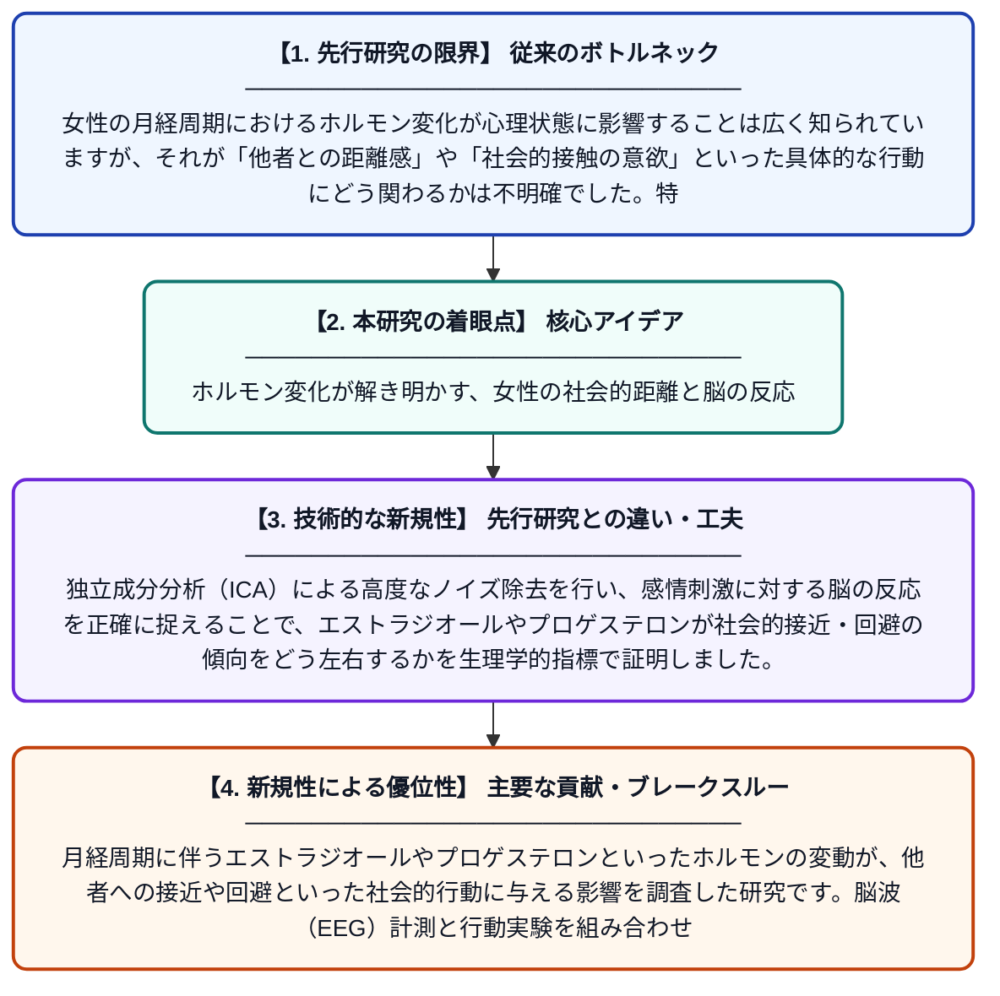

# 月経周期、エストラジオール、およびプロゲステロンが社会的な接近・回避行動の傾向に及ぼす影響に関する行動学的および電気生理学的研究

**Original Title**: *A behavioral and electrophysiological study on the influence of menstrual cycle, estradiol and progesterone on the social approach-avoidance behavior tendencies of …*

> **💡 一言要約**: ホルモン変化が解き明かす、女性の社会的距離と脳の反応

| 項目 | 内容 |
|---|---|
| **著者** | D Li, X Li, Y Yuan, H Zhu, Z Tan, G Huang, X Wang |
| **掲載誌** | International Journal of … 2026 |
| **アラートキーワード** | independent component ... |
| **原文リンク** | [https://www.sciencedirect.com/science/article/pii/S0167876026001820](https://www.sciencedirect.com/science/article/pii/S0167876026001820) |
| **PDF版要約** | [README.pdf](./README.pdf) |

---

## 📊 新規性の図解（先行研究との違いと本研究のブレークスルー）

## 📝 要約

月経周期に伴うエストラジオールやプロゲステロンといったホルモンの変動が、他者への接近や回避といった社会的行動に与える影響を調査した研究です。脳波（EEG）計測と行動実験を組み合わせることで、ホルモンバランスが社会的な意思決定における脳内プロセスをどのように変化させるかを明らかにしました。

## ❓ どんな問題に取り組んだか

女性の月経周期におけるホルモン変化が心理状態に影響することは広く知られていますが、それが「他者との距離感」や「社会的接触の意欲」といった具体的な行動にどう関わるかは不明確でした。特に、こうした行動の変化を支える脳内の情報処理メカニズムについては、詳細な解明が求められていました。

## ✨ 何が新しい？何がすごい？（新規性）

従来のアンケート調査だけでなく、脳波（EEG）を用いてミリ秒単位の脳活動を解析し、ホルモンレベルと社会的行動の相関を直接結びつけた点が非常に画期的です。独立成分分析（ICA）による高度なノイズ除去を行い、感情刺激に対する脳の反応を正確に捉えることで、エストラジオールやプロゲステロンが社会的接近・回避の傾向をどう左右するかを生理学的指標で証明しました。

## 🎓 大学1年生向けの解説

女性の体の中では、1ヶ月の間にホルモンのバランスがダイナミックに変化しています。この研究は、その変化が「人と関わりたい」あるいは「人から離れたい」という気持ちや行動にどう影響するかを、脳波を測ることで調べました。その結果、特定のホルモンが増減すると、他者に対する脳の反応の仕方が変わることが分かりました。私たちの何気ない日常の気分の変化が、実は体内の化学的な仕組みと深く関わっていることを教えてくれる研究です。
