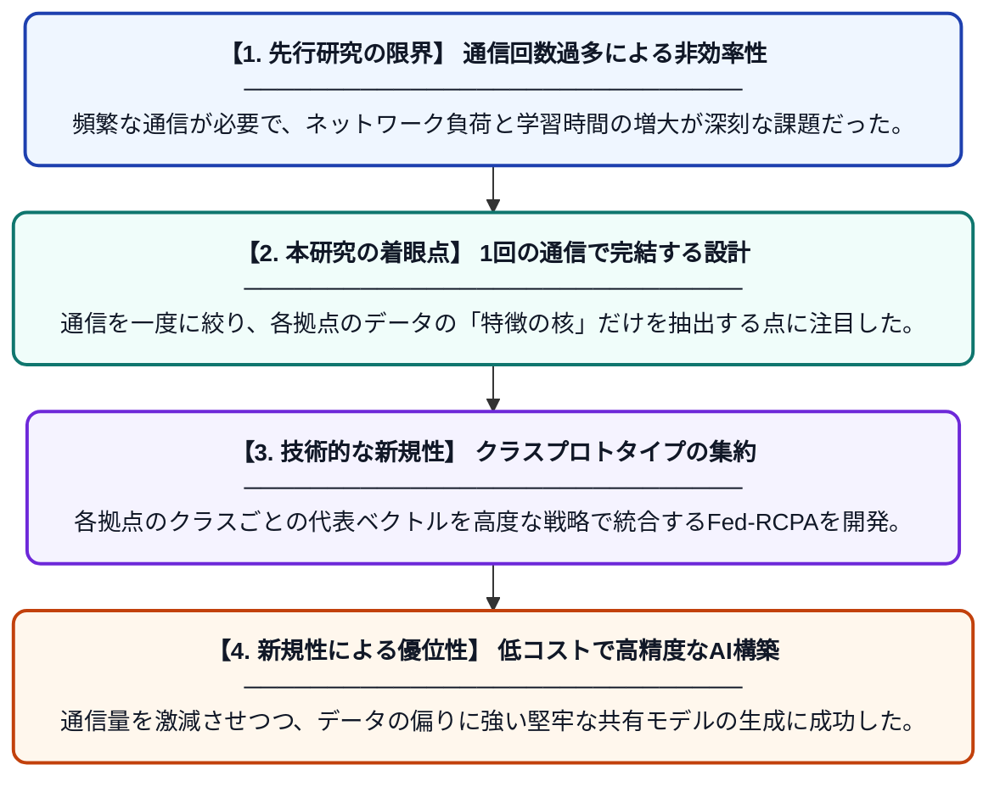

# Fed-RCPA: 代表クラスプロトタイプ集約に基づくワンショット連合学習

**Original Title**: *Fed-RCPA: Representative Class Prototype Aggregation-based One-Shot Federated Learning*

> **💡 一言要約**: 1回の通信で賢くなる！高速・高効率な連合学習

| 項目 | 内容 |
|---|---|
| **著者** | MA Badawi |
| **掲載誌** | International Journal of Artificial Intelligence and … 2026 |
| **アラートキーワード** | one shot |
| **PDF** | [https://mail.svedbergopen.com/index.php/ijaiml/article/download/3153/1948](https://mail.svedbergopen.com/index.php/ijaiml/article/download/3153/1948) |
| **原文リンク** | [https://mail.svedbergopen.com/index.php/ijaiml/article/download/3153/1948](https://mail.svedbergopen.com/index.php/ijaiml/article/download/3153/1948) |
| **PDF版要約** | [README.pdf](./README.pdf) |

---

## 📊 新規性の図解（先行研究との違いと本研究のブレークスルー）

## 📝 要約

通信コストと収束速度が課題となる従来の連合学習に対し、1回限りの通信で学習を完結させる「ワンショット連合学習」の新手法を提案しています。各クライアントから抽出されたクラスごとの代表的な特徴（プロトタイプ）を高度な戦略で集約することで、データの偏りがある環境でも高い精度を実現します。

## ❓ どんな問題に取り組んだか

従来の連合学習はサーバーと端末間で何度もモデルをやり取りするため、膨大な通信量と時間がかかるという課題がありました。また、1回の通信で済ませようとする既存のワンショット手法では、各端末が持つデータの偏り（非IID性）によって、最終的なモデルの精度が大幅に低下する問題がありました。

## ✨ 何が新しい？何がすごい？（新規性）

本論文の核心は、各クライアントから単なるモデルの重みではなく、データのクラス特性を凝縮した「代表プロトタイプ」を収集して集約するFed-RCPAアルゴリズムにあります。先行研究では困難だった多様なクライアント出力の統合を、洗練された集約戦略によって克服し、通信回数を劇的に減らしつつ精度の損失を最小限に抑えています。これにより、1回の通信でもグローバルなデータ分布を正確に捉えたモデル構築が可能になりました。

## 🎓 大学1年生向けの解説

AIを賢くするためには、通常、たくさんのデータを一箇所に集めるか、何度も通信して情報を更新し続ける必要があります。しかし、この研究では「たった1回の通信」で、みんなの知識を統合して賢いAIを作る魔法のような方法を開発しました。具体的には、各ユーザーの持つデータの「一番大事な特徴」だけを代表として送り、それを上手につなぎ合わせる仕組みです。これによって、スマホのバッテリーや通信量を節約しながら、プライバシーを守って素早くAIを学習させることができます。
