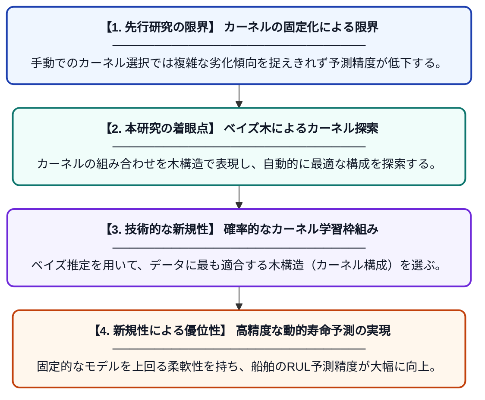

# 船舶推進システムのガウス過程予測に向けたベイズ木構造カーネル学習アプローチ

**Original Title**: *A Bayesian Tree-Structured Kernel Learning Approach for Gaussian Process Prognostics of Ship Propulsion Systems.*

> **💡 一言要約**: 船舶の寿命をベイズ木で最適に予測する

| 項目 | 内容 |
|---|---|
| **著者** | X Jia, Q Wang, R Zhang, H Ouyang |
| **掲載誌** | Structural Durability & Health Monitoring (SDHM) 2026 |
| **アラートキーワード** | gaussian process |
| **原文リンク** | [https://openurl.ebsco.com/contentitem/gcd:198213556?sid=ebsco:plink:crawler-gcd&id=ebsco:gcd:198213556&crl=c&jrnl=19302983](https://openurl.ebsco.com/contentitem/gcd:198213556?sid=ebsco:plink:crawler-gcd&id=ebsco:gcd:198213556&crl=c&jrnl=19302983) |
| **PDF版要約** | [README.pdf](./README.pdf) |

---

## 📊 新規性の図解（先行研究との違いと本研究のブレークスルー）

## 📝 要約

船舶推進システムの残り寿命（RUL）予測において、従来のガウス過程モデルが抱えていた固定的なカーネル選択の課題を解決する手法を提案しています。ベイズ木構造を用いることで、データの特性に合わせた最適なカーネル構成を自動的に探索・選択し、予測精度の向上を実現しました。

## ❓ どんな問題に取り組んだか

船舶の推進システムは複雑であり、その劣化状況を予測するためにガウス過程が使われますが、従来はカーネル関数を人間が固定的に選ぶ必要がありました。そのため、データの動的な変化や複雑なパターンを十分に捉えきれず、予測精度に限界があるという課題がありました。

## ✨ 何が新しい？何がすごい？（新規性）

本研究の核心は、ベイズ木構造を利用してガウス過程のカーネルを自動選択するフレームワークを構築した点にあります。先行研究では手動または単純な最適化でカーネルを決定していましたが、本手法は複数の基本カーネルを木構造で柔軟に組み合わせることで、高度な表現力を獲得しています。これにより、不確実性を考慮しつつ、未知の劣化データに対しても極めて高い適応性と予測精度を示すことが可能になりました。

## 🎓 大学1年生向けの解説

船のエンジンなどの重要な部品が「あとどれくらい使えるか」を予測することは、安全な航海のために非常に大切です。これまでは、予測のための計算ルールを人間が経験に基づいて決めていましたが、この研究ではAIにそのルール自体を自動で作らせる仕組みを開発しました。具体的には、計算のパーツを「木の枝分かれ」のように組み合わせることで、データの複雑な癖を正確に掴めるようになります。その結果、船の故障をより正確に予知できるようになり、メンテナンスの効率が大幅に向上します。
