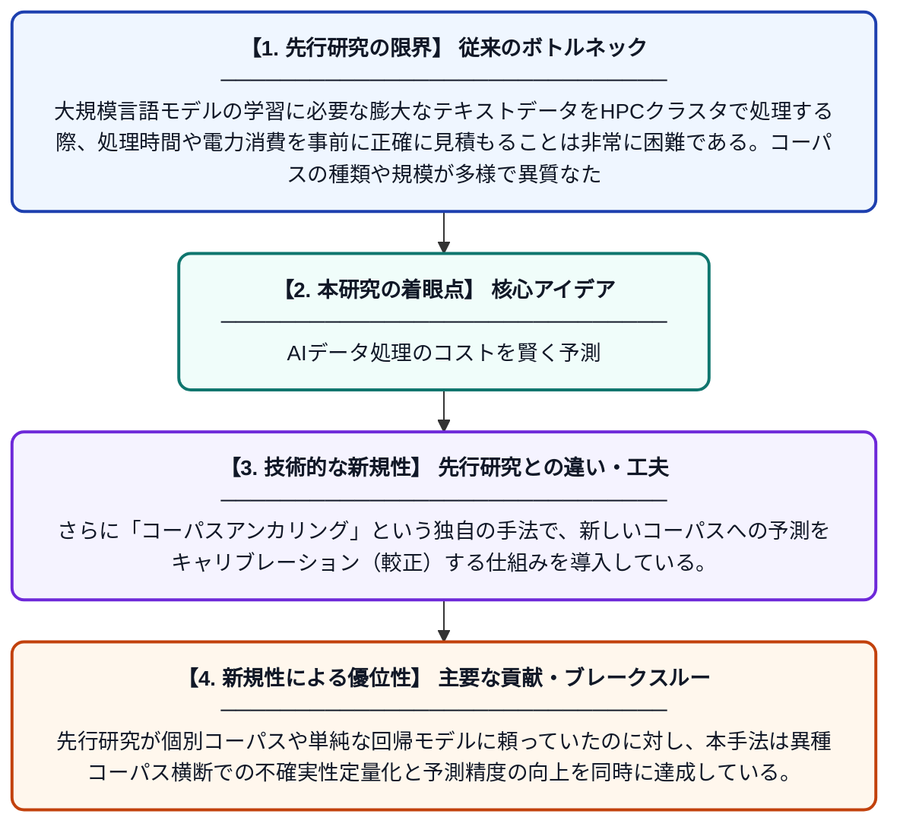

# ベイズ階層回帰とコーパスアンカリングによるHPCデータキュレーションの実行時間・エネルギー消費予測のキャリブレーション

**Original Title**: *Calibrated Runtime and Energy Prediction for HPC Data Curation with Bayesian Hierarchical Regression and Corpus Anchoring*

> **💡 一言要約**: AIデータ処理のコストを賢く予測

| 項目 | 内容 |
|---|---|
| **著者** | D Kravchuk |
| **掲載誌** | 2026 |
| **アラートキーワード** | Bayesian hierarchical ... |
| **PDF** | [https://studenttheses.uu.nl/bitstreams/5222a641-abdb-421c-b8de-d21d88b04158/download](https://studenttheses.uu.nl/bitstreams/5222a641-abdb-421c-b8de-d21d88b04158/download) |
| **原文リンク** | [https://studenttheses.uu.nl/bitstreams/5222a641-abdb-421c-b8de-d21d88b04158/download](https://studenttheses.uu.nl/bitstreams/5222a641-abdb-421c-b8de-d21d88b04158/download) |
| **PDF版要約** | [README.pdf](./README.pdf) |

---

## 📊 新規性の図解（先行研究との違いと本研究のブレークスルー）

## 📝 要約

大規模言語モデルの開発に必要な大量テキストデータの前処理パイプラインにおいて、実行時間とエネルギー消費を正確に予測する手法を提案している。ベイズ階層回帰と「コーパスアンカリング」という技術を用いて、異種コーパス間での部分プーリングによりログスループットをモデル化する。これにより、HPCクラスタ上でのデータキュレーション処理の計画と資源管理が大幅に改善される。

## ❓ どんな問題に取り組んだか

大規模言語モデルの学習に必要な膨大なテキストデータをHPCクラスタで処理する際、処理時間や電力消費を事前に正確に見積もることは非常に困難である。コーパスの種類や規模が多様で異質なため、単純なモデルでは予測精度が低く、計算資源の無駄遣いやスケジューリングの失敗につながっていた。

## ✨ 何が新しい？何がすごい？（新規性）

本研究は、異なるコーパス間の情報を「部分プーリング」で共有するベイズ階層回帰モデルを採用し、少ないデータでも安定した予測を実現した点が新しい。さらに「コーパスアンカリング」という独自の手法で、新しいコーパスへの予測をキャリブレーション（較正）する仕組みを導入している。先行研究が個別コーパスや単純な回帰モデルに頼っていたのに対し、本手法は異種コーパス横断での不確実性定量化と予測精度の向上を同時に達成している。

## 🎓 大学1年生向けの解説

ChatGPTのような賢いAIを作るには、まず大量の文章データをコンピュータで整理・加工する必要があります。この作業には強力なスーパーコンピュータを使いますが、「どれくらい時間がかかるか・電気代がいくらかかるか」を事前に正確に予測するのはとても難しい問題です。この論文では、統計学の『ベイズ推定』という方法を使って、様々な種類のデータでも処理時間と電力消費を高精度に予測できる仕組みを開発しました。これにより、無駄なコストを減らしつつ、効率よくAIの学習データを準備できるようになります。
