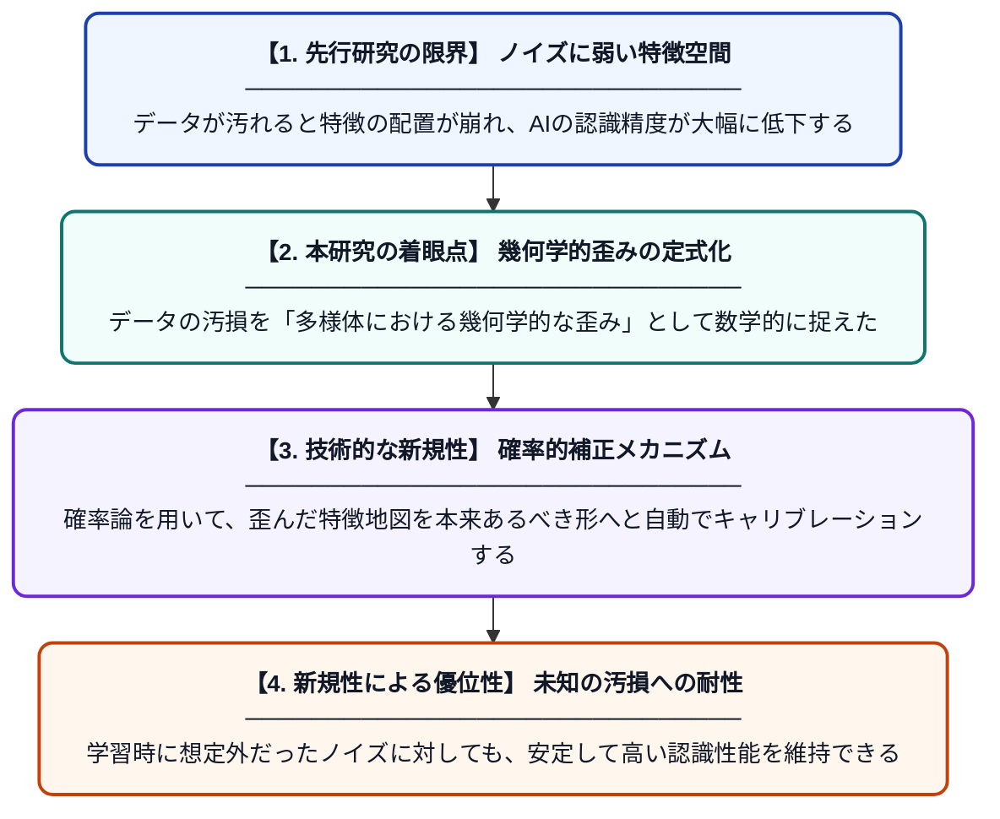

# 堅牢な点群表現学習のための確率論的幾何学に基づく多様体キャリブレーション

**Original Title**: *Probabilistic Geometry-based Manifold Calibration for Robust Point-Cloud Representation Learning*

> **💡 一言要約**: 幾何学のズレを確率で正し、3D認識をタフにする

| 項目 | 内容 |
|---|---|
| **著者** | X Jiang, D Hu, Y Hou, Z Wang, J Song, HT Shen, X Xu |
| **掲載誌** | Proceedings of the 34th ACM … 2026 |
| **アラートキーワード** | manifold learning |
| **原文リンク** | [https://dl.acm.org/doi/abs/10.1145/3767308.3835702](https://dl.acm.org/doi/abs/10.1145/3767308.3835702) |
| **PDF版要約** | [README.pdf](./README.pdf) |

---

## 📊 新規性の図解（先行研究との違いと本研究のブレークスルー）

## 📝 要約

点群データがノイズや欠損によって汚損されると、エンコーダーが生成する特徴空間の幾何学的整合性が崩れる課題に対し、確率論的幾何学を用いて多様体を補正する手法を提案しました。これにより、汚損されたデータに対しても頑健な表現学習が可能になります。

## ❓ どんな問題に取り組んだか

従来の点群表現学習では、入力データにノイズや欠損があると、エンコーダーが構築する特徴空間の幾何学的構造が歪んでしまいます。その結果、意味的な情報を抽出する際の精度が著しく低下し、実環境での信頼性が確保できないという課題がありました。

## ✨ 何が新しい？何がすごい？（新規性）

幾何学的整合性の歪みを確率モデルとして捉え、特徴空間の多様体上で直接補正（キャリブレーション）を行う新しい枠組みを導入しました。先行研究がデータ拡張などのヒューリスティックな手法に頼っていたのに対し、本研究は特徴空間内の構造そのものを数学的に最適化する点が画期的です。これにより、未知の汚損パターンに対しても高い汎用性と頑健性を実現しました。

## 🎓 大学1年生向けの解説

自動運転などで使われる3Dデータ（点群）は、雨やセンサーの不調によるノイズに弱いという弱点があります。この研究では、AIがデータを処理する途中の「特徴の地図」がノイズで歪んでしまうのを、数学的な幾何学の法則を使って自動で修正する技術を開発しました。例えるなら、霧で視界が悪くなっても、頭の中にある地図を正しく補正することで、目的地に迷わず辿り着けるようにするような仕組みです。
