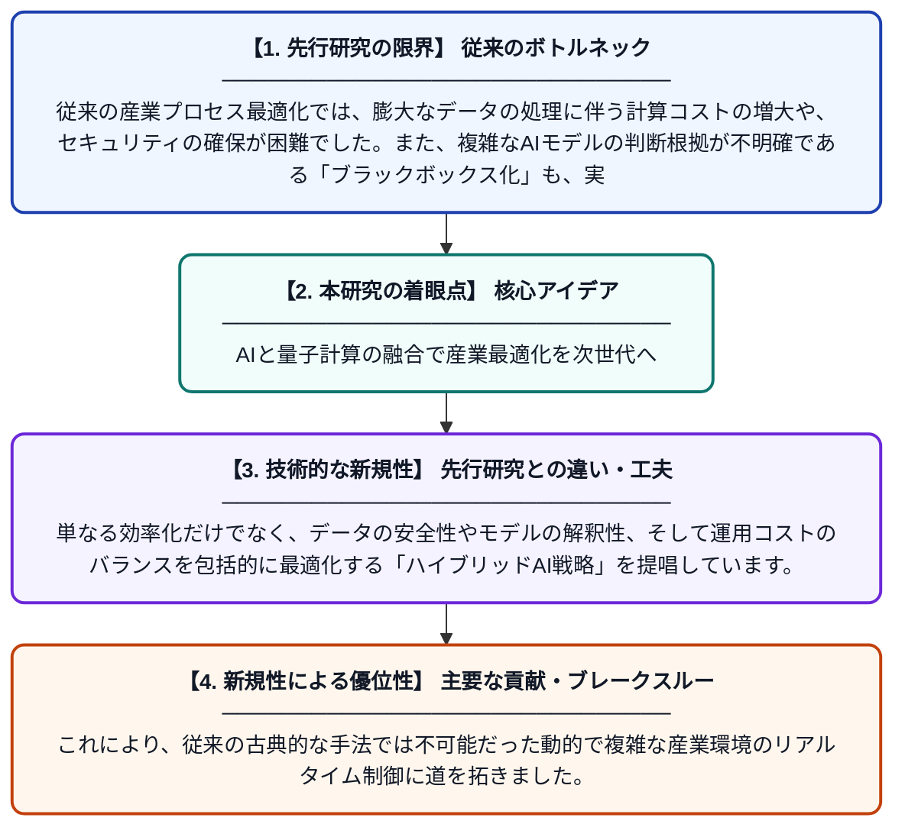

# 産業プロセスの開発と最適化に向けたAI主導のコンピューティング戦略

**Original Title**: *AI-driven computing strategies for industrial process development and optimization*

> **💡 一言要約**: AIと量子計算の融合で産業最適化を次世代へ

| 項目 | 内容 |
|---|---|
| **著者** | R Akter, TH Sardar |
| **掲載誌** | Integrating AI-enabled Computing Strategies into … 2027 |
| **アラートキーワード** | Secure Computing |
| **原文リンク** | [https://www.sciencedirect.com/science/chapter/edited-volume/pii/B9780443492242000033](https://www.sciencedirect.com/science/chapter/edited-volume/pii/B9780443492242000033) |
| **PDF版要約** | [README.pdf](./README.pdf) |

---

## 📊 新規性の図解（先行研究との違いと本研究のブレークスルー）

## 📝 要約

産業プロセスの効率化を目指し、AIを分散計算や量子コンピューティングと統合する新しい戦略を提案しています。MapReduceやハイブリッドAIを活用することで、計算コストの削減、予測精度の向上、およびモデルの解釈性の確保を同時に実現する手法を詳述しています。

## ❓ どんな問題に取り組んだか

従来の産業プロセス最適化では、膨大なデータの処理に伴う計算コストの増大や、セキュリティの確保が困難でした。また、複雑なAIモデルの判断根拠が不明確である「ブラックボックス化」も、実現場への導入を妨げる大きな課題となっていました。

## ✨ 何が新しい？何がすごい？（新規性）

この研究は、MapReduceによる分散処理と最新の量子計算技術をAIと統合し、スケーラビリティと計算速度を飛躍的に向上させた点が独創的です。単なる効率化だけでなく、データの安全性やモデルの解釈性、そして運用コストのバランスを包括的に最適化する「ハイブリッドAI戦略」を提唱しています。これにより、従来の古典的な手法では不可能だった動的で複雑な産業環境のリアルタイム制御に道を拓きました。

## 🎓 大学1年生向けの解説

この論文は、工場の複雑な仕組みを「AI」と「特別なスーパーコンピュータ（量子コンピュータなど）」を使って、最高に効率よく動かす方法を考えたものです。大量の情報をバラバラに分けて賢く計算することで、時間やお金を節約しながら、より正確な判断ができるようになります。また、AIがなぜその答えを出したのかを人間が理解しやすくする工夫もされています。これによって、未来の工場はより安全で、賢く、無駄のないものに進化します。
